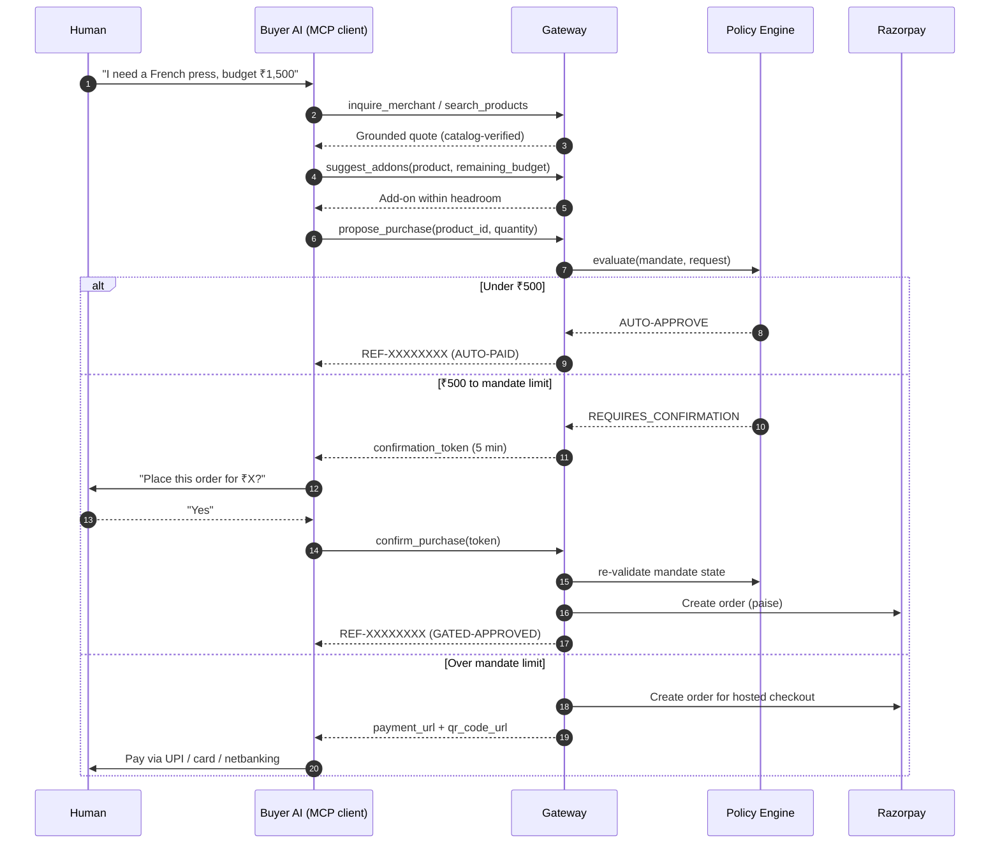
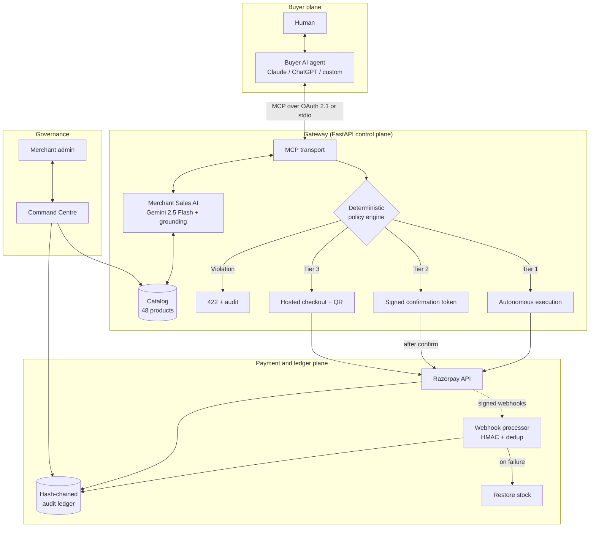
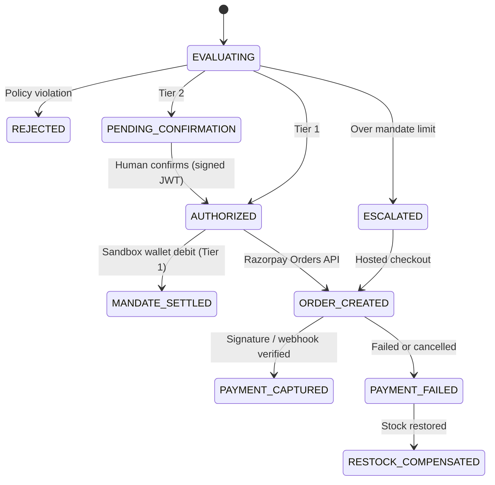

# 🌐 Agentic Commerce Gateway

> A zero-trust, merchant-side control plane that makes a store safely sellable to AI buyer agents: grounded sales conversations, budget-aware upsells, deterministic spending mandates, human-in-the-loop confirmation, Razorpay payment rails, and a tamper-evident audit ledger.

[](https://www.python.org/)
[](https://fastapi.tiangolo.com/)
[](https://razorpay.com/)
[](https://ai.google.dev/)
[](https://modelcontextprotocol.io/)
[](https://oauth.net/2.1/)
[](#testing)

**API docs:** [/docs](https://razorpay-c454.onrender.com/docs) · **Admin dashboard:** [/admin/dashboard](https://razorpay-c454.onrender.com/admin/dashboard)

---

## Table of Contents

1. [Overview](#overview)
2. [Key Features](#key-features)
3. [How a Purchase Flows](#how-a-purchase-flows)
4. [Architecture](#architecture)
5. [Policy Engine and Mandates](#policy-engine-and-mandates)
6. [Payment Rails: What Is Live vs. Simulated](#payment-rails-what-is-live-vs-simulated)
7. [Merchant Sales AI and Revenue Growth](#merchant-sales-ai-and-revenue-growth)
8. [Audit Ledger](#audit-ledger)
9. [MCP Tools](#mcp-tools)
10. [REST API](#rest-api)
11. [Quick Start](#quick-start)
12. [Configuration](#configuration)
13. [Connecting AI Clients](#connecting-ai-clients)
14. [Buyer Agent Instructions](#buyer-agent-instructions)
15. [Demo Scenarios](#demo-scenarios)
16. [Admin Command Centre](#admin-command-centre)
17. [Testing](#testing)
18. [Project Structure](#project-structure)
19. [Security Model and Known Limitations](#security-model-and-known-limitations)
20. [Roadmap](#roadmap)
21. [Hackathon Context](#hackathon-context)
22. [License and Author](#license-and-author)

---

## Overview

### The problem

Online checkout assumes a human typing card details. As AI agents (Claude, ChatGPT, custom agents) start handling shopping and procurement, giving them raw card access or an unconstrained merchant API creates real hazards:

| Hazard | What goes wrong |
|---|---|
| **Hallucination and overspending** | The agent invents a product or price, or spends far beyond what the user intended. |
| **Unilateral authorization** | High-value purchases happen without an explicit human decision. |
| **Dead-end rejections** | Over-limit requests just fail instead of escalating to a human payment path. |
| **Data leakage** | Merchant databases or credentials are exposed to client-side agents. |
| **No audit trail** | Probabilistic agent behavior has no verifiable record for compliance. |

### The solution

The gateway sits between a **buyer agent**, the **merchant's sales AI**, and **Razorpay**. The buyer agent can only *propose*. A deterministic policy engine decides what happens next, and the LLM never has authority over money.

> **The one loop:** a merchant becomes safely sellable to AI buyers, and the merchant's sales AI raises basket value without ever exceeding the buyer's spending mandate.

```
Buyer inquires → Merchant AI quotes (grounded) + upsells → Mandate policy gate → Razorpay rails → Tamper-evident audit
```

---

## Key Features

- **Three-tier authorization:** autonomous micro-purchases, token-gated human confirmation, and hosted-checkout escalation.
- **Deterministic policy engine:** six ordered checks (identity, expiry, merchant, category, per-transaction cap, daily cap). No LLM is involved in approval.
- **Grounded merchant AI:** Gemini 2.5 Flash reasons over the catalog, but every price, description and stock count is re-validated against the database. Hallucinated items are rejected.
- **Budget-aware upsells:** `suggest_addons` finds complementary items that fit inside the buyer's remaining headroom.
- **Never a dead end:** over-limit purchases escalate to a Razorpay hosted checkout link plus UPI QR code.
- **Replay-safe confirmation:** signed 5-minute JWT tokens, bucketed idempotency keys, and policy re-validation at confirmation time.
- **Hash-chained audit ledger:** append-only SHA-256 chain with `verify` and exportable `anchor` endpoints.
- **Dual-transport MCP:** remote Streamable HTTP (OAuth 2.1 protected) and local stdio.
- **Verified webhooks:** HMAC-SHA256 signature checks, persistent deduplication, and automatic stock restoration on failure.
- **Admin Command Centre:** live telemetry, mandate management, catalog view, audit trail, and an agent sandbox.

---

## How a Purchase Flows

The gateway routes every purchase proposal into one of three tiers. The ₹500 boundary is fixed; the upper boundary is each customer's mandate limit (₹2,000 in the demo).

| Tier | Condition | Gateway behavior | Result status |
|---|---|---|---|
| **1. Autonomous** | Amount < ₹500 (and within mandate) | Executes without confirmation | `AUTO-PAID` |
| **2. Human-gated** | ₹500 ≤ amount ≤ mandate limit | Returns `requires_confirmation: true` and a signed 5-minute `confirmation_token`; the agent must ask the human, then call `confirm_purchase` | `GATED-APPROVED` |
| **3. Escalated** | Amount > mandate limit | Returns a Razorpay hosted checkout `payment_url` and `qr_code_url` for manual payment | `PENDING-PAYMENT` |

Policy violations (wrong merchant, category, expired mandate, daily cap exceeded) return a `422` rejection and are written to the audit ledger.



---

## Architecture



**Design principle:** the LLM proposes and explains; deterministic code authorizes and records. Gemini output is never trusted for price, stock, or approval.

---

## Policy Engine and Mandates

A **mandate** is a customer's standing delegation to their agent: what it may buy, from whom, and how much. The pure `evaluate()` function applies six checks in order and stops at the first failure:

| # | Check | Rejects when |
|---|---|---|
| 1 | **Customer existence** | The OAuth JWT `sub` claim does not map to a known customer |
| 2 | **Mandate expiry** | The mandate's expiry timestamp has passed |
| 3 | **Merchant authorization** | The merchant is not whitelisted (e.g. `MERCH_ELEC`, `MERCH_FOOD`) |
| 4 | **Category authorization** | The category is not allowed (`electronics`, `food`, `home_kitchen`, `apparel`) |
| 5 | **Single-transaction cap** | The item total exceeds `max_transaction_amount` |
| 6 | **Cumulative daily cap** | Approved spend for the day would exceed `daily_limit` |

Safeguards around the engine:

- **Re-validation at confirmation:** limits, expiry, and cumulative daily spend are re-checked before Razorpay is called, so a stale token cannot bypass a changed mandate.
- **Token replay immunity:** confirmation tokens and proposals use bucketed idempotency keys, so resubmission returns the existing transaction rather than creating a duplicate order.
- **Conversational mandate changes are gated too:** `modify_spending_mandate` issues its own signed confirmation challenge and only applies the change after explicit human approval, with a `CUSTOMER_MANDATE_UPDATED_CONVERSATIONAL` audit record.

---

## Payment Rails: What Is Live vs. Simulated

This distinction matters, so it is stated plainly.

| Component | Status |
|---|---|
| Razorpay order creation (amounts converted to paise) | **Live** against `api.razorpay.com` in test mode |
| Hosted checkout UI and UPI QR | **Live** (test mode) |
| HMAC-SHA256 payment signature verification | **Live** |
| Webhook verification (`payment.captured`, `order.paid`, `payment_link.paid`) and dedup | **Live** |
| Autonomous micro-purchase settlement (Tier 1) | **Simulated** via a controlled sandbox mandate wallet with balance checks and stock restoration |

### Status vocabulary

| State | Meaning |
|---|---|
| `AUTHORIZED` | Policy engine approved the request. **No funds have moved.** |
| `ORDER_CREATED` / `PENDING` | A real Razorpay test order (`order_XXXX`) exists and awaits customer payment. |
| `PAYMENT_CAPTURED` / `PAID` | Customer payment completed and the signature or webhook was cryptographically verified. |
| `MANDATE_SETTLED` | A Tier 1 micro-purchase was settled against the simulated sandbox wallet. |
| `REJECTED` / `ESCALATED` | The request exceeded autonomous authority and was routed to a human via hosted checkout or QR. |
| `PAYMENT_FAILED` → `RESTOCK_COMPENSATED` | Payment failed or was cancelled; inventory was restored. |



Verify the live rails yourself:

```bash
python scripts/verify_live_razorpay.py
pytest tests/test_live_razorpay_checkout.py
```

---

## Merchant Sales AI and Revenue Growth

### Authoritative quote grounding

Gemini 2.5 Flash reasons over the store's private inventory, but the control plane treats its output as a *suggestion*. Every returned item is re-checked against the live database. If the model invents a product or misprices one (for example, ₹10 for a ₹4,999 monitor), the item is dropped or corrected to the authoritative catalog price and stock.

- Test: [`tests/test_gemini_grounding.py`](tests/test_gemini_grounding.py)
- Demo: `python scripts/demo_gemini_grounding.py`

### Budget-aware add-ons

`suggest_addons(product_id, remaining_budget)` consults the catalog's affinity map and returns complementary items that fit within the buyer's remaining headroom, so an upsell can never push the basket past the mandate.

### Simulated AOV benchmark

An offline benchmark over **47 synthetic buyer sessions** (electronics, food, home and kitchen, apparel) compares single-item baseline intent against budget-constrained add-on selection:

| Metric | Result |
|---|---|
| Baseline average basket value | ₹708.53 |
| With AI add-on | ₹997.60 |
| **Simulated AOV lift** | **+40.8%** |
| Add-on attach rate | 78.72% (37 of 47 sessions) |
| Mandate budget violations | 0 |

> **Interpretation note:** this is a *simulation* using the store's own affinity map, not measured production uplift. It shows the upsell logic respects budget constraints and attaches often; it does not predict real-world conversion. Reproduce with `python scripts/benchmark_aov.py` (output in [`benchmarks/aov_benchmark_results.json`](benchmarks/aov_benchmark_results.json)).

---

## Audit Ledger

Every proposal, policy evaluation, confirmation, escalation, mandate change, and webhook event is appended to a SHA-256 hash chain (`prev_hash` → `record_hash`).

- `GET /audit/verify` traverses the chain and reconciles it against the projection tables.
- `GET /audit/anchor` exports the current block height, genesis hash, latest timestamp, and a SHA-256 root digest for periodic external anchoring or notarization.
- Orders can be looked up by product name or reference code (`REF-XXXXXXXX`).

**Threat model:** the chain is tamper-*evident* within the application's threat model. An actor with direct write access to the underlying database could rewrite mutable tables, but dual-layer reconciliation and externally stored anchors make such tampering detectable. It is not tamper-*proof*; see [limitations](#security-model-and-known-limitations).

---

## MCP Tools

Available over **Remote Streamable HTTP** (`/mcp`, OAuth 2.1) and **local stdio**.

| Tool | Purpose | Key inputs |
|---|---|---|
| `inquire_merchant` | Ask the Merchant Sales AI for grounded quotes, recommendations, or order tracking | `query`, `max_budget`, `category`, `quantity` |
| `search_products` | Fast catalog search | `query`, `category`, `max_price` |
| `suggest_addons` | Cross-sell items within remaining budget headroom | `product_id`, `remaining_budget` |
| `propose_purchase` | Submit a purchase to the policy engine; returns auto-pay, a confirmation token, or a checkout link | `product_id`, `quantity` |
| `confirm_purchase` | Finalize a gated purchase with its 5-minute token | `confirmation_token` |
| `check_order_status` | Query the ledger for settlement status and `REF-XXXXXXXX` | `reference_or_id` |
| `get_spending_mandate` | Inspect limits, categories, and authorized merchants | none |
| `modify_spending_mandate` | Request a limit change (two-step, token-confirmed) | `new_limit`, `confirmation_token` |
| `resolve_customer` *(stdio only)* | Map a name or email to a customer ID | `identifier` |

On stdio, tools also accept an explicit `customer_id`; over remote HTTP, identity comes from the OAuth token.

---

## REST API

Full OpenAPI spec at [`/openapi.json`](https://razorpay-c454.onrender.com/openapi.json), interactive docs at [`/docs`](https://razorpay-c454.onrender.com/docs).

| Area | Endpoints |
|---|---|
| Catalog | `GET /products`, `GET /products/{id}` |
| Merchant AI | `POST /merchant/inquire`, `POST /merchant/recommend-addons` |
| Agent purchasing | `POST /agent/purchase`, `POST /agent/confirm` |
| Payments | `POST /payment/create-order`, `POST /payment/verify`, `POST /payment/webhook` |
| Audit | `GET /audit`, `GET /audit/{tx_id}`, `GET /audit/verify`, `GET /audit/anchor` |
| OAuth | `GET /oauth/authorize`, `POST /oauth/token`, `GET /.well-known/oauth-authorization-server` |
| UI | `/admin/dashboard`, `/checkout` |
| MCP | `/mcp` |

`POST /payment/simulate-webhook` exists for testing only: it is admin-protected, disabled by default in production, and hidden from the production OpenAPI schema.

---

## Quick Start

**Prerequisites:** Python 3.11+, a [Razorpay test-mode](https://dashboard.razorpay.com/) key pair, and a [Gemini API key](https://ai.google.dev/).

```bash
# macOS / Linux
git clone https://github.com/<your-username>/<repo-name>.git
cd <repo-name>
python3 -m venv .venv && source .venv/bin/activate
pip install -r requirements.txt
cp .env.example .env        # then fill in your keys
uvicorn app.main:app --reload
```

```powershell
# Windows PowerShell
git clone https://github.com/<your-username>/<repo-name>.git
cd <repo-name>
python -m venv .venv; .\.venv\Scripts\Activate.ps1
pip install -r requirements.txt
copy .env.example .env      # then fill in your keys
uvicorn app.main:app --reload
```

The gateway is now at `http://localhost:8000`, with Swagger at `/docs`.

### Run the 3-minute buyer journey

```bash
python scripts/demo_3min_buyer_journey.py
```

This walks the full flow in under a minute:

1. **Natural-language procurement:** buyer asks for a barista-grade French press (budget ₹1,500); the merchant AI matches `HK005` (₹999) with catalog-grounded specs.
2. **Headroom-aware add-on:** with ₹501 of headroom left, the growth engine recommends `FD007` Kumbakonam Filter Coffee (₹420), leaving an ₹81 buffer (a +42.0% lift *for this single basket*).
3. **Policy gate:** the buyer proposes the purchase over OAuth 2.1; the engine decides between auto-pay and a single-use JWT confirmation.
4. **Escalation:** a ₹4,999 monitor exceeds the mandate and escalates to a real Razorpay test-mode hosted checkout with link and QR.
5. **Audit verification:** `GET /audit/verify` traverses the chain and reconciles the projection with zero tampering.

---

## Configuration

Secrets are loaded from environment variables. **Default sandbox keys are rejected on startup in production mode.** See [`.env.example`](.env.example) for the complete list.

| Variable | Purpose |
|---|---|
| `DATABASE_URL` | SQLite path (e.g. `gateway.db`) or a PostgreSQL URL |
| `ADMIN_API_KEY` | Protects admin endpoints and the dashboard |
| `GEMINI_API_KEY` | Merchant Sales AI (Gemini 2.5 Flash) |
| `RAZORPAY_KEY_ID` | Razorpay test-mode key ID (`rzp_test_...`) |
| `RAZORPAY_KEY_SECRET` | Razorpay test-mode secret |

---

## Connecting AI Clients

**OAuth 2.1 parameters** (for any compliant client):

| Parameter | Value |
|---|---|
| Authorization URL | `https://razorpay-c454.onrender.com/oauth/authorize` |
| Token URL | `https://razorpay-c454.onrender.com/oauth/token` |
| Scope | `purchase` |
| Token auth method | `client_secret_post` or `client_secret_basic` |
| Discovery (RFC 8414) | `https://razorpay-c454.onrender.com/.well-known/oauth-authorization-server` |

### Claude.ai (remote MCP)

1. Open **Settings → Connectors** and add a custom connector.
2. Name it `RazorPay-Merchant` and set the URL to `https://razorpay-c454.onrender.com/mcp`.
3. Click **Connect**. Claude discovers the OAuth endpoints automatically and opens the login portal.
4. Sign in (demo account, Google SSO, or self-registration) and click **Authorize**.

If the connector asks for client credentials manually, use the sandbox values in [Sandbox Credentials](#sandbox-credentials).

### Claude Desktop (local stdio)

Edit `claude_desktop_config.json` (`%APPDATA%\Claude\` on Windows, `~/Library/Application Support/Claude/` on macOS):

```json
{
  "mcpServers": {
    "razorpay-buyer-gateway": {
      "command": "/path/to/.venv/bin/python",
      "args": ["-m", "app.mcp.server"],
      "env": {
        "DATABASE_URL": "gateway.db",
        "ADMIN_API_KEY": "<your-admin-key>",
        "GEMINI_API_KEY": "<your-gemini-key>",
        "RAZORPAY_KEY_ID": "rzp_test_<id>",
        "RAZORPAY_KEY_SECRET": "<your-test-secret>"
      }
    }
  }
}
```

On Windows, point `command` at `.venv\Scripts\python.exe`. Restart Claude Desktop; the tools appear under the hammer icon.

### ChatGPT (Custom GPT Actions)

1. In the GPT Builder, choose **Configure → Create new action**.
2. Import the schema from `https://razorpay-c454.onrender.com/openapi.json`.
3. Set authentication to **OAuth** using the parameters above.

### Sandbox credentials

> ⚠️ **Sandbox only.** These values exist for the public demo deployment and Razorpay *test mode*. Never reuse them for a real deployment; production mode rejects defaults at startup.

| Item | Value |
|---|---|
| OAuth client ID / secret | `claude-desktop-client` / `claude-demo-secret` |
| Demo user | `dinesh` / `password123` |
| Admin dashboard key | `dev-admin-secret-key` |

---

## Buyer Agent Instructions

Paste into **Claude Settings → Custom Instructions** (or Project Instructions) to enable proactive buyer-concierge behavior.

```markdown
# Role: Autonomous AI Buyer & Commerce Concierge

You are my personal AI Buyer Agent connected to my Razorpay Merchant Store via MCP tools (`inquire_merchant`, `search_products`, `suggest_addons`, `propose_purchase`, `confirm_purchase`, `check_order_status`, `get_spending_mandate`, `modify_spending_mandate`).

## Core Directives:

1. **Proactive Commerce Actions**:
   - Whenever I express a need, craving, or intent (e.g., "I'm hungry", "I need coffee", "I want to upgrade my desk"), DO NOT give generic cooking recipes or generic advice.
   - Immediately consult the Merchant Agent using `inquire_merchant` or `search_products` to see what is available in the real store catalog.

2. **Context & Time Awareness**:
   - If it is late at night (e.g., 11 PM – 2 AM) and I say "I'm hungry", search for ready-to-eat healthy snacks, roasted nuts, makhana, dark chocolate granola, or herbal teas from the `food` category.
   - If I mention work, productivity, or electronics, search for keyboards, mice, GaN chargers, or desk lamps (`electronics` / `home_kitchen`).

3. **Value & Cross-Sell Recommendations**:
   - Use `suggest_addons` to discover complementary add-ons that fit within my budget mandate headroom.
   - Present a clear quote with Product Name, Price (₹ INR), and why it fits my current situation.

4. **Three-Tier Human-in-the-Loop Protocol**:
   - For orders < ₹500: The gateway executes autonomously. Return my Order Reference Code (`REF-XXXXXXXX`).
   - For orders between ₹500 and Mandate Limit: `propose_purchase` returns `requires_confirmation: true` and a `confirmation_token`. Present the quote clearly: "I found [Product Name] for ₹[Price]. Would you like me to place this order for you?" Once I confirm, call `confirm_purchase`.
   - For orders exceeding Mandate Limit: The gateway returns a hosted Razorpay checkout link (`payment_url`) and QR code (`qr_code_url`). Present the link directly so I can complete payment manually via UPI, Netbanking, or Card.

5. **Order Verification**:
   - If I ask about my order status or payment receipt, call `check_order_status` to confirm settlement and delivery status.

6. **Budget & Mandate Governance**:
   - If I ask about my spending limits or remaining budget, call `get_spending_mandate`.
   - If I ask to adjust or raise my spending limit, call `modify_spending_mandate(new_limit=...)`. Always present the confirmation challenge to me clearly and call the tool again with `confirmation_token` only when I confirm.
```

> These instructions improve agent behavior, but they are not the safety boundary. Even a misbehaving agent cannot exceed the mandate: enforcement lives in the gateway.

---

## Demo Scenarios

| # | Prompt | What happens |
|---|---|---|
| 1 | *"I'm hungry at 1 AM. Suggest some late night snacks."* then *"Order the Peri-Peri Makhana"* | `inquire_merchant` recommends Peri-Peri Roasted Foxnuts Makhana (₹179). Under ₹500, so it auto-executes and returns `REF-XXXXXXXX` (`AUTO-PAID`). |
| 2 | *"I want to buy a mechanical keyboard for coding."* then *"Yes, place the order"* | Finds `KB001` (₹1,499). `propose_purchase` returns a confirmation token. After *"Yes, confirm it"*, `confirm_purchase` mints the order (`GATED-APPROVED`). |
| 3 | *"Buy the 27-inch 4K Monitor."* | `MN001` (₹4,999) exceeds the ₹2,000 mandate, so the gateway returns a hosted checkout link and UPI QR instead of an error. |
| 4 | *"What complementary items can I add to my keyboard order?"* | `suggest_addons(KB001, 500)` returns the Braided USB-C Fast Charging Cable (₹399), which fits the ₹500 headroom. |
| 5 | *"Did my keyboard order go through?"* | `check_order_status` reads the ledger and reports the order reference, amount, and payment status. |
| 6 | *"What's my spending limit, and can you raise it to ₹5,000?"* | `get_spending_mandate` reports ₹2,000. `modify_spending_mandate(5000)` returns a signed challenge; after *"Yes, I authorize it"*, the mandate updates and the change is logged. |

---

## Admin Command Centre

Open [`/admin/dashboard`](https://razorpay-c454.onrender.com/admin/dashboard) and authenticate with the admin key.

| Tab | Contents |
|---|---|
| **Overview** | KPI cards (approved volume, proposals evaluated, approval rate, active mandates) and a live transactions table with status pills |
| **Analytics** | Revenue progression chart, auto-pay vs. human-gated split, and policy interceptions (overspend prevented) |
| **Audit Trail** | Hash-chained ledger, a ledger-validity badge, and one-click anchor export |
| **Mandates & Auth** | Per-customer limits, daily allowances, allowed merchants and categories, plus a customer provisioning modal |
| **Store Catalog** | Searchable multi-merchant catalog (48 products) with live stock indicators |
| **Agent Sandbox** | Simulate inquiries, proposals, approvals, and token confirmations without an external AI client |

Keyboard shortcut: `Ctrl+B` toggles the sidebar.

---

## Testing

```bash
pytest tests/ -v
```

Current result: **167 passed**.

| Suite | Tests | Covers |
|---|---:|---|
| `test_mcp.py` | 26 | Stdio tools, confirmation gating, order status, idempotency |
| `test_policy_engine.py` | 25 | Boundary limits, expiry, category whitelists, daily caps |
| `test_payments.py` | 22 | Orders, webhooks, persistent dedup, stock restore, payment links |
| `test_agent_router.py` | 16 | Authenticated purchasing, confirmation tokens, replay immunity |
| `test_oauth.py` | 16 | JWT tokens, PBKDF2 hashing, refresh grants, `sub` claims |
| `test_admin.py` | 13 | Mandate updates, customer provisioning, admin security |
| `test_merchant_agent.py` | 10 | Gemini reasoning, quote grounding, add-ons |
| `test_audit.py` | 9 | Hash chain, tamper evidence, anchor endpoint |
| `test_catalog.py` | 9 | Filtering, multi-token search, 48-product catalog |
| `test_mcp_remote.py` | 8 | Streamable HTTP, auth headers, token isolation |
| `test_customer_mandate.py` | 5 | Conversational mandate queries and two-step tokens |
| `test_google_oauth_and_signup.py` | 5 | Google SSO redirect, registration, auto-provisioning |
| `test_dashboard.py` | 3 | HTML dashboard, static assets |

Live-rails tests (`test_live_razorpay_checkout.py`, `test_gemini_grounding.py`) call external services and need valid keys.

---

## Project Structure

```
.
├── app/
│   ├── main.py              # FastAPI entrypoint, CORS, routers, MCP mounting
│   ├── auth.py              # OAuth JWT and admin API key dependencies
│   ├── db.py                # SQLite / PostgreSQL access layer
│   ├── exceptions.py        # Transport-agnostic domain exceptions
│   ├── admin/               # Customer management and mandate updates
│   ├── catalog/             # Product schema, 48-product dataset, search, stock
│   ├── agent/               # Purchase orchestration, confirmation tokens
│   ├── merchant_agent/      # Gemini client, quote grounding, add-on engine
│   ├── mcp/                 # MCP tools; stdio and remote HTTP servers
│   ├── policy/              # Mandate schema, pure evaluate() engine, store
│   ├── payment/             # Razorpay wrapper, HMAC verification, order/link creation
│   ├── oauth/               # OAuth 2.1 flows, PBKDF2, JWT signing, stores
│   └── audit/               # Hash-chained ledger, verify, anchor
├── scripts/
│   ├── demo_3min_buyer_journey.py
│   ├── benchmark_aov.py
│   ├── demo_gemini_grounding.py
│   └── verify_live_razorpay.py
├── benchmarks/
│   └── aov_benchmark_results.json
├── static/
│   ├── admin/               # Command Centre UI
│   └── checkout/            # Hosted checkout and UPI QR UI
├── tests/
├── .env.example
├── requirements.txt
└── README.md
```

---

## Security Model and Known Limitations

**What the design guarantees**

- The LLM cannot approve, price, or execute a purchase; the deterministic engine and database are the sources of truth.
- Agent identity comes from a verified OAuth JWT, not from client-supplied parameters (remote transport).
- Confirmation tokens are signed, short-lived (5 minutes), and replay-protected.
- Mandates are re-evaluated at execution time, not only at proposal time.
- Webhooks are signature-verified and deduplicated.

**Known limitations (be aware before adopting)**

- **Test-mode payments only.** Live-mode operation has not been validated.
- **Tier 1 settlement is simulated** against a sandbox wallet; no real funds move for autonomous micro-purchases.
- **Audit ledger is tamper-evident, not tamper-proof.** Direct database write access can rewrite state; protection depends on exporting and storing anchors externally.
- **AOV lift is simulated** on synthetic sessions, not measured on real traffic.
- **Demo credentials are public** and must never be used outside the sandbox.
- **Single-merchant-gateway assumptions** in places (catalog is multi-merchant, but operational tooling targets one operator).

---

## Roadmap

- [ ] Real settlement path for Tier 1 (Razorpay mandates / UPI AutoPay)
- [ ] Periodic automatic anchoring of the audit ledger to external storage
- [ ] Per-category and per-merchant spend caps within a mandate
- [ ] Rate limiting and anomaly detection on agent proposals
- [ ] Measured (A/B) upsell evaluation on real sessions
- [ ] Mandate templates and delegated sub-mandates for multi-agent setups
- [ ] Observability: structured logs and metrics export

---

## Hackathon Context

Built for the **Razorpay Buildathon, Track 01 (Agent-to-Agent commerce)**. How it maps to common evaluation criteria:

| Criterion | Where to look |
|---|---|
| Track fit and originality | Merchant AI plus buyer AI loop; guided selling and add-on upsell |
| End-to-end execution | Inquiry → grounded quote → policy → token or checkout → Razorpay order → webhook → status |
| Merchant revenue growth | `suggest_addons`, `scripts/benchmark_aov.py` |
| Safety and controls | Policy engine, signed tokens, replay immunity, re-validation, escalation links |
| Razorpay implementation | Paise conversion, HMAC verification, hosted checkout, webhook dedup, stock compensation |
| Audit and governance | `/audit/verify`, `/audit/anchor`, Command Centre |
| Engineering quality | 167 passing tests, typed code, dual-transport MCP, SQLite/PostgreSQL |
