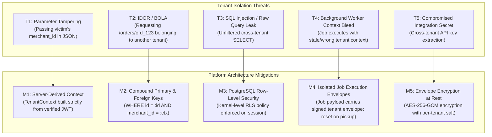

# Multi-Tenant Database Architecture & Design Specification

- **Document ID**: `P1-ARCH-05-DATABASE`
- **Milestone**: P1.0 — Architecture and Repository Preparation
- **Author**: Antigravity Lead Orchestrator & Database Architect
- **Status**: IMPLEMENTED & TESTED (P1.1.1)
- **Authoritative Engine**: PostgreSQL 16+ (ACID, Row-Level Security, JSONB, Schemas) / SQLite 3.35+ (Local Test Harness)
- **Active Hardening**:
  - Compound Primary Key `(merchant_id, id)` on `catalog_products`
  - Transaction-Scoped RLS (`SET LOCAL app.current_merchant_id = '...'`)
  - Connection Pool Bleed Prevention
  - Application-Layer Tenant Context (`TenantContext` via `contextvars`)

---

## 1. Tenancy Model: Merchant Organization as Sovereign Tenant

The platform establishes the **Merchant Organization** (`merchants`) as the authoritative root tenant. All commerce, integration, workforce, and payment assets derive their security boundary from this entity:

```text
merchants (Tenant Root)
  ├── merchant_members (Employees & Roles)
  ├── stores (E-commerce Channels: WooCommerce, Shopify)
  │     └── store_connections (Sync state, webhooks)
  ├── integration_credentials (Encrypted API tokens & keys)
  ├── catalog_products (Tenant-owned SKUs & prices)
  │     └── inventory_reservations (Atomic stock holds)
  ├── orders (Tenant-owned customer transactions)
  ├── payment_intents (Tenant-scoped transaction rails)
  ├── agent_instances (Tenant-provisioned AI workers)
  │     ├── agent_permissions (RBAC for agent tools)
  │     └── agent_tasks (Task execution history)
  └── audit_events (Tenant-partitioned hash-chained audit log)
```

---

## 2. Mandatory Tenant Isolation Principles

1. **Authoritative Server Context**: The active tenant identity (`merchant_id`) is resolved strictly from the authenticated JWT claims or session context. Client payloads specifying `merchant_id` are strictly forbidden for authorization decisions.
2. **PostgreSQL Row-Level Security (RLS)**: RLS is configured across all merchant-owned tables as defense-in-depth:
   ```sql
   ALTER TABLE catalog_products ENABLE ROW LEVEL SECURITY;
   CREATE POLICY tenant_isolation_policy ON catalog_products
       USING (merchant_id = NULLIF(current_setting('app.current_merchant_id', true), ''));
   ```
3. **Compound Tenant-Aware Foreign Keys**: Child records with compound keys enforce tenant co-location, guaranteeing that a store or product cannot be assigned to an order belonging to a different merchant:
   ```sql
   FOREIGN KEY (store_id, merchant_id) REFERENCES stores(id, merchant_id)
   ```
4. **Credential Encryption at Rest**: All third-party secrets (`consumer_secret`, `paytm_merchant_key`) are encrypted using authenticated symmetric encryption (AES-256-GCM) with an initialization vector (IV) and authentication tag.
5. **No Cross-Tenant Query Leaks**: All query APIs enforce `WHERE merchant_id = :ctx_merchant_id` at the application layer prior to hitting the database.

---

## 3. Four Disjoint Authorization Domains

The architecture strictly decouples four authorization contexts that must never be conflated:

| Authorization Domain | Principal / Actor | Authority Grant Mechanism | Scope of Power | Security Boundary & Guard |
|---|---|---|---|---|
| **Domain 1: Buyer Spending Authority** | Consumer / Shopper | Ed25519 Signed Mandates & OAuth 2.1 | Pre-authorized wallet spending, max item limits, daily caps | Handled by `app/governance` (P0 preserved). Bound to consumer's private signing key. |
| **Domain 2: Merchant Employee Authority** | Merchant Staff (Admin, Manager, Support) | RBAC (`merchant_members`, `merchant_roles`) | Managing stores, products, employee invitations, workforce config | Validated by `verify_merchant_permission` dependency. Bound to employee session. |
| **Domain 3: Merchant AI Agent Authority** | Provisioned AI Workers (Sales, Inventory, etc.) | Tool Grants (`agent_permissions`) & Policy Engine | Invoking specific domain tools within bounded financial limits | Cannot bypass policy engine. Actions $\ge$ threshold trigger human approval. |
| **Domain 4: Payment Transaction Authorization** | Payment Rail / Provider (Paytm, Razorpay) | Provider Webhook Cryptographic Signatures | Transitioning payment status from `PENDING` -> `CAPTURED` | Validated by HMAC/Checksum against raw payload bytes. Deduplicated in `processed_webhook_events`. |

---

## 4. Entity Definitions & PostgreSQL DDL Specifications

### 4.1 Core Merchant & Organization Entities

```sql
-- 1. Merchant Organization
CREATE TABLE merchants (
    id TEXT PRIMARY KEY,                       -- e.g. 'merch_01h7x...'
    name TEXT NOT NULL,
    legal_name TEXT,
    tax_id TEXT,                               -- GSTIN / VAT
    status TEXT NOT NULL DEFAULT 'ACTIVE',     -- 'ACTIVE', 'SUSPENDED', 'PENDING_VERIFICATION'
    currency TEXT NOT NULL DEFAULT 'INR',
    created_at TIMESTAMPTZ NOT NULL DEFAULT CURRENT_TIMESTAMP,
    updated_at TIMESTAMPTZ NOT NULL DEFAULT CURRENT_TIMESTAMP
);
CREATE INDEX idx_merchants_status ON merchants(status);

-- 2. Merchant Roles (RBAC)
CREATE TABLE merchant_roles (
    role_id TEXT NOT NULL,                     -- 'OWNER', 'ADMIN', 'STORE_MANAGER', 'FINANCE', 'SUPPORT'
    merchant_id TEXT NOT NULL,
    name TEXT NOT NULL,
    permissions JSONB NOT NULL DEFAULT '[]',   -- ["products:write", "orders:read", "workforce:manage"]
    is_system_role BOOLEAN NOT NULL DEFAULT FALSE,
    PRIMARY KEY (merchant_id, role_id),
    FOREIGN KEY (merchant_id) REFERENCES merchants(id) ON DELETE CASCADE
);

-- 3. Merchant Members (Employees)
CREATE TABLE merchant_members (
    id TEXT PRIMARY KEY,
    merchant_id TEXT NOT NULL,
    user_id TEXT NOT NULL,                     -- Reference to auth credential
    email TEXT NOT NULL,
    display_name TEXT NOT NULL,
    role_id TEXT NOT NULL,
    status TEXT NOT NULL DEFAULT 'ACTIVE',     -- 'INVITED', 'ACTIVE', 'DEACTIVATED'
    created_at TIMESTAMPTZ NOT NULL DEFAULT CURRENT_TIMESTAMP,
    updated_at TIMESTAMPTZ NOT NULL DEFAULT CURRENT_TIMESTAMP,
    UNIQUE(merchant_id, email),
    FOREIGN KEY (merchant_id) REFERENCES merchants(id) ON DELETE CASCADE,
    FOREIGN KEY (merchant_id, role_id) REFERENCES merchant_roles(merchant_id, role_id)
);
CREATE INDEX idx_members_user ON merchant_members(user_id);

-- 4. Merchant Invitations
CREATE TABLE merchant_invitations (
    invitation_id TEXT PRIMARY KEY,
    merchant_id TEXT NOT NULL,
    email TEXT NOT NULL,
    role_id TEXT NOT NULL,
    token_hash TEXT NOT NULL UNIQUE,
    expires_at TIMESTAMPTZ NOT NULL,
    accepted_at TIMESTAMPTZ,
    created_at TIMESTAMPTZ NOT NULL DEFAULT CURRENT_TIMESTAMP,
    FOREIGN KEY (merchant_id) REFERENCES merchants(id) ON DELETE CASCADE
);

-- 5. Merchant Settings
CREATE TABLE merchant_settings (
    merchant_id TEXT PRIMARY KEY,
    max_auto_approval_limit_paise BIGINT NOT NULL DEFAULT 50000, -- ₹500.00
    payout_account_id TEXT,
    notifications_enabled BOOLEAN NOT NULL DEFAULT TRUE,
    config JSONB NOT NULL DEFAULT '{}',
    updated_at TIMESTAMPTZ NOT NULL DEFAULT CURRENT_TIMESTAMP,
    FOREIGN KEY (merchant_id) REFERENCES merchants(id) ON DELETE CASCADE
);
```

### 4.2 Stores & Integration Entities

```sql
-- 6. Stores (Channels)
CREATE TABLE stores (
    id TEXT NOT NULL,
    merchant_id TEXT NOT NULL,
    name TEXT NOT NULL,
    platform TEXT NOT NULL,                    -- 'WOOCOMMERCE', 'SHOPIFY', 'CUSTOM'
    store_url TEXT NOT NULL,
    status TEXT NOT NULL DEFAULT 'CONNECTED',  -- 'CONNECTED', 'SYNCING', 'ERROR', 'DISCONNECTED'
    sync_interval_seconds INTEGER NOT NULL DEFAULT 3600,
    last_synced_at TIMESTAMPTZ,
    created_at TIMESTAMPTZ NOT NULL DEFAULT CURRENT_TIMESTAMP,
    updated_at TIMESTAMPTZ NOT NULL DEFAULT CURRENT_TIMESTAMP,
    PRIMARY KEY (merchant_id, id),
    UNIQUE(id),
    FOREIGN KEY (merchant_id) REFERENCES merchants(id) ON DELETE CASCADE
);
CREATE INDEX idx_stores_platform ON stores(platform);

-- 7. Integration Credentials (Encrypted)
CREATE TABLE integration_credentials (
    id TEXT PRIMARY KEY,
    merchant_id TEXT NOT NULL,
    store_id TEXT,
    provider TEXT NOT NULL,                    -- 'WOOCOMMERCE', 'PAYTM', 'RAZORPAY'
    key_ciphertext BYTEA NOT NULL,             -- AES-256-GCM encrypted
    key_iv BYTEA NOT NULL,
    key_tag BYTEA NOT NULL,
    key_version INTEGER NOT NULL DEFAULT 1,
    expires_at TIMESTAMPTZ,
    created_at TIMESTAMPTZ NOT NULL DEFAULT CURRENT_TIMESTAMP,
    FOREIGN KEY (merchant_id) REFERENCES merchants(id) ON DELETE CASCADE,
    FOREIGN KEY (store_id) REFERENCES stores(id) ON DELETE CASCADE
);
```

### 4.3 AI Workforce Subsystem Entities

```sql
-- 8. Agent Definitions (System Templates)
CREATE TABLE agent_definitions (
    agent_type TEXT PRIMARY KEY,               -- 'SALES', 'SUPPORT', 'INVENTORY', 'GROWTH', 'FINANCE'
    name TEXT NOT NULL,
    description TEXT NOT NULL,
    system_prompt_template TEXT NOT NULL,
    available_tools JSONB NOT NULL DEFAULT '[]',
    default_policy JSONB NOT NULL DEFAULT '{}'
);

-- 9. Agent Instances (Provisioned per Merchant)
CREATE TABLE agent_instances (
    id TEXT PRIMARY KEY,
    merchant_id TEXT NOT NULL,
    agent_type TEXT NOT NULL,
    display_name TEXT NOT NULL,
    status TEXT NOT NULL DEFAULT 'ACTIVE',     -- 'ACTIVE', 'PAUSED', 'DECOMMISSIONED'
    model_override TEXT,
    custom_instructions TEXT,
    created_at TIMESTAMPTZ NOT NULL DEFAULT CURRENT_TIMESTAMP,
    updated_at TIMESTAMPTZ NOT NULL DEFAULT CURRENT_TIMESTAMP,
    FOREIGN KEY (merchant_id) REFERENCES merchants(id) ON DELETE CASCADE,
    FOREIGN KEY (agent_type) REFERENCES agent_definitions(agent_type)
);
CREATE INDEX idx_agent_instances_merch ON agent_instances(merchant_id, status);

-- 10. Agent Tool Permissions
CREATE TABLE agent_permissions (
    id TEXT PRIMARY KEY,
    merchant_id TEXT NOT NULL,
    agent_instance_id TEXT NOT NULL,
    tool_name TEXT NOT NULL,                   -- 'search_products', 'reserve_stock', 'create_quote'
    is_allowed BOOLEAN NOT NULL DEFAULT TRUE,
    max_amount_paise BIGINT,                   -- Max financial impact without escalation
    requires_human_approval BOOLEAN NOT NULL DEFAULT FALSE,
    FOREIGN KEY (merchant_id) REFERENCES merchants(id) ON DELETE CASCADE,
    FOREIGN KEY (agent_instance_id) REFERENCES agent_instances(id) ON DELETE CASCADE,
    UNIQUE(agent_instance_id, tool_name)
);

-- 11. Agent Tasks & Executions
CREATE TABLE agent_tasks (
    task_id TEXT PRIMARY KEY,
    merchant_id TEXT NOT NULL,
    agent_instance_id TEXT NOT NULL,
    channel TEXT NOT NULL,                     -- 'MCP', 'WEB_CHAT', 'BACKGROUND_CRON'
    task_type TEXT NOT NULL,
    status TEXT NOT NULL DEFAULT 'PENDING',    -- 'PENDING', 'RUNNING', 'AWAITING_APPROVAL', 'COMPLETED', 'FAILED'
    input_payload JSONB NOT NULL,
    output_payload JSONB,
    approval_id TEXT,                          -- References governance purchase_approvals if escalated
    error_message TEXT,
    started_at TIMESTAMPTZ,
    completed_at TIMESTAMPTZ,
    created_at TIMESTAMPTZ NOT NULL DEFAULT CURRENT_TIMESTAMP,
    FOREIGN KEY (merchant_id) REFERENCES merchants(id) ON DELETE CASCADE,
    FOREIGN KEY (agent_instance_id) REFERENCES agent_instances(id) ON DELETE CASCADE
);
CREATE INDEX idx_agent_tasks_status ON agent_tasks(merchant_id, status);
```

### 4.4 Evolution of Existing P0 Tables

| Existing Table | Evolution Path in P1 | Migration Strategy & Cryptographic Safety |
|---|---|---|
| `catalog_products` | Add `store_id TEXT REFERENCES stores(id)` and foreign key constraint to `merchants(id)`. Convert `price_paise` to canonical `NOT NULL BIGINT`. | Seed default merchant with `id = 'MERCH_ELEC'` (aliased to default demo merchant) to preserve exact identity. Backfill `store_id = 'STORE_ELEC_MAIN'`. |
| `audit_records` | Add `merchant_id TEXT NOT NULL REFERENCES merchants(id)`, `actor_id TEXT`, `actor_type TEXT` ('BUYER_AGENT', 'EMPLOYEE', 'WORKFORCE_AGENT'). | Backfill legacy records to `'MERCH_ELEC'`. Existing records already specify `merchant_id = 'MERCH_ELEC'`. |
| `audit_events` | Add `merchant_id TEXT NOT NULL`. Retain append-only SHA-256 hash chaining. | Additive column populated from `audit_records`. Hash chain continues uninterrupted; historical hash integrity preserved. |
| `purchase_approvals`| Add `merchant_id TEXT NOT NULL`. Link human approvals to `agent_tasks(task_id)` when triggered by AI workers. | Schema addition; backward compatible with single-use key-bound validation. |
| `signed_mandates` | Add foreign key constraint to `merchants(id)`. | **Crucial**: Existing signed mandates embed `"merchant_id": "MERCH_ELEC"` in canonical RFC 8785 JSON payloads signed with Ed25519. Seeding `id = 'MERCH_ELEC'` guarantees cryptographic signature verification never breaks. |
| `customer_mandates`| Retained in `app/governance` strictly for Buyer AI agents. Scoped to authorized merchants (`allowed_merchants: ["MERCH_ELEC", "MERCH_FOOD"]`). | No breaking changes; backward compatibility guaranteed. |
| `customer_wallets` | Retained as simulated buyer auto-debit ledger for test mock environments. | Isolated from real merchant payment settlements. |

---

## 5. Tenant Isolation Threat Model & Defenses



