# Multi-Tenant Database Entity-Relationship Diagram (ERD)

- **Document ID**: `P1-ARCH-06-ERD`
- **Milestone**: P1.0 — Architecture and Repository Preparation
- **Author**: Antigravity Lead Orchestrator & Database Architect
- **Status**: PROPOSED ERD SPECIFICATION
- **Engine**: PostgreSQL 16+

---

## 1. Complete Platform Entity-Relationship Diagram

```mermaid
erDiagram
    MERCHANTS ||--o{ MERCHANT_ROLES : defines
    MERCHANTS ||--o{ MERCHANT_MEMBERS : employs
    MERCHANTS ||--o{ MERCHANT_INVITATIONS : issues
    MERCHANTS ||--|| MERCHANT_SETTINGS : configures
    MERCHANTS ||--o{ STORES : owns
    MERCHANTS ||--o{ INTEGRATION_CREDENTIALS : holds
    MERCHANTS ||--o{ AGENT_INSTANCES : provisions
    MERCHANTS ||--o{ CATALOG_PRODUCTS : owns
    MERCHANTS ||--o{ ORDERS : processes
    MERCHANTS ||--o{ PAYMENT_INTENTS : transacts
    MERCHANTS ||--o{ AUDIT_EVENTS : records

    MERCHANT_ROLES ||--o{ MERCHANT_MEMBERS : assigns

    STORES ||--o{ INTEGRATION_CREDENTIALS : uses
    STORES ||--o{ CATALOG_PRODUCTS : exposes
    STORES ||--o{ ORDERS : sources

    AGENT_DEFINITIONS ||--o{ AGENT_INSTANCES : specializes
    AGENT_INSTANCES ||--o{ AGENT_PERMISSIONS : delegates
    AGENT_INSTANCES ||--o{ AGENT_TASKS : executes

    CATALOG_PRODUCTS ||--o{ PRODUCT_RELATIONSHIPS : sources
    CATALOG_PRODUCTS ||--o{ INVENTORY_RESERVATIONS : holds
    CATALOG_PRODUCTS ||--o{ ORDER_ITEMS : contains

    ORDERS ||--o{ ORDER_ITEMS : comprises
    ORDERS ||--o{ INVENTORY_RESERVATIONS : claims
    ORDERS ||--o{ PAYMENT_INTENTS : settles

    PAYMENT_INTENTS ||--o{ PAYMENT_TRANSACTIONS : records
    PAYMENT_TRANSACTIONS ||--o{ SETTLEMENT_BATCHES : aggregates

    CUSTOMER_MANDATES ||--o{ SIGNED_MANDATES : cryptographically_signs
    CUSTOMER_SIGNING_KEYS ||--o{ SIGNED_MANDATES : verifies
    CUSTOMER_SIGNING_KEYS ||--o{ PURCHASE_APPROVALS : authorizes
    AGENT_TASKS ||--o{ PURCHASE_APPROVALS : escalates_to

    MERCHANTS {
        string id PK "merch_01h7x..."
        string name "Business Name"
        string status "ACTIVE | SUSPENDED"
        string currency "INR"
        timestamp created_at
    }

    MERCHANT_MEMBERS {
        string id PK
        string merchant_id FK
        string user_id "Auth User Ref"
        string email
        string role_id FK
        string status "ACTIVE | INVITED"
    }

    MERCHANT_ROLES {
        string role_id PK
        string merchant_id PK, FK
        string name
        jsonb permissions
    }

    STORES {
        string id PK
        string merchant_id PK, FK
        string name
        string platform "WOOCOMMERCE | SHOPIFY"
        string store_url
        string status "CONNECTED | SYNCING"
    }

    INTEGRATION_CREDENTIALS {
        string id PK
        string merchant_id FK
        string store_id FK
        string provider "WOOCOMMERCE | PAYTM"
        bytea key_ciphertext
        bytea key_iv
        bytea key_tag
    }

    AGENT_DEFINITIONS {
        string agent_type PK "SALES | SUPPORT | INVENTORY | GROWTH | FINANCE"
        string name
        text system_prompt_template
        jsonb available_tools
    }

    AGENT_INSTANCES {
        string id PK
        string merchant_id FK
        string agent_type FK
        string display_name
        string status "ACTIVE | PAUSED"
    }

    AGENT_PERMISSIONS {
        string id PK
        string merchant_id FK
        string agent_instance_id FK
        string tool_name
        boolean is_allowed
        bigint max_amount_paise
        boolean requires_human_approval
    }

    AGENT_TASKS {
        string task_id PK
        string merchant_id FK
        string agent_instance_id FK
        string channel "MCP | WEB_CHAT"
        string status "PENDING | RUNNING | COMPLETED | FAILED"
        jsonb input_payload
        jsonb output_payload
        string approval_id FK
    }

    CATALOG_PRODUCTS {
        string id PK
        string merchant_id FK
        string store_id FK
        string name
        string category
        bigint price_paise "Integer Paise"
        integer stock "Current Available"
        string status "ACTIVE | OUT_OF_STOCK"
    }

    INVENTORY_RESERVATIONS {
        string reservation_id PK
        string merchant_id FK
        string product_id FK
        integer quantity
        string order_id FK
        string status "HELD | CONFIRMED | RELEASED"
        timestamp expires_at
    }

    ORDERS {
        string id PK
        string merchant_id FK
        string store_id FK
        string customer_id
        bigint total_amount_paise
        string status "CREATED | PAID | FULFILLED | CANCELLED"
        timestamp created_at
    }

    ORDER_ITEMS {
        string id PK
        string order_id FK
        string product_id FK
        integer quantity
        bigint unit_price_paise
    }

    PAYMENT_INTENTS {
        string intent_id PK
        string merchant_id FK
        string order_id FK
        bigint amount_paise
        string currency "INR"
        string provider "PAYTM | RAZORPAY"
        string status "PENDING | CAPTURED | FAILED"
        string idempotency_key UK
    }

    PAYMENT_TRANSACTIONS {
        string txn_id PK
        string intent_id FK
        string provider_reference "Paytm Order/Txn ID"
        string payment_method "UPI | NETBANKING | CARD"
        bigint amount_paise
        string status "SUCCESS | FAILURE"
    }

    PURCHASE_APPROVALS {
        string approval_id PK
        string purchase_id UK
        string customer_id
        string key_id FK
        bigint total_payable_paise
        string status "PENDING_APPROVAL | CONSUMED | EXPIRED"
        timestamp consumed_at
    }

    AUDIT_EVENTS {
        bigint id PK
        string merchant_id FK
        string event_id
        string transaction_id
        string event_type
        text payload_json
        string prev_hash
        string event_hash "Deterministic SHA-256"
        timestamp created_at
    }
```

---

## 2. Cardinality & Relationship Constraints

| Parent Entity | Child Entity | Cardinality | Deletion Behavior | Tenant Co-Location Constraint |
|---|---|---|---|---|
| `merchants` | `merchant_members` | $1 \to N$ | CASCADE | `merchant_id` required on member |
| `merchants` | `stores` | $1 \to N$ | CASCADE | Compound PK `(merchant_id, id)` |
| `merchants` | `agent_instances` | $1 \to N$ | CASCADE | `merchant_id` required on agent |
| `agent_instances` | `agent_permissions`| $1 \to N$ | CASCADE | `agent_instance_id` + `tool_name` unique |
| `agent_instances` | `agent_tasks` | $1 \to N$ | RESTRICT | Preserves execution history |
| `merchants` | `catalog_products` | $1 \to N$ | RESTRICT | Stock items protected from accidental cascade |
| `stores` | `catalog_products` | $1 \to N$ | RESTRICT | Multi-channel catalog partitioning |
| `orders` | `order_items` | $1 \to N$ | CASCADE | Standard order composition |
| `orders` | `inventory_reservations`| $1 \to N$ | RESTRICT | Reservations must be released before order delete |
| `orders` | `payment_intents` | $1 \to N$ | RESTRICT | Financial transaction trace preserved |
| `merchants` | `audit_events` | $1 \to N$ | NO ACTION | Audit events cannot be deleted or cascaded |

