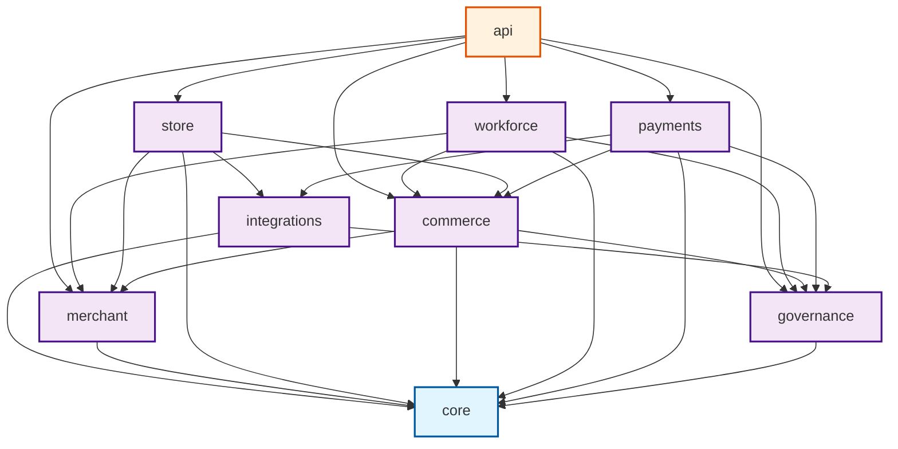

# Domain Boundaries & Architecture Taxonomy

- **Document ID**: `P1-ARCH-03-DOMAINS`
- **Milestone**: P1.0 — Architecture and Repository Preparation
- **Author**: Antigravity Lead Orchestrator & System Architect
- **Status**: PROPOSED ARCHITECTURAL SPECIFICATION
- **Target Repository**: `d:\agentic-commerce-gateway`

---

## 1. Domain Decomposition Principles

To transition from the current single-tenant gateway to a multi-tenant platform without breaking existing P0 transaction guarantees, domain boundaries must be strictly delimited. The platform follows **Domain-Driven Design (DDD)** inside a **Modular Monolith**:

1. **High Cohesion, Low Coupling**: Each domain encapsulates its internal business logic, database entities, and invariants behind explicit public service interfaces.
2. **Explicit Dependency Inversion**: Cross-domain calls occur strictly through high-level service contracts or domain events. Circular imports between domain packages are strictly prohibited.
3. **Tenant Context Propagation**: All domain service methods receive or resolve an immutable `TenantContext` containing the verified `merchant_id`, acting actor (`actor_id`, `actor_type`), and granted permissions.
4. **No Direct Table Sharing**: A domain owns its database tables. Cross-domain data queries must join through domain APIs or foreign key references, never via unmanaged raw SQL across private domain models.

---

## 2. Target Domain Hierarchy

The codebase will progressively converge towards the following directory hierarchy:

```text
app/
├── core/                  # System foundations, tenancy context, config, database, crypto
│   ├── config.py
│   ├── context.py
│   ├── db.py
│   ├── security.py
│   └── exceptions.py
│
├── merchant/              # Merchant organizations, employees, roles, and settings
│   ├── models.py
│   ├── service.py
│   ├── rbac.py
│   └── invitations.py
│
├── store/                 # Connected commerce channels (WooCommerce, Shopify, Custom)
│   ├── models.py
│   ├── service.py
│   └── sync.py
│
├── workforce/             # AI workforce registry, orchestration, specialists, and tasks
│   ├── models.py
│   ├── registry.py
│   ├── orchestrator.py
│   ├── tasks.py
│   ├── tools/
│   └── specialists/
│
├── commerce/              # Multi-tenant catalog, inventory, pricing, customers, orders
│   ├── models.py
│   ├── catalog_service.py
│   ├── inventory_service.py
│   ├── order_service.py
│   └── cart_service.py
│
├── payments/              # Provider-neutral payment orchestration and settlement
│   ├── models.py
│   ├── orchestrator.py
│   ├── router.py
│   ├── reconciliation.py
│   └── providers/
│       ├── base.py
│       ├── paytm.py
│       └── razorpay.py
│
├── governance/            # Policies, mandates, approvals, signing, and cryptographic audit
│   ├── models.py
│   ├── policy_service.py
│   ├── approval_service.py
│   ├── signing_service.py
│   └── audit_store.py
│
├── integrations/          # External platform connectors, webhooks, and outbox delivery
│   ├── outbox.py
│   ├── woocommerce/
│   ├── shopify/
│   └── paytm/
│
├── api/                   # Public REST routers and Model Context Protocol (MCP) servers
│   ├── v1/
│   │   ├── auth.py
│   │   ├── merchants.py
│   │   ├── stores.py
│   │   ├── workforce.py
│   │   ├── commerce.py
│   │   ├── payments.py
│   │   └── dashboard.py
│   ├── legacy/            # Preserved P0 endpoints for backward compatibility
│   └── mcp/               # stdio and Streamable HTTP MCP tools
│
└── main.py                # ASGI application entrypoint & middleware assembly
```

---

## 3. Logical Domain Responsibilities & Contracts

| Domain | Core Responsibilities | Owned Entities | Invariants & Business Rules |
|---|---|---|---|
| **`core`** | Configuration loading, PostgreSQL connection lifecycle, tenant context extraction, base cryptographic utilities, common error envelopes. | None (shared primitives) | Fails closed if `DATABASE_URL` or essential secrets are missing in production. |
| **`merchant`** | Merchant organization onboarding, employee identities, RBAC role assignments, invitations, business preferences. | `merchants`, `merchant_members`, `merchant_roles`, `merchant_invitations`, `merchant_settings` | Every merchant must have at least one `OWNER`. Member actions require active membership. |
| **`store`** | External store registration, connector credentials, sync schedules, catalog sync status. | `stores`, `store_connections`, `integration_credentials` | Credentials must be encrypted at rest (AES-256-GCM). One store belongs to exactly one merchant. |
| **`workforce`** | AI agent definitions, agent instance provisioning, task state machines, permission-controlled tool execution, human escalation triggers. | `agent_definitions`, `agent_instances`, `agent_permissions`, `agent_tasks` | AI agents cannot execute financial mutations without passing policy checks or human approvals. |
| **`commerce`** | Multi-tenant catalog products, inventory stock counts, reservations, order lifecycle, pricing rules. | `catalog_products`, `product_relationships`, `orders`, `order_items`, `inventory_reservations` | Stock counts cannot be negative. Prices stored strictly in integer paise. Atomic reservation before order capture. |
| **`payments`** | Payment intents, multi-provider routing, Paytm/Razorpay execution, webhook verification, refunds, reconciliation. | `payment_intents`, `payment_transactions`, `settlement_batches`, `processed_webhook_events` | Zero floating-point math. Webhook events deduplicated idempotently. Provider state transitions strictly verified. |
| **`governance`**| Buyer spending mandates, Ed25519 cryptographic signing, single-use purchase approvals, append-only hash-chained audit ledger. | `customer_mandates`, `signed_mandates`, `customer_signing_keys`, `purchase_approvals`, `audit_events`, `audit_records` | Append-only event log with SHA-256 hash chaining. Approvals are single-use and bound to `key_id`. |
| **`integrations`**| Asynchronous event outbox, external e-commerce webhook ingestion, API rate-limiting, retry policies. | `event_outbox`, `integration_logs` | Guarantees at-least-once delivery for outbound events. Inbound webhooks validated by signature. |
| **`api`** | HTTP REST serialization, OpenAPI spec generation, MCP JSON-RPC handling, request validation, authentication dependencies. | None (interfaces only) | Validates tenant context before dispatching to domain services. Masks sensitive identifiers from AI tools. |

---

## 4. Inter-Domain Dependency Graph



### Dependency Rules:
1. **`core` is independent**: It imports no other domain module.
2. **`governance` does not depend on `commerce` or `payments`**: Governance evaluates abstract policies and records immutable audit blocks.
3. **`workforce` accesses `commerce` via service interfaces**: Workforce agents never mutate inventory tables directly.
4. **`integrations` adapters isolate third-party SDKs**: Domain logic in `commerce` and `payments` remains independent of external SDK interfaces (e.g. `paytmchecksum`, `razorpay`).

