# Module Migration & Strangler Mapping Blueprint

- **Document ID**: `P1-ARCH-04-MIGRATION-MAP`
- **Milestone**: P1.0 — Architecture and Repository Preparation
- **Author**: Antigravity Lead Orchestrator & Software Architect
- **Status**: PROPOSED IMPLEMENTATION BLUEPRINT
- **Target Repository**: `d:\agentic-commerce-gateway`

---

## 1. Migration Methodology: Strangler Fig Pattern

To prevent system downtime, protect the existing 279 green tests, and maintain active MCP connections, the repository transformation will employ the **Strangler Fig Application Pattern**:

```mermaid
flowchart TD
    subgraph PHASE_A["1. Current Baseline"]
        REQ1["Inbound Client Request"] --> LEGACY_GW["Monolithic App Modules\n(app/agent, app/catalog, app/payment)"]
        LEGACY_GW --> LEGACY_DB[("SQLite / Custom Pg\ngateway.db")]
    end

    subgraph PHASE_B["2. Strangler Coexistence (P1.1 - P1.4)"]
        REQ2["Inbound Client Request"] --> ROUTE_SHIM{"API Gateway / Router Shim"}
        ROUTE_SHIM -- "Legacy MCP & REST" --> LEGACY_FACADE["Legacy Façade Wrapper"]
        ROUTE_SHIM -- "New Multi-Tenant REST" --> DOMAIN_SVCS["New Domain Modules\n(core, merchant, store, workforce)"]
        LEGACY_FACADE --> DOMAIN_SVCS
        DOMAIN_SVCS --> PG_DB[("PostgreSQL\nMulti-Tenant Schema")]
    end

    subgraph PHASE_C["3. Target Architecture (P1.5+)"]
        REQ3["Inbound Client Request"] --> UNIFIED_API["Modular Monolith API\n(app/api/v1, app/api/mcp)"]
        UNIFIED_API --> DOMAIN_LAYER["Target Domain Services"]
        DOMAIN_LAYER --> PG_DB2[("Authoritative PostgreSQL")]
    end
```



### Core Migration Rules:
1. **Zero Mass File Deletions**: Existing files in `app/` will **not** be moved or deleted during P1.0.
2. **Façade Re-exporting**: When a domain module is migrated (e.g., `app/commerce/catalog_service.py`), the original file (`app/catalog/service.py`) becomes a thin backward-compatible proxy re-exporting the new implementation.
3. **Preserved Test Harness**: Existing test modules (`tests/test_*.py`) must pass at every step of the migration without altering test assertions.

---

## 2. Comprehensive Module Mapping Matrix

| Existing Module / File | Proposed Target Module | Current Responsibilities | Target Responsibilities | Key Dependencies | Complexity | Migration Risks | Sequence |
|---|---|---|---|---|---|---|---|
| **`app/db.py`** | `app/core/db.py` | String-manipulated SQLite & PostgreSQL connection generator | Robust PostgreSQL connection pool (Psycopg 3 / AsyncPG or pooled Psycopg2) with SQLite test harness fallback | None (core utility) | **Medium** | Connection exhaustion under load; dialect edge cases | **Step 1** (P1.1) |
| **`app/auth.py`** | `app/core/security.py` & `app/core/context.py` | Single `ADMIN_API_KEY` verification & basic agent OAuth JWT verification | Multi-tenant JWT decoding, extraction of `TenantContext` (`merchant_id`, `user_id`, `roles`), RBAC evaluation | `pyjwt`, `cryptography` | **Medium** | Context leakage between concurrent async requests | **Step 2** (P1.1) |
| **`app/exceptions.py`** | `app/core/exceptions.py` | Domain exceptions (`InsufficientStockError`, `MandateNotFoundError`, etc.) | Comprehensive, hierarchical domain exceptions with standardized RFC 7807 error responses | `app/core` | **Low** | Unhandled exceptions propagating to client | **Step 1** (P1.1) |
| **`app/admin/`** | `app/merchant/` & `app/api/v1/merchants.py` | Single-tenant admin creation of customer mandates and credentials | Multi-tenant organization onboarding, employee management, role assignment, and invitations | `app/core`, `app/merchant` | **High** | Privilege escalation; authorization bypass | **Step 3** (P1.1) |
| **`app/oauth/`** | `app/core/security.py` & `app/merchant/service.py` | Buyer OAuth 2.1 server with PKCE and persisted demo credentials | Reused for merchant employee login, merchant API keys, and retained for Buyer AI agents | `app/core`, PostgreSQL | **Medium** | Token invalidation; session hijacking | **Step 3** (P1.1) |
| **`app/catalog/`** | `app/commerce/` & `app/api/v1/commerce.py` | Single-tenant products, stock updates, affinity relationships, recommendations | Multi-tenant, store-scoped catalog with SKU management, inventory reservations, and category hierarchies | `app/core`, `app/merchant`, `app/store` | **High** | Stock reservation race conditions; cross-merchant catalog leaks | **Step 5** (P1.2/1.3) |
| **`app/policy/`** | `app/governance/policy_service.py` | Buyer spending mandate evaluations (daily limits, categories, merchants) | Preserved for buyer agents; extended to evaluate merchant business rules and agent execution limits | `app/core`, `app/governance` | **Medium** | Breaking existing mandate policy validation tests | **Step 6** (P1.4) |
| **`app/signing/`** | `app/governance/signing_service.py` | Ed25519 Option A non-custodial signing, challenges, and purchase approvals | Retained for cryptographic mandate signing and merchant high-value action authorizations | `cryptography`, `app/core` | **Medium** | Key mismatch; payload canonicalization divergence | **Step 6** (P1.4) |
| **`app/wallet/`** | `app/commerce/wallet_service.py` | Simulated customer auto-debit balances (`customer_wallets`) | Retained as simulated buyer balance for local testing; decoupled from real merchant settlement | `app/core`, `app/commerce` | **Low** | None (simulated test utility) | **Step 7** (P1.4) |
| **`app/payment/`** | `app/payments/` & `app/integrations/paytm/` | Razorpay order creation, payment links, UPI QR, and webhook processing | Provider-neutral orchestrator: Paytm adapter (primary) + Razorpay adapter (preserved) + reconciliation | `app/core`, `app/commerce`, `app/governance` | **High** | Double payment; webhook signature replay; floating-point paise bug | **Step 8** (P1.4/1.5) |
| **`app/agent/`** | `app/workforce/tasks.py` & `app/api/legacy/agent.py` | Buyer AI purchase proposals, gated confirmation tokens, auto-debit flow | Re-routed through commerce order service; wraps workforce task executor | `app/commerce`, `app/governance`, `app/payments` | **Medium** | Confirmation token invalidation; idempotency regression | **Step 7** (P1.4) |
| **`app/merchant_agent/`**| `app/workforce/specialists/sales_agent.py` | Natural language sales inquiries, Gemini grounding, cross-sell quotes | Migrated into official Sales Specialist Agent within the multi-tenant workforce framework | `app/workforce`, `app/commerce` | **Medium** | Prompt injection; ungrounded catalog hallucination | **Step 7** (P1.4) |
| **`app/mcp/`** | `app/api/mcp/` & `app/workforce/tools/` | stdio & Streamable HTTP MCP server exposing buyer tools | Retains existing buyer tools; introduces merchant workforce MCP interface with RBAC scoping | `app/workforce`, `app/core` | **Medium** | Breaking ChatGPT / Claude Desktop MCP compatibility | **Step 9** (P1.5) |
| **`app/audit/`** | `app/governance/audit_store.py` | SHA-256 hash-chained append-only event ledger and query projection | Extended with `merchant_id` tenant scoping and acting employee/agent audit metadata | `app/core`, PostgreSQL | **Medium** | Hash chain break during schema migration | **Step 4** (P1.1) |
| **`app/main.py`** | `app/main.py` | Root FastAPI app mounting all routers and static directory | Assembly root loading core middleware, mounting versioned routers (`/api/v1`), legacy fallbacks, and MCP | All modules | **Medium** | Middleware order regressions; routing conflicts | **Continuous** |

---

## 3. Recommended Phased Migration Sequence

The strangler migration will be executed across the planned engineering phases:

```text
P1.0 (Current) ─────► Baseline & Architecture Specification (Zero Code Restructuring)
      │
      ▼
P1.1 ───────────────► Introduce app/core/ (Context, DB, Tenancy)
                      Introduce app/merchant/ (Merchants, Members, RBAC)
                      Introduce app/governance/audit_store.py (Tenant-Aware Hash Chaining)
      │
      ▼
P1.2 ───────────────► Introduce app/store/ (Store Connections, Encrypted Credentials)
                      Introduce app/commerce/ (Tenant-Aware Catalog & Inventory)
                      Backfill legacy data into Default Demo Merchant
      │
      ▼
P1.3 ───────────────► Introduce app/integrations/woocommerce/
                      Implement Bi-directional Store & Catalog Synchronization
      │
      ▼
P1.4 ───────────────► Introduce app/workforce/ (Agent Registry, Orchestrator, Tasks)
                      Introduce app/payments/ (Provider-Neutral Orchestrator & Paytm Adapter)
                      Wrap legacy Razorpay into IPaymentProvider adapter
      │
      ▼
P1.5 ───────────────► Merchant Dashboard UI & Complete End-to-End Verification
```

---

## 4. Preservation of P0 Security & Concurrency Guarantees

During all module migrations, the following invariants established in P0 must be preserved:

1. **Integer Paise Invariant**: No module may introduce float arithmetic for monetary values. `price_paise`, `amount_paise`, `daily_budget_paise`, and `balance_paise` remain canonical integers.
2. **Row-Level Concurrency**: Stock deduction must retain conditional atomic SQL (`WHERE id = :id AND stock >= :qty`) or PostgreSQL row locks (`SELECT ... FOR UPDATE`).
3. **Dedicated Secret Separation**: `CONFIRMATION_TOKEN_SECRET` and `JWT_SECRET` remain strictly isolated. Confirmation tokens cannot be used to authenticate API routes.
4. **Non-Custodial Keys & Challenge Consumption**: Ed25519 public keys only; private keys never touch the server. Challenges and purchase approvals are single-use.
5. **Deterministic Webhook Idempotency**: Webhook events check persistent `processed_webhook_events` before triggering state transitions.

