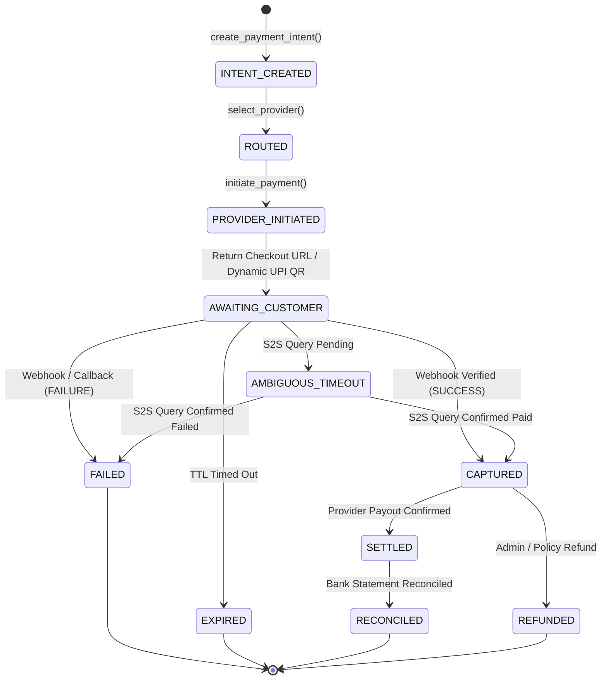
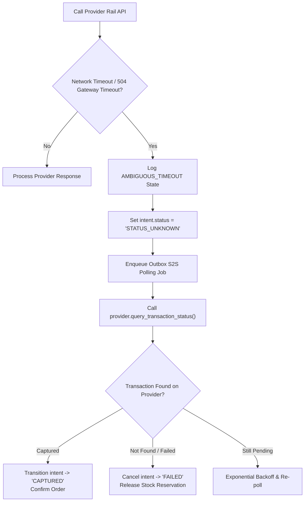

# Provider-Neutral Payment Orchestration Architecture

- **Document ID**: `P1-ARCH-07-PAYMENT`
- **Milestone**: P1.0 — Architecture and Repository Preparation
- **Author**: Antigravity Lead Orchestrator & Payment Systems Engineer
- **Status**: PROPOSED ARCHITECTURAL BLUEPRINT
- **Intended Primary Rail**: Paytm Payment Infrastructure
- **Preserved Existing Rail**: Razorpay Test & Hosted Checkout

---

## 1. Architectural Mandate & Non-Negotiable Boundaries

Payment operations are mission-critical. The platform's payment architecture is grounded in strict financial safety invariants:

1. **Deterministic Application Boundary**: AI agents (sales, support, workforce) have **zero direct access to payment credentials**, **zero ability to initiate raw gateway HTTP calls**, and **zero authority to settle transactions independently**. Agents only submit typed proposals to the `PaymentOrchestrator`, which enforces policies before execution.
2. **Integer-Paise Financial Representation**: All monetary values are strictly represented and calculated as positive 64-bit integers in **paise** ($\text{INR} \times 100$). Floating-point arithmetic (`float`, `double`) is strictly banned in all financial paths to eliminate precision loss.
3. **Provider-Neutral Abstraction**: Business logic interacts exclusively with unified platform entities (`PaymentIntent`, `PaymentTransaction`, `RefundIntent`). Gateway-specific implementations (Paytm, Razorpay) are isolated behind a common `IPaymentProvider` adapter interface.
4. **Separation of Gateway Capabilities from Orchestrator Routing**: Paytm is the platform's intended primary payment processor. However, the platform **does not assume** Paytm acts as a multi-acquirer meta-router. Payment routing across distinct gateways is performed by the platform's internal `PaymentRouter`, not delegated to external provider black boxes.

---

## 2. The Six-Stage Payment Lifecycle

Every financial transaction flows through six deterministic states:



### Stage 1: Payment Intent Creation
- A domain action (order checkout, invoice generation) requests a payment intent from the `PaymentOrchestrator`.
- The orchestrator validates the authoritative amount against the persistent order/cart ledger, sets `status = "PENDING"`, and binds a mandatory `idempotency_key`.

### Stage 2: Payment Routing & Policy Evaluation
- The `PaymentRouter` evaluates the merchant's routing preferences, order size, currency, and provider health metrics to select the appropriate adapter (`PAYTM` or `RAZORPAY`).

### Stage 3: Provider Execution
- The selected adapter transforms the platform intent into the provider's specific API contract (e.g. Paytm `initiateTransaction` or Razorpay `orders.create`).
- Retrieves transaction tokens, hosted checkout URLs, or dynamic UPI QR codes.

### Stage 4: Payment Verification & Settlement Acknowledgment
- Dual confirmation: Customer redirection callback and asynchronous server-to-server (S2S) webhook notification.
- The adapter cryptographically validates the provider's signature (Paytm SHA-256 Checksum or Razorpay HMAC-SHA256).
- Deduplicates event IDs against `processed_webhook_events`.

### Stage 5: Settlement Tracking
- Tracks daily batch settlements from providers into merchant bank accounts.

### Stage 6: Reconciliation
- Automatically matches provider settlement reports against internal ledger transactions to identify fee deductions, chargebacks, or timing variances.

---

## 3. Provider Interface Specification (`IPaymentProvider`)

All payment gateway integrations implement this typed Python interface:

```python
from abc import ABC, abstractmethod
from typing import Optional
from pydantic import BaseModel

class ProviderSession(BaseModel):
    provider: str
    provider_order_id: str
    txn_token: Optional[str] = None
    checkout_url: Optional[str] = None
    qr_code_data: Optional[str] = None
    raw_response: dict

class WebhookResult(BaseModel):
    is_valid: bool
    event_id: str
    provider_reference: str
    transaction_id: str
    amount_paise: int
    status: str  # 'SUCCESS', 'FAILURE', 'PENDING'
    error_message: Optional[str] = None

class IPaymentProvider(ABC):
    @property
    @abstractmethod
    def provider_code(self) -> str:
        """Unique provider identifier (e.g. 'PAYTM', 'RAZORPAY')."""
        ...

    @abstractmethod
    async def initiate_payment(
        self,
        merchant_credentials: dict,
        intent_id: str,
        amount_paise: int,
        currency: str,
        callback_url: str,
        customer_info: dict,
    ) -> ProviderSession:
        """Initializes payment with provider rail and returns session tokens/URLs."""
        ...

    @abstractmethod
    def verify_webhook(
        self,
        headers: dict,
        raw_body: bytes,
        merchant_credentials: dict,
    ) -> WebhookResult:
        """Verifies cryptographic signature and normalizes webhook payload."""
        ...

    @abstractmethod
    async def query_transaction_status(
        self,
        merchant_credentials: dict,
        provider_reference: str,
        intent_id: str,
    ) -> WebhookResult:
        """Queries provider API directly to resolve ambiguous timeouts or pending states."""
        ...

    @abstractmethod
    async def initiate_refund(
        self,
        merchant_credentials: dict,
        provider_reference: str,
        refund_amount_paise: int,
        refund_id: str,
    ) -> dict:
        """Executes a full or partial refund against a captured transaction."""
        ...
```

---

## 4. Paytm Primary Adapter Specification

### 4.1 Actual Paytm Capabilities vs. Proposed Orchestration Abstraction

| Capability Dimension | Documented Paytm PG Reality | Proposed Platform Orchestrator Abstraction |
|---|---|---|
| **API Architecture** | Paytm All-in-One Payment Gateway / Custom Checkout APIs | `IPaymentProvider` standard interface |
| **Authentication** | `mid` (Merchant ID) and `merchant_key` | Stored in `integration_credentials` (AES-256-GCM encrypted) |
| **Signature Scheme** | Paytm Checksum (`paytmchecksum.generateSignature` / `verifySignature` with AES/SHA-256) | Encapsulated inside `PaytmAdapter.verify_webhook` |
| **Payment Modes Supported**| Paytm Wallet, UPI (Intent & Collect), Dynamic QR, Netbanking, Credit/Debit Cards | Exposed to customer checkout as dynamic payment links & UPI QR |
| **Multi-Acquirer Routing** | Paytm handles routing **only** across its own acquiring banking partners | Platform's `PaymentRouter` decides between Paytm vs. fallback rails |
| **Refunds & S2S Status** | Refund API (`v2/refund/apply`) & Transaction Status API (`v3/order/status`) | Invoked automatically during saga rollback or polling ambiguous states |

### 4.2 Handling Ambiguous Provider Timeouts

When a network timeout occurs while calling Paytm or Razorpay during order initiation or webhook processing:



1. The transaction is **never** assumed failed immediately, preventing double debits or phantom reservations.
2. It transitions to `STATUS_UNKNOWN`.
3. A durable outbox task queries the provider's status API with exponential backoff until a terminal state (`SUCCESS` or `FAILURE`) is confirmed.

---

## 5. Financial Integrity Verification Matrix

| Invariant / Threat | Baseline P0 Mechanism | Target P1 Architecture Protection |
|---|---|---|
| **Floating-Point Imprecision** | Integer `price_paise` and `amount_paise` | Mandatory `BIGINT` across database columns and domain Pydantic schemas. |
| **Amount Tampering** | Server-computed HMAC token on checkout | `PaymentOrchestrator` grounds amount strictly in persistent order ledger; client amount is ignored. |
| **Duplicate Webhook Execution** | `processed_webhook_events` deduplication table | S2S webhooks enforce database unique constraints on `event_id` within an ACID transaction. |
| **Idempotent Order Creation** | SHA-256 bucketed key on `audit_records` | Unique index `idx_payment_intents_idempotency_key` on `payment_intents`. |
| **Cryptographic Webhook Forgery**| Razorpay HMAC-SHA256 signature check | Paytm Checksum verification and Razorpay HMAC verification over raw request bytes. |
| **Phantom Stock on Failure** | Exactly-once saga compensation `restore_stock` | Saga orchestrator releases stock reservations upon payment rejection, expiration, or refund. |

