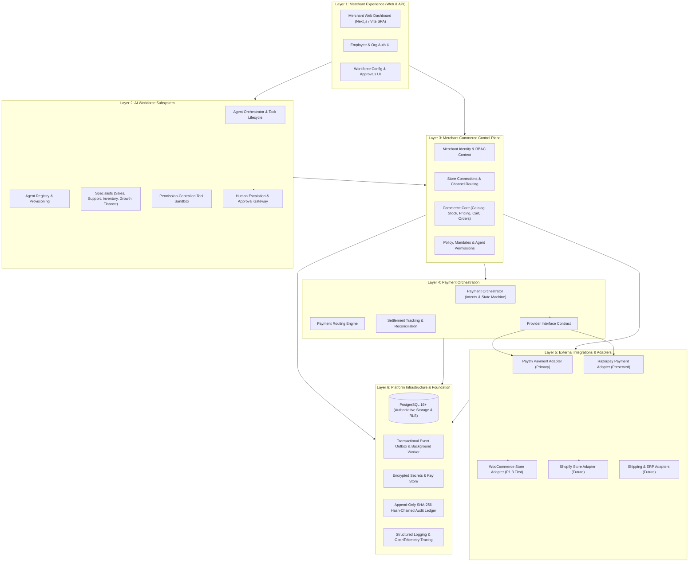
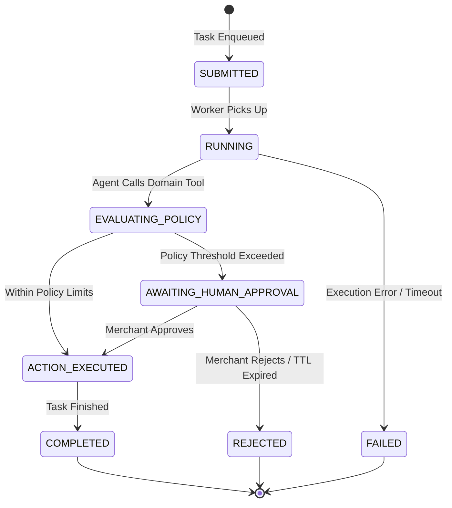
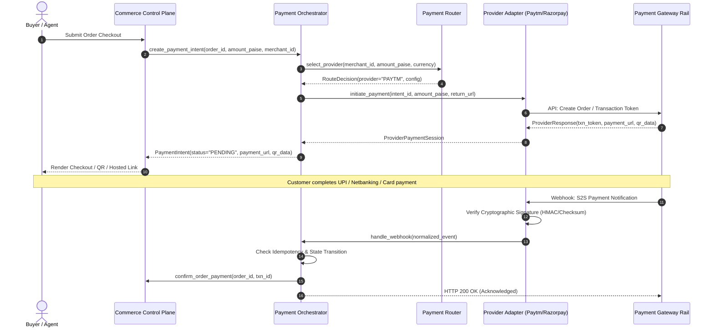
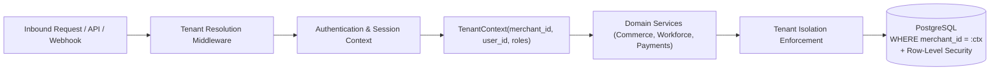

# Target Architecture Specification — Multi-Tenant Modular Monolith

- **Document ID**: `P1-ARCH-02-TARGET-SPEC`
- **Milestone**: P1.0 — Architecture and Repository Preparation
- **Author**: Antigravity Lead Orchestrator & System Architect
- **Status**: PROPOSED ARCHITECTURAL BLUEPRINT
- **Target Repository**: `d:\agentic-commerce-gateway`
- **Product Vision**: *One merchant. One connected business. Multiple AI workers. Powered by Paytm payment orchestration.*

---

## 1. Architectural Philosophy & Principles

The transformation of the **Agentic Commerce Gateway** into the **Agentic Commerce Platform** adopts a **Multi-Tenant Modular Monolith** architecture governed by the following core architectural tenets:

1. **Merchant-First Authority**: The Merchant Organization is the sovereign tenant. Every store, product, inventory unit, customer profile, order, and AI worker exists strictly within the context of an authenticated merchant organization.
2. **Deterministic Business Control**: AI agents are workforce execution units, **never** the authoritative source of truth. All financial calculations, state transitions, stock deductions, and payments are executed by deterministic domain services.
3. **Strangler Fig Migration**: The existing gateway capabilities (MCP endpoints, Buyer AI tools, Razorpay testing rails, and Ed25519 mandate verification) continue operating uninterrupted. New multi-tenant services encapsulate and progressively migrate legacy single-tenant assumptions.
4. **Provider-Neutral Payment Rails**: Payment operations are decoupled from underlying payment gateways. Paytm serves as the primary transaction infrastructure, with existing Razorpay rails preserved behind a unified orchestration contract.
5. **Integer-Paise Financial Precision**: Floating-point representations are strictly forbidden across financial data paths. All pricing, debits, credits, and ledger updates use 64-bit integer paise ($\text{INR} \times 100$).
6. **Defense-in-Depth Isolation**: Tenant isolation is enforced at the application context layer, database query abstraction, and PostgreSQL Row-Level Security (RLS) policies.

---

## 2. Six-Layer Architecture Overview

The platform is structured into six cohesive logical layers residing within a unified codebase:



---

## 3. Detailed Layer Specifications

### 3.1 Layer 1 — Merchant Experience

#### Responsibilities
- Provide responsive, intuitive web and mobile interfaces for merchant administrators and store managers.
- Manage employee registration, login, multi-factor authentication, and organization switching.
- Visualize catalog health, inventory levels, connected store synchronization status, and order fulfillment.
- Configure merchant AI workers (sales, support, inventory, growth, finance) and define operational bounds.
- Present human-in-the-loop escalation queues and pending purchase/refund approval requests.
- Render business analytics: Average Order Value (AOV) uplift, agent task completion rate, and payment conversion.

#### Module Ownership
- Target modules: `app/api/v1/merchant/`, `app/api/v1/dashboard/`, and `frontend/` (or enhanced `static/admin/`).

#### Public Interfaces
- REST API:
  - `POST /api/v1/auth/register`, `POST /api/v1/auth/login`, `GET /api/v1/merchants/me`
  - `POST /api/v1/merchants/invitations`, `GET /api/v1/merchants/members`
  - `GET /api/v1/dashboard/overview`, `GET /api/v1/dashboard/analytics`

#### Dependencies
- Layer 3 (Merchant Commerce Control Plane) for domain data.
- Layer 2 (AI Workforce) for agent status and task queues.

#### Existing vs. Required Changes
- **Existing**: Single-tenant vanilla JS admin dashboard (`static/admin/`) relying on a hardcoded `ADMIN_API_KEY`.
- **Required**: Implement merchant employee authentication, organization onboarding, multi-store view, and workforce permission configuration panels.

---

### 3.2 Layer 2 — AI Workforce

#### Responsibilities
- Provision, configure, and monitor merchant-specific AI workers.
- Maintain an agent registry with parameterized agent definitions, tool permissions, and operational constraints.
- Orchestrate task lifecycles (`PENDING` -> `RUNNING` -> `AWAITING_APPROVAL` -> `COMPLETED` / `FAILED`).
- Provide an isolated tool execution environment where tools strictly inherit the authenticated merchant's context.
- Enforce mandatory human escalation when an action violates business policies or exceeds delegated financial thresholds.

#### Specialist AI Agents
1. **Sales Agent**: Engages buyer agents/shoppers, answers catalog inquiries, offers bounded quotes, suggests add-ons.
2. **Customer Support Agent**: Resolves order queries, tracks shipments, initiates return/refund requests under policy.
3. **Inventory Agent**: Monitors stock levels across channels, alerts on low stock, drafts purchase reorders.
4. **Growth Agent**: Analyzes purchase affinities, tunes cross-sell recommendations, tests discount campaigns.
5. **Order Operations Agent**: Orchestrates order processing, reservation confirmation, and fulfillment routing.
6. **Finance Agent**: Reconciles daily payment settlements against provider webhooks and detects balance anomalies.



#### Module Ownership
- Target module: `app/workforce/` (`orchestrator.py`, `registry.py`, `tasks.py`, `tools.py`, `specialists/`).

#### Dependencies
- Layer 3 for inventory, catalog, and order mutation services.
- Layer 6 for persistent task storage and audit logging.

#### Security Boundaries
- **Inviolable Rule**: AI models have **zero direct database access** and **zero payment credential access**.
- All agent operations invoke strongly-typed domain tools guarded by merchant tenancy checks and policy verification.

---

### 3.3 Layer 3 — Merchant Commerce Control Plane

#### Responsibilities
- Maintain authoritative multi-tenant domain models: Merchants, Stores, Catalogs, Inventories, Customers, Carts, Orders.
- Enforce business policies, role-based access control (RBAC), and agent action mandates.
- Maintain inventory reservation lifecycles (`RESERVED` -> `CONFIRMED` -> `RELEASED`).
- Ground AI interactions in live, deterministic catalog data.

#### Module Ownership
- Target modules: `app/merchant/`, `app/store/`, `app/commerce/`, `app/governance/`.

#### Public Interfaces
- Internal Python Service Interfaces:
  - `MerchantService`, `StoreService`, `CatalogService`, `InventoryService`, `OrderService`, `PolicyEngine`.
- External REST Endpoints:
  - `POST /api/v1/stores`, `GET /api/v1/stores/{id}/sync-status`
  - `GET /api/v1/commerce/products`, `POST /api/v1/commerce/orders`

#### Existing vs. Required Changes
- **Existing**: `app/catalog/` contains single-tenant tables with hardcoded `'MERCH_ELEC'`. `app/policy/` evaluates buyer spending mandates.
- **Required**: Scope all tables by `merchant_id` and `store_id`. Decouple buyer spending policies from merchant governance policies.

---

### 3.4 Layer 4 — Payment Orchestration

#### Responsibilities
- Provide a unified, provider-neutral abstraction for all commerce payment flows.
- Orchestrate the complete payment lifecycle:
  $$\text{Payment Intent} \longrightarrow \text{Routing} \longrightarrow \text{Provider Execution} \longrightarrow \text{Verification} \longrightarrow \text{Settlement} \longrightarrow \text{Reconciliation}$$
- Execute payment routing rules based on merchant preferences, transaction amounts, payment methods, and provider health.
- Enforce strict financial integrity: integer-paise calculations, idempotency keys, and tamper-proof webhooks.
- Provide refund initiation, settlement tracking, and ledger reconciliation services.



#### Module Ownership
- Target module: `app/payments/` (`orchestrator.py`, `router.py`, `service.py`, `reconciliation.py`, `models.py`).

#### Public Interfaces
- `IPaymentProvider` interface:
  ```python
  class IPaymentProvider(ABC):
      @abstractmethod
      def create_payment(self, intent: PaymentIntent) -> ProviderPaymentResult: ...
      @abstractmethod
      def verify_webhook(self, headers: dict, body: bytes) -> WebhookVerificationResult: ...
      @abstractmethod
      def query_transaction(self, provider_ref: str) -> TransactionStatus: ...
      @abstractmethod
      def refund_payment(self, refund_request: RefundRequest) -> RefundResult: ...
  ```

---

### 3.5 Layer 5 — External Integrations

#### Responsibilities
- Provide isolated, pluggable connector adapters to sync data with external e-commerce platforms and payment rails.
- **Store Connectors**:
  - **WooCommerce Connector** (P1.3 Priority): Bi-directional catalog sync, real-time webhook order ingestion, inventory delta sync.
  - **Shopify Connector** (Future): GraphQL admin API, stock sync, webhook event listeners.
- **Payment Adapters**:
  - **Paytm Adapter** (Primary): Merchant onboarding APIs, All-in-One Payment SDK/PG, UPI dynamic QR, webhook validation.
  - **Razorpay Adapter** (Preserved): Existing test rails and live checkout links wrapped in `IPaymentProvider`.
- **Credential Isolation**: All API keys, consumer secrets, and webhook secrets must be AES-256-GCM encrypted at rest.

#### Module Ownership
- Target module: `app/integrations/` (`connectors/woocommerce/`, `connectors/shopify/`, `payment_adapters/paytm/`, `payment_adapters/razorpay/`).

---

### 3.6 Layer 6 — Infrastructure & Persistence

#### Responsibilities
- **PostgreSQL 16+**: Authoritative relational database for all transactional records, multi-tenant row isolation, and ACID transactions.
- **Transactional Outbox & Worker**: Guarantees at-least-once event delivery for webhook notifications and external store synchronization without two-phase commit overhead.
- **Secrets Management**: AES-256-GCM encryption for integration credentials and API tokens.
- **Cryptographic Audit Ledger**: Preserve and extend the append-only SHA-256 hash-chained ledger (`audit_events`) with merchant tenant scoping.
- **Observability**: Structured JSON logging with trace correlation IDs, error categorization, and health monitoring.

---

## 4. Cross-Cutting Security & Tenancy Boundary



1. **Authoritative Context Binding**: The `merchant_id` is derived strictly from the verified JWT / API session, never from request payload parameters.
2. **PostgreSQL RLS as Defense in Depth**: Every merchant-owned table incorporates `merchant_id`. In addition to explicit ORM query filtering, database sessions set `SET LOCAL app.current_merchant_id = '...'` to activate PostgreSQL Row-Level Security.
3. **Audit Immutability**: All employee, customer, agent, and system actions emit structured audit records hash-chained in Layer 6.

