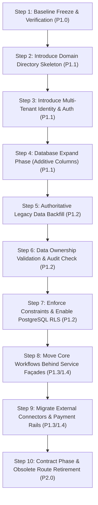

# End-to-End Migration Plan — Zero-Downtime Strangler Transition

- **Document ID**: `P1-IMPL-01-MIGRATION`
- **Milestone**: P1.0 — Architecture and Repository Preparation
- **Author**: Antigravity Lead Orchestrator & Release Engineer
- **Status**: PROPOSED IMPLEMENTATION BLUEPRINT

---

## 1. Ten-Step Sequential Migration Roadmap

To transition the existing Agentic Commerce Gateway into the Multi-Tenant Agentic Commerce Platform without disrupting production traffic or breaking existing tests, the following sequential path is mandated:



---

## 2. Detailed Execution Steps & Operational Safeguards

### Step 1: Baseline Freeze & Verification (Milestone P1.0)
- **Objective**: Establish the verified commit (`01a6d2c`) and test suite baseline (279 passed).
- **Actions**: Physical code inspection, schema inventory, security threat model, authoring of ADRs and architectural specifications.
- **Gate**: Zero application code modified; working tree completely clean; all tests passing.

---

### Step 2: Introduce Domain Directory Skeleton (Milestone P1.1)
- **Objective**: Establish target domain packages without modifying existing business modules.
- **Actions**:
  - Create packages `app/core/`, `app/merchant/`, `app/store/`, `app/workforce/`, `app/commerce/`, `app/payments/`, `app/governance/`, `app/integrations/`, `app/api/`.
  - Introduce `app/core/context.py` containing `TenantContext` dataclass and async `contextvars`.
  - Introduce `app/core/db.py` providing robust connection pooling with backward-compatible SQLite wrappers.
- **Validation**: Full test suite re-run; verify no import regressions.

---

### Step 3: Introduce Multi-Tenant Identity & RBAC (Milestone P1.1)
- **Objective**: Enable merchant organization onboarding and employee session tokens.
- **Actions**:
  - Create tables: `merchants`, `merchant_roles`, `merchant_members`, `merchant_invitations`, `merchant_settings`.
  - Seed default demo merchant: `MERCH_DEFAULT` (name: "Demo Merchant Store", status: "ACTIVE").
  - Introduce `POST /api/v1/auth/register`, `POST /api/v1/auth/login`, `GET /api/v1/merchants/me`.
  - Implement `TenantContextMiddleware` that extracts `merchant_id` from Bearer JWTs.

---

### Step 4: Database Expand Phase — Additive Columns (Milestones P1.1 – P1.2)
- **Objective**: Prepare existing tables for multi-tenancy without breaking active queries.
- **Rule**: **Never add immediate NOT NULL columns without default values or prior backfills.**
- **Schema Alterations**:
  ```sql
  -- Add nullable tenant column to existing tables
  ALTER TABLE catalog_products ADD COLUMN IF NOT EXISTS merchant_id TEXT;
  ALTER TABLE catalog_products ADD COLUMN IF NOT EXISTS store_id TEXT;
  ALTER TABLE audit_records ADD COLUMN IF NOT EXISTS merchant_id TEXT;
  ALTER TABLE audit_events ADD COLUMN IF NOT EXISTS merchant_id TEXT;
  ALTER TABLE purchase_approvals ADD COLUMN IF NOT EXISTS merchant_id TEXT;
  ALTER TABLE customer_mandates ADD COLUMN IF NOT EXISTS merchant_id TEXT;
  ```
- **Operational Safety**: Existing single-tenant code continues to write to these tables without failure.

---

### Step 5: Authoritative Legacy Data Backfill (Milestone P1.2)
- **Objective**: Associate all pre-existing records with the seed default tenant while preserving cryptographic signatures.
- **Cryptographic Grounding**: Because baseline Ed25519 `signed_mandates` embed `"merchant_id": "MERCH_ELEC"` into their signed RFC 8785 canonical payloads, the seed organization must use `id = 'MERCH_ELEC'`. Arbitrarily renaming to `MERCH_DEFAULT` would invalidate cryptographic signatures.
- **Backfill Script**:
  ```sql
  BEGIN;
  -- Seed the default legacy merchant organization first
  INSERT INTO merchants (id, name, legal_name, status, currency)
  VALUES ('MERCH_ELEC', 'Electronics Demo Merchant', 'Demo Retail India Pvt Ltd', 'ACTIVE', 'INR')
  ON CONFLICT (id) DO NOTHING;

  -- Backfill existing catalog items (already default to MERCH_ELEC)
  UPDATE catalog_products 
  SET merchant_id = 'MERCH_ELEC', 
      store_id = 'STORE_ELEC_MAIN' 
  WHERE merchant_id IS NULL OR merchant_id = '';

  -- Backfill audit records and events
  UPDATE audit_records SET merchant_id = 'MERCH_ELEC' WHERE merchant_id IS NULL OR merchant_id = '';
  UPDATE audit_events SET merchant_id = 'MERCH_ELEC' WHERE merchant_id IS NULL OR merchant_id = '';

  -- Backfill existing purchase approvals and mandates
  UPDATE purchase_approvals SET merchant_id = 'MERCH_ELEC' WHERE merchant_id IS NULL OR merchant_id = '';
  UPDATE customer_mandates SET merchant_id = 'MERCH_ELEC' WHERE merchant_id IS NULL OR merchant_id = '';
  COMMIT;
  ```

---

### Step 6: Data Ownership Validation & Referential Audit (Milestone P1.2)
- **Objective**: Empirically verify that zero unowned (NULL tenant) records exist.
- **Verification Query**:
  ```sql
  SELECT 'catalog_products' AS tbl, COUNT(*) FROM catalog_products WHERE merchant_id IS NULL
  UNION ALL
  SELECT 'audit_records', COUNT(*) FROM audit_records WHERE merchant_id IS NULL
  UNION ALL
  SELECT 'audit_events', COUNT(*) FROM audit_events WHERE merchant_id IS NULL;
  ```
- **Exit Criteria**: All counts must strictly equal `0`.

---

### Step 7: Enforce Constraints & Activate Row-Level Security (Milestone P1.2)
- **Objective**: Lock in data integrity at the database engine level.
- **Actions**:
  ```sql
  -- Enforce NOT NULL and Foreign Keys
  ALTER TABLE catalog_products ALTER COLUMN merchant_id SET NOT NULL;
  ALTER TABLE catalog_products ADD CONSTRAINT fk_cat_merchant FOREIGN KEY (merchant_id) REFERENCES merchants(id);

  ALTER TABLE audit_records ALTER COLUMN merchant_id SET NOT NULL;
  ALTER TABLE audit_records ADD CONSTRAINT fk_audit_merchant FOREIGN KEY (merchant_id) REFERENCES merchants(id);

  -- Enable PostgreSQL Row-Level Security
  ALTER TABLE catalog_products ENABLE ROW LEVEL SECURITY;
  ALTER TABLE audit_records ENABLE ROW LEVEL SECURITY;
  CREATE POLICY tenant_isolation_catalog ON catalog_products
      USING (merchant_id = current_setting('app.current_merchant_id', true));
  ```

---

### Step 8: Move Core Workflows Behind Service Façades (Milestones P1.3 – P1.4)
- **Objective**: Route all business operations through domain services (`CommerceService`, `PaymentOrchestrator`, `WorkforceOrchestrator`).
- **Actions**:
  - Legacy `app/catalog/service.py` functions become shims calling `app.commerce.catalog_service`.
  - Legacy `app/payment/service.py` functions become shims calling `app.payments.orchestrator`.
  - All unit tests continue to pass via shims.

---

### Step 9: Migrate Integrations & Introduce Paytm Rails (Milestones P1.3 – P1.4)
- **Objective**: Activate WooCommerce store synchronization and Paytm payment orchestration.
- **Actions**:
  - Connect WooCommerce store channels via `app/integrations/woocommerce/`.
  - Route payments through `IPaymentProvider` with Paytm as primary and Razorpay as fallback.
  - Implement database outbox worker for reliable asynchronous webhook processing.

---

### Step 10: Contract Phase & Obsolete Route Retirement (Milestone P2.0)
- **Objective**: Clean up legacy shims after complete merchant platform adoption.
- **Actions**:
  - Remove deprecated single-tenant shims in `app/catalog/` and `app/admin/`.
  - Drop deprecated database columns (e.g. float `price` in favor of integer `price_paise`).
  - Formalize API v1 as the sole authoritative interface.

