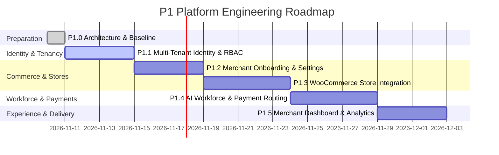

# P1 Implementation Roadmap: Gateway to Agentic Commerce Platform

- **Document ID**: `P1-IMPL-03-ROADMAP`
- **Milestone**: P1.0 — Architecture and Repository Preparation
- **Author**: Antigravity Lead Orchestrator & Technical Product Lead
- **Status**: APPROVED IMPLEMENTATION ROADMAP
- **Target Cycle**: Milestones P1.0 through P1.5

---

## 1. Roadmap Overview & Timeline Execution

The transformation from the single-tenant Agentic Commerce Gateway into a Multi-Tenant, Merchant-First Agentic Commerce Platform is partitioned into six rigorously gated engineering milestones:

---

## 2. Detailed Milestone Specifications

### Milestone P1.0 — Architecture Specification & Baseline (CURRENT)
- **Scope**: Establish verified repository baseline, audit schemas, author 6-layer target architecture, create 9 ADRs, multi-tenant ERDs, API contracts, threat model, and implementation blueprints. Zero application code modifications.
- **Dependencies**: Clean git commit `01a6d2c`, green test suite (279 passed).
- **Deliverables**: Complete documentation package in `docs/architecture/`, `docs/adr/`, `docs/implementation/`.

---

### Milestone P1.1 — Multi-Tenant Merchant Identity & Tenancy Context
- **Scope**: Merchant organization creation, employee registration, login, role-based access control (RBAC), and server-side `TenantContext` propagation.
- **Dependencies**: P1.0 baseline specifications.
- **Database Changes**:
  - Create tables: `merchants`, `merchant_roles`, `merchant_members`, `merchant_invitations`.
  - Seed default demo tenant `MERCH_DEFAULT`.
- **API Changes**:
  - `POST /api/v1/auth/register`
  - `POST /api/v1/auth/login`
  - `GET /api/v1/merchants/me`
  - `POST /api/v1/merchants/invitations`
  - `GET /api/v1/merchants/members`
- **Security Requirements**:
  - Passwords hashed with Argon2id or PBKDF2-SHA256 with unique cryptographic salt.
  - Constant-time secret comparisons.
  - JWT tokens encode `merchant_id`, `user_id`, and `role`.
  - Request context enforces server-side tenancy; client cannot override `merchant_id`.
- **Testing Requirements**:
  - Unit tests for user registration, duplicate email rejection, role assignments.
  - Tenant context isolation tests ensuring user in Merchant A cannot read Merchant B.
- **Acceptance Criteria**: Employees can register, log in, invite team members, and access tenant-scoped context.

---

### Milestone P1.2 — Merchant Onboarding & Configuration
- **Scope**: Business profile settings, financial auto-approval limits, store channel registration, and encrypted credential storage.
- **Dependencies**: P1.1.
- **Database Changes**:
  - Create tables: `stores`, `store_connections`, `merchant_settings`, `integration_credentials`.
  - Add additive columns `merchant_id` and `store_id` to `catalog_products`, `audit_records`, and `audit_events`.
  - Backfill existing rows with `MERCH_DEFAULT`.
- **API Changes**:
  - `PUT /api/v1/merchants/settings`
  - `POST /api/v1/stores`
  - `GET /api/v1/stores`
  - `POST /api/v1/stores/{id}/connect`
- **Security Requirements**:
  - Third-party API credentials encrypted at rest using AES-256-GCM.
  - Decryption keys loaded strictly from process environment (`CREDENTIAL_ENCRYPTION_KEY`).
- **Testing Requirements**:
  - Credential encryption/decryption round-trip tests.
  - Data backfill verification ensuring zero orphan records.
- **Acceptance Criteria**: Merchant can configure business settings and connect store credentials securely.

---

### Milestone P1.3 — Store Integration Framework (WooCommerce First)
- **Scope**: Pluggable store connector interface, WooCommerce REST v3 synchronization, inventory stock delta syncing, inbound order webhooks, and transactional outbox worker.
- **Dependencies**: P1.2.
- **Database Changes**:
  - Create table: `event_outbox` (id, merchant_id, event_type, payload, status, retry_count).
  - Add index `idx_outbox_pending` on `event_outbox(status, scheduled_at)`.
- **API Changes**:
  - `POST /api/v1/stores/{id}/sync`
  - `GET /api/v1/stores/{id}/sync-status`
  - `POST /api/v1/webhooks/stores/{store_id}/woocommerce`
- **Security Requirements**:
  - WooCommerce webhook signature verification via HMAC-SHA256 (`X-WC-Webhook-Signature`).
  - Outbox worker inherits verified `merchant_id` when executing tasks.
- **Testing Requirements**:
  - Mock WooCommerce client tests for product ingestion and stock decrement.
  - Outbox at-least-once delivery and retry backoff test suite.
- **Acceptance Criteria**: Products and stock levels synchronize bi-directionally between WooCommerce and the platform.

---

### Milestone P1.4 — AI Workforce Foundation & Payment Orchestration
- **Scope**: Merchant AI agent registry, specialist agent provisioning (Sales, Inventory, Support), permission-controlled tool sandbox, human escalation queue, and Paytm payment adapter.
- **Dependencies**: P1.3.
- **Database Changes**:
  - Create tables: `agent_definitions`, `agent_instances`, `agent_permissions`, `agent_tasks`.
  - Create tables: `payment_intents`, `payment_transactions`.
- **API Changes**:
  - `GET /api/v1/workforce/agents`
  - `POST /api/v1/workforce/agents`
  - `GET /api/v1/workforce/tasks`
  - `POST /api/v1/workforce/tasks/{id}/approve`
  - `POST /api/v1/payments/intents`
  - `POST /api/v1/webhooks/payments/paytm`
- **Security Requirements**:
  - AI agents have zero direct payment access; actions $\ge$ threshold trigger `purchase_approvals`.
  - Paytm Checksum signature verification on S2S notifications.
  - Integer-paise financial enforcement.
- **Testing Requirements**:
  - Adversarial prompt injection tests on agent tool execution.
  - Provider-neutral payment routing tests (Paytm vs. Razorpay fallback).
- **Acceptance Criteria**: Merchants can provision AI workers with bounded tools, and payments settle through Paytm.

---

### Milestone P1.5 — Merchant Dashboard & Analytics
- **Scope**: Web dashboard UI for merchant operators, connected store status, catalog view, workforce controls, pending approval management, and AOV uplift analytics.
- **Dependencies**: P1.4.
- **API Changes**:
  - `GET /api/v1/dashboard/overview`
  - `GET /api/v1/dashboard/analytics/aov`
- **UI Deliverables**:
  - Multi-tenant admin dashboard (enhanced vanilla SPA or modern frontend).
  - Real-time approval queue for human-in-the-loop task escalation.
- **Testing Requirements**:
  - End-to-end user journey tests (registration -> store connect -> agent provision -> purchase -> Paytm settlement).
- **Acceptance Criteria**: Merchant can oversee and control their entire commerce operation from the unified web interface.

