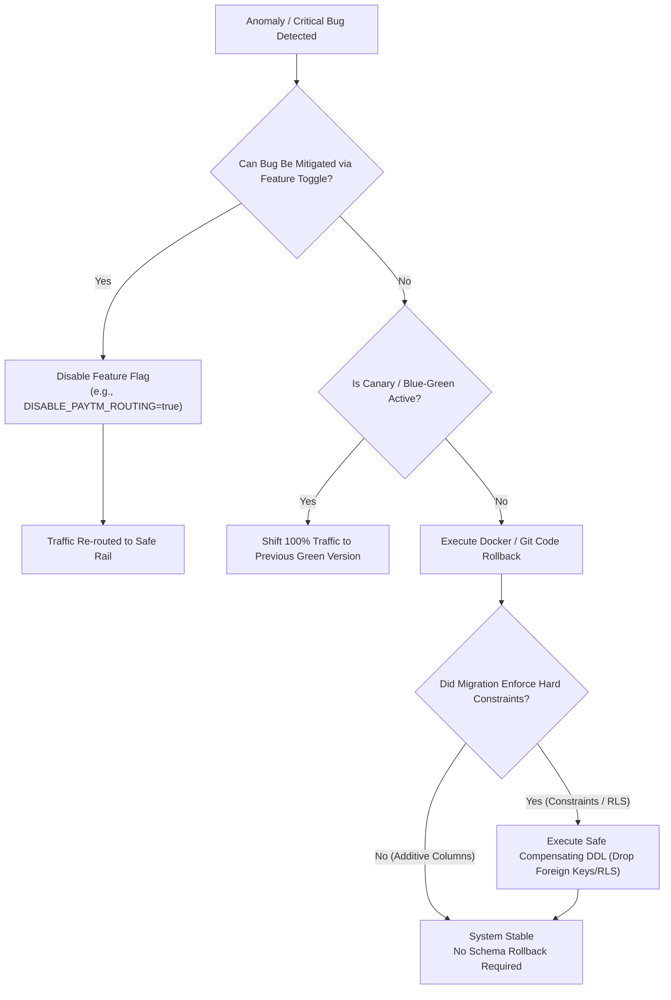

# Disaster Recovery & Phased Rollback Strategy

- **Document ID**: `P1-IMPL-02-ROLLBACK`
- **Milestone**: P1.0 — Architecture and Repository Preparation
- **Author**: Antigravity Lead Orchestrator & DevOps Engineer
- **Status**: PROPOSED OPERATIONAL SAFETY SPECIFICATION

---

## 1. Rollback Philosophy & Golden Rules

1. **Do No Harm to Data**: A rollback must never destroy, overwrite, or truncate production data. If an issue is detected, the preferred mitigation is "forward correction" via patch or feature toggle. If a rollback is mandatory, it must preserve all transactional records created during the new deployment.
2. **Backward-Compatible Schema Migration (Expand & Contract)**: Because database migrations are strictly additive in the Expand Phase, rolling back code never requires immediate destructive schema down-migrations. The previous version of the application can safely run against a database that has additional, nullable columns.
3. **Decoupled Financial Reversals**: Captured payments, refunds, and bank payouts **cannot be rolled back via database transactions**. Downstream financial actions require explicit administrative compensating transactions (refunds, voids, manual reconciliation).

---

## 2. Phased Rollback Procedures



### 2.1 Milestone P1.1 (Identity & Auth) Rollback
- **Trigger**: High failure rate in merchant registration or authentication; session token decoding failure.
- **Action**:
  - Revert deployment to commit `01a6d2c`.
  - The newly created tables (`merchants`, `merchant_members`, `merchant_roles`) remain dormant in the database.
  - Legacy `ADMIN_API_KEY` and Buyer OAuth authentication continue operating immediately.
  - Zero data loss: newly created merchant accounts remain preserved in tables for debugging.

### 2.2 Milestone P1.2 (Multi-Tenant Catalog & Stores) Rollback
- **Trigger**: Cross-merchant data leak detected; store sync lockups; catalog corruption.
- **Action**:
  - Disable RLS policies: `ALTER TABLE catalog_products DISABLE ROW LEVEL SECURITY;`.
  - Switch traffic back to legacy single-tenant catalog router (`app/catalog/router.py`).
  - Additive columns (`merchant_id`, `store_id`) are safely ignored by the legacy code.

### 2.3 Milestone P1.3 (WooCommerce Integration) Rollback
- **Trigger**: Rate-limiting by merchant WooCommerce servers; outbox queue starvation; stock desynchronization.
- **Action**:
  - Disable outbox worker in environment configuration: `ENABLE_OUTBOX_WORKER=false`.
  - Pause store synchronization status: `UPDATE stores SET status = 'DISCONNECTED';`.
  - Revert to static seed catalog or manual inventory adjustments.

### 2.4 Milestone P1.4 (Paytm Payment Orchestration) Rollback
- **Trigger**: Paytm webhook signature failures; checkout redirect loops; transaction timeout spikes.
- **Action**:
  - Set platform routing toggle: `PAYMENT_DEFAULT_PROVIDER=RAZORPAY`.
  - All new checkout intents immediately route through the battle-tested Razorpay test/production rail.
  - Ambiguous Paytm transactions are handled by the reconciliation status query script (`scripts/reconcile_paytm.py`).

---

## 3. Database Down-Migration & Compensating Scripts

If a database schema change must be rolled back during staging or pre-production testing:

```sql
-- Safe Compensating DDL for Milestone P1.2
BEGIN;
-- 1. Disable Row-Level Security
ALTER TABLE catalog_products DISABLE ROW LEVEL SECURITY;
DROP POLICY IF EXISTS tenant_isolation_catalog ON catalog_products;

-- 2. Drop Foreign Key Constraints (leaves columns intact)
ALTER TABLE catalog_products DROP CONSTRAINT IF EXISTS fk_cat_merchant;
ALTER TABLE audit_records DROP CONSTRAINT IF EXISTS fk_audit_merchant;

-- 3. Relax NOT NULL constraints to prevent legacy write failures
ALTER TABLE catalog_products ALTER COLUMN merchant_id DROP NOT NULL;
ALTER TABLE audit_records ALTER COLUMN merchant_id DROP NOT NULL;
COMMIT;
```

> [!CAUTION]
> **Never Execute DROP COLUMN or DROP TABLE in Production**
> Dropping columns or tables destroys live operational data and breaks running application replicas during rolling deployments. Columns are only retired during planned major version upgrades (P2.0) after confirming zero references exist across all logs.

---

## 4. Operational Runbook: Disaster Recovery & Data Verification

1. **Pre-Migration Snapshot**: Prior to applying any database migration in production, an automated point-in-time recovery (PITR) snapshot is created.
2. **Replication Verification**: Ensure standby read replicas are in sync (`replay_lag < 1s`) before initiating schema changes.
3. **Data Integrity Audit**: Post-rollback, execute verification scripts to confirm referential integrity:
   - Check stock counts match pre-migration baselines.
   - Verify audit hash chains are intact: `python -m scripts.verify_audit_integrity`.

