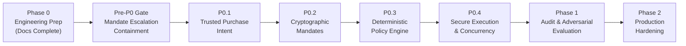

# Phase 0 Master Plan: Engineering Preparation & Readiness Assessment

- **Project:** Agentic Commerce Gateway
- **Phase:** Phase 0 (Engineering Preparation & Pre-Implementation Specification)
- **Revision:** 1.1.0 (Incorporates ADR-01, ADR-02, ADR-03 & Pre-P0 Containment Gate)
- **Status:** Complete — Specification Finalized
- **Governing Role:** Engineering Orchestrator
- **Target Implementation Phases:** P0.1 (Trusted Purchase Intent), P0.2 (Cryptographic Mandates), P0.3 (Deterministic Policy Engine), P0.4 (Secure Execution Engine)

---

## 1. Executive Summary & Objective

The **Agentic Commerce Gateway** is a merchant-side gateway and policy enforcement system designed to allow external AI shopping agents (e.g., Claude, ChatGPT, custom autonomous buyers) to discover catalog products, consult merchant reasoning agents, and propose purchases under bounded, customer-authorized spending mandates.

The primary objective of **Phase 0** is to perform an exhaustive, evidence-backed inspection of the existing codebase to:
1. Establish a verified baseline of the current application architecture and test suite.
2. Uncover the end-to-end purchase proposal and confirmation execution lifecycles.
3. Map module dependencies, sensitive data flows, and representation boundaries (floats vs. integer paise).
4. Identify existing security vulnerabilities (8 total findings: 3 Critical, 3 High, 2 Medium), trust boundary violations, and architectural attack surfaces.
5. Formulate strict, testable policy contracts and database migration strategies for upcoming implementation phases (P0.1–P0.4).
6. Author Architecture Decision Records (ADR-01, ADR-02, ADR-03) addressing unresolved architectural trade-offs.
7. Eliminate all architectural ambiguity and improvisation before any production code or schema changes are enacted.

> [!IMPORTANT]
> **Strict Phase 0 Mandate: Documentation Only**  
> Under no circumstances may application code, database schemas, active policy logic, payment integrations, or authentication behaviors be modified during Phase 0. All artifacts created during this phase reside strictly under `docs/phase-0/`.

---

## 2. Strict Phase 0 Constraints & Operating Boundaries

All activities in Phase 0 are governed by zero-modification rules:
- **No Source Code Changes:** No application files (`app/*`), scripts, or tests may be edited or refactored.
- **No Policy Modifications:** The current `evaluate()` logic in `app/policy/engine.py` remains unmodified.
- **No Cryptographic Implementation:** Ed25519 signing and verification algorithms are specified in contract form only; no code implementation is performed in Phase 0.
- **No Payment Alterations:** Existing Razorpay and auto-debit wallet integrations remain untouched.
- **No Schema Mutations:** No database tables are altered, added, or dropped, and no migration scripts are executed against SQLite or PostgreSQL.
- **No Environment Changes:** Dependencies are maintained strictly as declared in `requirements.txt`.
- **Preservation of Working Tree:** All pre-existing untracked and modified files are preserved without loss.
- **No Silent Fixes:** Discovered bugs and vulnerabilities are documented with rigorous proof of exploitability rather than patched opportunistically.

---

## 3. Dynamic Multi-Agent Orchestration Architecture

To ensure multi-dimensional technical rigor, Phase 0 deployed specialized agents coordinated by the **Engineering Orchestrator**. The orchestrator enforces strict segregation of documentation files to avoid write collisions.

```mermaid
flowchart TD
    ORCH["Engineering Orchestrator<br/>(Master Coordination & Final Gate Review)"]
    
    subgraph Specialists["Domain Specialist Agents"]
        ARCH["System Architect<br/>(Baseline, Inventory, Data Flow)"]
        SEC["Security Engineer<br/>(Threat Model, Security Boundaries)"]
        BACK["Backend Engineer<br/>(Lifecycles, Policy Contract, DB Migration)"]
        QA["QA Engineer<br/>(Test Strategy & Evaluation Framework)"]
    end

    subgraph Deliverables["Phase 0 Specification Deliverables (`docs/phase-0/`)"]
        D00["00_PHASE_0_MASTER_PLAN.md"]
        D01["01_REPOSITORY_BASELINE.md"]
        D02["02_ARCHITECTURE_INVENTORY.md"]
        D03["03_PURCHASE_FLOW_ANALYSIS.md"]
        D04["04_DEPENDENCY_AND_DATA_FLOW.md"]
        D05["05_THREAT_MODEL.md"]
        D06["06_SECURITY_BOUNDARIES.md"]
        D07["07_POLICY_CONTRACT_SPECIFICATION.md"]
        D08["08_DATABASE_MIGRATION_PLAN.md"]
        D09["09_TEST_AND_EVALUATION_STRATEGY.md"]
        D10["10_PHASE_0_FINAL_REVIEW.md"]
    end

    subgraph ADRs["Architecture Decision Records (`docs/phase-0/`)"]
        ADR1["ADR-01_MANDATE_SIGNING_AUTHORITY.md"]
        ADR2["ADR-02_POSTGRESQL_CONCURRENCY_MODEL.md"]
        ADR3["ADR-03_INDEPENDENT_HUMAN_APPROVAL.md"]
    end

    ORCH --> ARCH & SEC & BACK & QA
    ORCH -.-> D00 & D10
    ARCH -.-> D01 & D02 & D04
    SEC -.-> D05 & D06
    BACK -.-> D03 & D07 & D08
    QA -.-> D09
    
    BACK -.-> ADR1
    BACK -.-> ADR2
    SEC -.-> ADR3
```

### Delegation Matrix

| Specialist Agent | Assigned Responsibilities | Primary Deliverables |
| :--- | :--- | :--- |
| **Engineering Orchestrator** | Dynamic coordination, evidence validation, conflict resolution, readiness synthesis | `00_PHASE_0_MASTER_PLAN.md` `10_PHASE_0_FINAL_REVIEW.md` |
| **System Architect** | Repository baseline inspection, component inventory, dependency matrices, data-flow tracing | `01_REPOSITORY_BASELINE.md` `02_ARCHITECTURE_INVENTORY.md` `04_DEPENDENCY_AND_DATA_FLOW.md` |
| **Security Engineer** | Threat modeling, attack surface mapping, trust-boundary definition, LLM isolation analysis | `05_THREAT_MODEL.md` `06_SECURITY_BOUNDARIES.md` `ADR-03_INDEPENDENT_HUMAN_APPROVAL.md` |
| **Backend Engineer** | Purchase/confirmation lifecycle analysis, deterministic policy contract design, DB migration planning | `03_PURCHASE_FLOW_ANALYSIS.md` `07_POLICY_CONTRACT_SPECIFICATION.md` `08_DATABASE_MIGRATION_PLAN.md` `ADR-01_MANDATE_SIGNING_AUTHORITY.md` `ADR-02_POSTGRESQL_CONCURRENCY_MODEL.md` |
| **QA Engineer** | Comprehensive test pyramid design, adversarial test cases, regression coverage, measurable metrics | `09_TEST_AND_EVALUATION_STRATEGY.md` |

---

## 4. Evidence Classification Taxonomy

To ensure complete intellectual honesty and prevent unsubstantiated claims, all substantive statements across every Phase 0 document are tagged with the following four-tier classification system:

- **`[VERIFIED]`**: Fact directly confirmed by physical inspection of the source code, database schemas, configuration files, or executed test output in the actual repository.
- **`[INFERRED]`**: Highly probable technical deduction supported by observed architectural patterns, framework conventions, or intermediate execution traces.
- **`[ASSUMPTION]`**: Operating hypothesis or unverified parameter requiring empirical validation prior to implementation.
- **`[RECOMMENDATION]`**: Proposed architectural enhancement, security mitigation, or refactoring strategy to be evaluated for execution in P0.1–P0.4.

---

## 5. Scope of the Phase 0 Deliverables

The Phase 0 documentation suite comprises eleven core specification documents and three foundational Architecture Decision Records:

### Core Specifications
1. **`00_PHASE_0_MASTER_PLAN.md`**: Master governance roadmap, multi-agent structure, constraints, and quality standards.
2. **`01_REPOSITORY_BASELINE.md`**: Git commit history, tech stack versions, two-stage test execution history (initial failure vs. 205 passed, 1 live test deselected), environment status, and working features.
3. **`02_ARCHITECTURE_INVENTORY.md`**: Comprehensive component catalog detailing responsibilities, I/O, flows, tables, external APIs, and limitations across 12 subsystems.
4. **`03_PURCHASE_FLOW_ANALYSIS.md`**: Step-by-step tracing of the 19-stage proposal lifecycle and 9-stage confirmation lifecycle, complete with failure modes and sequence diagrams.
5. **`04_DEPENDENCY_AND_DATA_FLOW.md`**: Inter-module coupling matrix, monetary representation flows (paise vs. rupees), identity lineage, and transaction UUID propagation.
6. **`05_THREAT_MODEL.md`**: Deep threat model covering 17 STRIDE threat vectors mapped to 8 underlying vulnerabilities (3 Critical, 3 High, 2 Medium), prompt injection, and threat-to-control matrices.
7. **`06_SECURITY_BOUNDARIES.md`**: Rigorous delineation of 8 authority ownerships (Identity, Pricing, Mandate, Policy, Approval, Payment, Audit, Catalogue) and the 7 LLM security boundaries.
8. **`07_POLICY_CONTRACT_SPECIFICATION.md`**: Concrete specification of the future P0.1–P0.3 policy engine contract, machine-readable reason codes, and fail-fast evaluation invariants.
9. **`08_DATABASE_MIGRATION_PLAN.md`**: Existing schema analysis, target relational schema, monetary migration to integer paise using `ROUND_HALF_UP` quantization, concurrency control, and rollback strategies.
10. **`09_TEST_AND_EVALUATION_STRATEGY.md`**: Comprehensive validation plan spanning unit, integration, invariant, concurrency, payment failure, adversarial, and regression testing.
11. **`10_PHASE_0_FINAL_REVIEW.md`**: Executive synthesis, critical security findings, readiness verdict (**CONDITIONALLY APPROVED**), and P0.1 implementation prerequisites.

### Architecture Decision Records (ADRs)
1. **`ADR-01_MANDATE_SIGNING_AUTHORITY.md`**: Specification of mandate signing authority, key lifecycle, verification invariants, and unresolved cryptographic key management decisions.
2. **`ADR-02_POSTGRESQL_CONCURRENCY_MODEL.md`**: Production concurrency control architecture, isolation levels, atomic conditional updates, lock ordering, and PostgreSQL integration testing requirements.
3. **`ADR-03_INDEPENDENT_HUMAN_APPROVAL.md`**: Mandatory pre-P0 containment decision for conversational mandate escalation, independent human approval channel, and deprecation of agent-executable modification tokens.

---

## 6. Implementation Phase Roadmap (P0.1–P2.0)

Phase 0 provides the technical specification foundation for subsequent phases:

- **Pre-P0 Mandatory Gate:** Immediate containment of `modify_spending_mandate` MCP tool. Disallow AI agents from receiving or submitting executable mandate modification tokens.
- **P0.1 — Trusted Purchase Intent:** External agents propose SKU and quantity only. Enforce strict request schema validation and confirmation-time catalog price re-verification (`STALE_PRICE_DETECTED`).
- **P0.2 — Cryptographic Mandates:** Ed25519 digitally signed mandates, nonces, validity periods, customer-bound key rings, revocation checks.
- **P0.3 — Deterministic Policy Engine:** Three-state outcomes (`ALLOW`, `STEP_UP`, `DENY`), machine-readable reason codes, fail-fast invariants, budget reservation checks.
- **P0.4 — Secure Execution & Concurrency:** PostgreSQL row-level locks, atomic conditional updates, integer paise throughout, single-use approval token burning.
- **Phase 1 — Audit & Adversarial Evaluation:** Tamper-evident ledger enhancements, external anchor notarization, prompt injection defense hardening, automated penetration tests.
- **Phase 2 — Production Readiness:** Distributed idempotency store (Redis), HSM/KMS key management, high-throughput PostgreSQL tuning, production deployment orchestration.

---

## 7. Phase 0 Readiness Gate Criteria

Phase 0 certification distinguishes **documentation readiness** from **implementation readiness**:
- [x] All 11 specification documents exist under `docs/phase-0/` with complete, substantive analysis.
- [x] All 3 Architecture Decision Records (ADR-01, ADR-02, ADR-03) exist under `docs/phase-0/`.
- [x] Baseline test results are documented with empirical verification (initial failure due to missing dependencies, followed by remediation and subsequent run: 205 passed, 1 live integration test deselected, 0 failed).
- [x] Both proposal and confirmation lifecycles are mapped with sequence diagrams and edge-case failure modes.
- [x] All 8 vulnerability findings (3 Critical, 3 High, 2 Medium) are consistently categorized.
- [x] Explicit security boundaries separate untrusted LLMs and agents from authoritative backend execution.
- [x] Policy contracts and invariants are defined with deterministic reason codes and evaluation order.
- [x] Database schema migration to integer paise using explicit Decimal quantization is fully planned.
- [x] Concurrency race conditions (TOCTOU in stock decrement and wallet debit) are documented with PostgreSQL resolution designs.
- [x] Zero application code, database schema, payment behavior, or policy logic was modified during Phase 0.

### Readiness Verdict: CONDITIONALLY APPROVED
Documentation is certified as **COMPLETE** and **APPROVED**. Implementation of P0.1 is authorized **conditionally** upon completing the Pre-P0 Containment Gate (ADR-03: disabling/restricting the conversational mandate modification tool for AI agents) and securing formal architectural sign-off on unresolved key management decisions.
