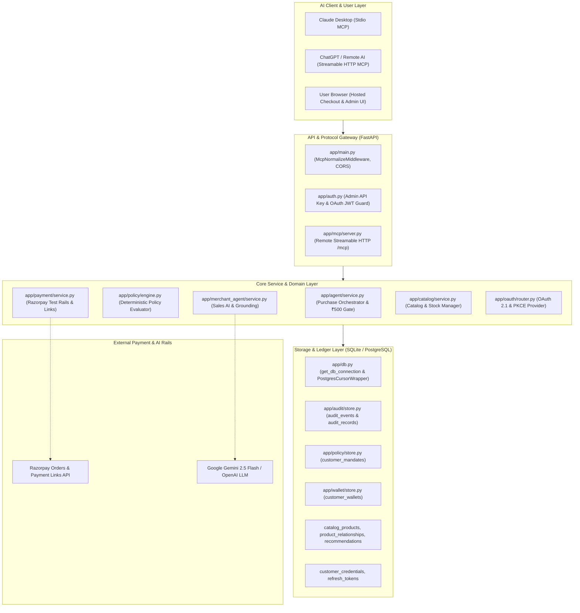

# Gateway Architecture & Component Inventory

- **Document ID**: `PHASE-0-DOC-02`
- **Revision**: `1.0.0`
- **Status**: `APPROVED / ARCHITECTURAL BASELINE`
- **Author**: System Architect Specialist
- **Timestamp**: `2026-11-09T17:41:00Z`
- **Target Repository**: `d:\agentic-commerce-gateway`

---

## 1. Architectural System Overview

The **Agentic Commerce Gateway** is structured as a modular, transport-agnostic control plane enforcing zero-trust commerce interactions between Autonomous AI Buyer Agents, Merchant Sales AI, and payment rails.

---

## 2. Module-by-Module Component Inventory

### 2.1 [`app/main.py`](file:///d:/agentic-commerce-gateway/app/main.py) — Application Entrypoint & Middleware Pipeline
- **Status Classification**: `Implemented`
- **Responsibility**:
  - Initializes FastAPI application instance and registers global lifespan handlers.
  - Configures CORS middleware for web-based MCP clients (e.g., ChatGPT web connector).
  - Normalizes `/mcp` requests via `McpNormalizeMiddleware` (trailing slash rewrite to prevent 307 redirects, injection of `text/event-stream` into `Accept` header).
  - Mounts static asset directories (`/static`, `/checkout`, `/admin/dashboard`).
  - Registers sub-routers: `catalog`, `agent`, `audit`, `admin`, `oauth`, `merchant_agent`, `payment`.
  - Mounts remote Streamable HTTP MCP server at `/mcp`.
  - Exposes operational endpoints: `/health`, `/api/analytics/growth-benchmark`, `/api/analytics/recommendations`, and diagnostic `/debug-search`.
- **Inputs / Outputs**:
  - Inbound: HTTP/1.1 and JSON-RPC over HTTP requests across all registered prefixes.
  - Outbound: JSON envelopes, Starlette responses, Static HTML/JS files.
- **Execution Flow**:
  1. Process startup: loads `.env`, configures root logger, binds lifespan `remote_mcp_lifespan`.
  2. Request enters middleware stack: `McpNormalizeMiddleware` intercepts path/headers -> `CORSMiddleware` handles headers/preflight -> routes to target router.
- **Dependencies**:
  - Internal: `app.admin.router`, `app.agent.router`, `app.audit`, `app.catalog.router`, `app.mcp.server`, `app.merchant_agent`, `app.oauth.router`, `app.payment.router`, `app.db`.
  - External: `fastapi`, `starlette`.
- **Database Tables Accessed**:
  - Read queries on `catalog_products` within `/debug-search` diagnostic endpoint.
- **External APIs**: None directly (delegated to mounted routers).
- **Security-Critical Operations**:
  - CORS configuration sets `allow_origins=["*"]`, enabling browser-based clients to reach the gateway.
  - `/debug-search` outputs database prefix, table row counts, and raw exception tracebacks; represents an information disclosure vector if unauthenticated in production.
- **Existing Limitations**:
  - Wildcard CORS (`*`) with `allow_credentials=True` is permissive.
  - `/debug-search` is public and lacks authentication protection.

---

### 2.2 [`app/auth.py`](file:///d:/agentic-commerce-gateway/app/auth.py) — Authentication & Credential Verification
- **Status Classification**: `Implemented`
- **Responsibility**:
  - Enforces role-based authentication dependencies for REST and administrative endpoints.
  - Distinguishes between System Administrators (`auth_type: admin`) and Autonomous AI Agents (`auth_type: oauth`).
  - Auto-generates ephemeral 256-bit cryptographically secure keys in production if `ADMIN_API_KEY` is not set or left at default.
- **Inputs / Outputs**:
  - Inputs: `Request` object inspecting headers `X-Admin-API-Key` and `Authorization: Bearer <token>`.
  - Outputs: Admin key string (`verify_admin_key`) or dictionary `{"auth_type": "admin"|"oauth", "customer_id": Optional[str]}` (`verify_agent_or_admin_auth`).
- **Execution Flow**:
  1. Inspects `X-Admin-API-Key` header; if matches `expected_admin_key`, returns admin auth.
  2. If absent, inspects `Authorization` header for `Bearer <token>`.
  3. If token equals admin key, grants admin auth.
  4. Otherwise, delegates to `verify_access_token(token)` from [`app/oauth/crypto.py`](file:///d:/agentic-commerce-gateway/app/oauth/crypto.py) to decode OAuth JWT.
  5. Extracts `sub` claim and binds it as verified `customer_id`.
  6. Raises `401 Unauthorized` on missing, expired, or tampered tokens.
- **Dependencies**:
  - Internal: `app.oauth.crypto.verify_access_token`.
  - External: `fastapi`, `secrets`.
- **Database Tables Accessed**: None directly (token verification is stateless HS256 JWT decoding).
- **External APIs**: None.
- **Security-Critical Operations**:
  - Admin key comparison uses `!=` string equality instead of `secrets.compare_digest` (timing attack potential).
  - Production auto-generation of ephemeral admin key prevents default credential compromise.
  - Strong identity binding: Prevents agent callers from claiming a different `customer_id` than the verified `sub` claim.
- **Existing Limitations**:
  - Symmetric HMAC key (`JWT_SECRET`) shared between access tokens and purchase confirmation tokens.
  - Lacks asymmetric signing (e.g. RS256/ES256) for federated token verification.

---

### 2.3 [`app/agent/service.py`](file:///d:/agentic-commerce-gateway/app/agent/service.py) & [`app/agent/router.py`](file:///d:/agentic-commerce-gateway/app/agent/router.py) — Purchase Proposal Orchestration & Human Confirmation Gating
- **Status Classification**: `Implemented` (with `Simulated` settlement on Tier 1)
- **Responsibility**:
  - Orchestrates purchase proposals under strict spending mandate policies.
  - Implements the non-bypassable ₹500 Human-in-the-Loop Confirmation Gate.
  - Implements bucketing-based idempotency key generation (60-second window) to neutralize agent retry storms.
  - Generates and verifies cryptographically signed 5-minute JWT confirmation tokens (`purchase_confirmation`).
  - Re-evaluates inventory stock and deterministic policy rules at confirmation execution time (preventing time-of-check to time-of-use / TOCTOU exploits).
  - Routes outcome to either immediate settlement (Tier 1), gated proposal (Tier 2), or hosted-checkout escalation (Tier 3).
- **Inputs / Outputs**:
  - Inputs: `customer_id`, `product_id`, `quantity`, `idempotency_key`, `logical_order_group_id`, `recommendation_id` (or `confirmation_token` for `/agent/confirm`).
  - Outputs: `PurchaseResponse` (decision: `APPROVED` | `REJECTED` | `PENDING_CONFIRMATION` | `PAYMENT_FAILED`, `amount`, `transaction_id`, `payment: PaymentResult`, `requires_confirmation`, `confirmation_token`).
- **Execution Flow (`execute_purchase`)**:
  1. Validates input types (`quantity >= 1`).
  2. Resolves idempotency key (client-provided or deterministic SHA-256 60s bucket).
  3. Checks `audit_store.get_by_idempotency_key`: if found, immediately returns cached replay response.
  4. Looks up product in catalog via `get_product(product_id)`.
  5. Validates inventory (`quantity <= product.stock`).
  6. Fetches customer mandate via `mandate_store.get_mandate(customer_id)`.
  7. Computes total amount (`price * quantity`).
  8. Fetches cumulative daily spend via `audit_store.get_daily_spend(customer_id)`.
  9. Evaluates policy via `evaluate(purchase_request, mandate, current_daily_spend)`.
  10. Mints UUID `transaction_id`.
  11. Checks Gating Rule: If `APPROVED` and `amount >= ₹500`, sets decision to `PENDING_CONFIRMATION` and generates signed 5-minute confirmation token.
  12. Records Phase A audit entry (`write_proposal`).
  13. Payment Execution:
      - If `APPROVED` (< ₹500): Creates Razorpay order, executes `wallet_store.debit`, decrements inventory stock, marks Phase B audit as `captured`.
      - If `REJECTED`: Creates Razorpay payment link and dynamic UPI QR code for manual checkout.
  14. Returns `PurchaseResponse`.
- **Execution Flow (`confirm_purchase`)**:
  1. Decodes and verifies confirmation token (signature and 5-minute TTL).
  2. Validates caller identity matches token `sub`.
  3. Replay guard: Checks if `transaction_id` is already finalized.
  4. Re-checks catalog inventory stock.
  5. Re-evaluates deterministic policy rules against current daily spend.
  6. Creates Razorpay order, auto-debits wallet balance, decrements stock, updates audit record to `captured` / `APPROVED`.
- **Dependencies**:
  - Internal: `app.audit`, `app.catalog.service`, `app.exceptions`, `app.oauth.crypto`, `app.payment`, `app.policy.engine`, `app.policy.requests`, `app.policy.store`, `app.wallet.store`.
  - External: `jwt`, `pydantic`.
- **Database Tables Accessed**: `audit_records`, `audit_events`, `catalog_products`, `customer_mandates`, `customer_wallets`.
- **External APIs**: Razorpay Orders / Payment Links API (via `app.payment`).
- **Security-Critical Operations**:
  - Fixed ₹500 autonomous threshold cannot be modified or bypassed by agent proposals.
  - Confirmation token binds `customer_id`, `product_id`, `quantity`, `amount`, and `transaction_id`.
  - Execution-time policy re-evaluation prevents exploitation of stale proposals.
- **Existing Limitations**:
  - Autonomous settlement debits an in-database simulated sandbox wallet rather than initiating live recurring UPI AutoPay mandates.
  - Floating-point arithmetic used for `amount = product.price * quantity`.

---

### 2.4 [`app/policy/engine.py`](file:///d:/agentic-commerce-gateway/app/policy/engine.py), [`mandate.py`](file:///d:/agentic-commerce-gateway/app/policy/mandate.py), [`requests.py`](file:///d:/agentic-commerce-gateway/app/policy/requests.py), [`store.py`](file:///d:/agentic-commerce-gateway/app/policy/store.py) — Deterministic Spending Mandate Policy Engine
- **Status Classification**: `Implemented`
- **Responsibility**:
  - Pure, deterministic evaluation of agent purchase proposals against customer intent mandates.
  - Strict zero-LLM authorization: no generative AI models participate in policy decisions.
  - Sequential, fail-fast evaluation across 6 ordered rules:
    1. `CUSTOMER_MISMATCH`: Caller ID must exactly match mandate customer.
    2. `MANDATE_EXPIRED`: UTC timestamp must not exceed `expires_at`.
    3. `MERCHANT_NOT_ALLOWED`: Merchant must exist in `allowed_merchants` allowlist (case-insensitive).
    4. `CATEGORY_NOT_ALLOWED`: Category must exist in `allowed_categories` allowlist (case-insensitive).
    5. `AMOUNT_EXCEEDS_LIMIT`: Transaction amount must not exceed `max_transaction_amount`.
    6. `DAILY_LIMIT_EXCEEDED`: `current_daily_spend + amount` must not exceed `daily_limit`.
  - Persistent storage of customer mandates in `customer_mandates` table with lazy seeding from `DEMO_MANDATES`.
- **Inputs / Outputs**:
  - Inputs: `PurchaseRequest` (customer, product, category, amount, merchant, quantity), `Mandate`, `current_daily_spend`.
  - Outputs: `PolicyDecision` (status: `"APPROVED"` | `"REJECTED"`, human-readable `reason`, `rule_violated: Optional[RuleViolated]`).
- **Execution Flow**: Evaluates conditions 1 through 6 sequentially; halts and returns `REJECTED` on the first failing rule; returns `APPROVED` with `rule_violated=None` only if all 6 pass.
- **Dependencies**:
  - Internal: `app.policy.mandate`, `app.policy.requests`, `app.db`.
  - External: `pydantic`.
- **Database Tables Accessed**: `customer_mandates`.
- **External APIs**: None.
- **Security-Critical Operations**:
  - Fail-safe default: Rejects on any violation.
  - Pure function architecture (`evaluate`) ensures zero side effects during evaluation.
  - `save_mandate` uses `ON CONFLICT(customer_id) DO UPDATE` to ensure atomic mandate updates.
- **Existing Limitations**:
  - Per-category spending limits and per-merchant spending limits within a mandate are not yet implemented (allowlist is binary).
  - Floating-point currency representation in `max_transaction_amount` and `daily_limit`.

---

### 2.5 [`app/mcp/server.py`](file:///d:/agentic-commerce-gateway/app/mcp/server.py) & [`app/mcp/tools.py`](file:///d:/agentic-commerce-gateway/app/mcp/tools.py) — Model Context Protocol Dual-Transport Servers & Tool Handlers
- **Status Classification**: `Implemented`
- **Responsibility**:
  - Exposes standard Model Context Protocol (MCP) tool interfaces to AI agent clients.
  - Implements **Dual Transport Architecture**:
    1. **Local Stdio Transport**: Single-user process runner (`create_mcp_server`) for Claude Desktop, with explicit `customer_id` parameters defaulting to `"CUST001"`.
    2. **Remote Streamable HTTP Transport**: Multi-tenant server mounted at `/mcp` (`create_remote_mcp_server`), strictly protected by `McpAuthMiddleware` and binding identity to the verified JWT `sub` claim.
  - Implements **Data Minimization Projection** via `to_customer_response`: strips internal transaction UUIDs and Razorpay order IDs from AI responses, returning minimized customer reference codes (`REF-XXXXXXXX`).
  - Implements Conversational Mandate Modification via `modify_spending_mandate` with a two-step signed cryptographic challenge protocol.
- **Tool Catalog**:
  - `inquire_merchant`: Natural language procurement query to Merchant Sales AI.
  - `search_products`: Multi-attribute catalog search.
  - `suggest_addons`: Contextual cross-sell recommendations within budget headroom.
  - `respond_to_recommendation`: Accept/reject add-on proposals with terminal idempotency.
  - `propose_purchase`: Submit purchase proposal under mandate.
  - `confirm_purchase`: Execute gated payment using confirmation token.
  - `check_order_status`: Query settlement and fulfillment status.
  - `get_spending_mandate`: Inspect active mandate limits and allowlists.
  - `modify_spending_mandate`: Request or finalize mandate limit/allowlist changes.
  - `resolve_customer` (stdio only): Resolve display name or email to customer ID.
- **Inputs / Outputs**:
  - JSON-RPC 2.0 payloads over stdio or Streamable HTTP (SSE).
  - Outputs: Tool call result envelopes containing formatted dictionary projections.
- **Dependencies**:
  - Internal: `app.agent.service`, `app.audit`, `app.catalog.service`, `app.merchant_agent`, `app.oauth.crypto`, `app.policy.store`.
  - External: `mcp`, `starlette`, `fastapi`, `jwt`.
- **Database Tables Accessed**: Accessed through service layers (`customer_mandates`, `audit_records`, `catalog_products`, `recommendations`).
- **External APIs**: None directly.
- **Security-Critical Operations**:
  - `McpAuthMiddleware` validates OAuth 2.1 Bearer token before any remote MCP tool executes.
  - Context variable `authenticated_customer_id` ensures thread-safe, coroutine-safe identity propagation.
  - `modify_spending_mandate_handler` generates signed challenge tokens (`mandate_confirmation`) requiring explicit human confirmation before updating database rules.
- **Existing Limitations**:
  - Stdio runner assumes a single demo user (`CUST001`) by default.
  - Error messages in `McpAuthMiddleware` return JSON-RPC 2.0 error format, requiring clients to handle HTTP 401 with JSON body.

---

### 2.6 [`app/audit/store.py`](file:///d:/agentic-commerce-gateway/app/audit/store.py), [`models.py`](file:///d:/agentic-commerce-gateway/app/audit/models.py), [`router.py`](file:///d:/agentic-commerce-gateway/app/audit/router.py) — Cryptographically Hash-Chained Audit Ledger
- **Status Classification**: `Implemented`
- **Responsibility**:
  - Implements an append-only, tamper-evident transaction log using cryptographic SHA-256 hash chaining.
  - Uses a CQRS-inspired architecture:
    - **Event Stream (`audit_events`)**: Append-only ledger recording all lifecycle events (`PROPOSAL_EVALUATED`, `HUMAN_CONFIRMED`, `ORDER_CREATED`, `PAYMENT_CAPTURED`, `PAYMENT_FAILED`) chained sequentially from `GENESIS`.
    - **Projection View (`audit_records`)**: Relational current-state view updated concurrently for fast indexing, filtering, and daily spend calculations.
  - Provides cryptographic integrity verification (`/audit/verify`) and external checkpoint anchoring (`/audit/anchor`).
  - Tracks cumulative approved daily spend per customer to enforce mandate daily limits.
- **Inputs / Outputs**:
  - Inputs: Transaction lifecycle events, payment outcomes, query filters (customer, decision, payment_status).
  - Outputs: `AuditRecord`, `AuditEvent`, integrity status reports (`status: "VERIFIED_IMMUTABLE"`), and cryptographic anchor state dictionaries.
- **Execution Flow**:
  1. Proposal evaluation triggers `write_proposal` -> appends `PROPOSAL_EVALUATED` block to `audit_events` with `compute_event_hash` -> inserts current state into `audit_records`.
  2. Payment or confirmation triggers `update_payment_outcome` -> appends lifecycle event block -> updates `audit_records` state and `record_hash`.
  3. Integrity verification (`verify_integrity`): Walks `audit_events` from `id=1` to tip, recomputing every SHA-256 hash against `prev_hash`; then reconciles projection `record_hash` against event stream.
- **Dependencies**:
  - Internal: `app.audit.models`, `app.auth.verify_admin_key`, `app.db`.
  - External: `fastapi`, `hashlib`, `pydantic`.
- **Database Tables Accessed**: `audit_events`, `audit_records`, `processed_webhook_events`.
- **External APIs**: None.
- **Security-Critical Operations**:
  - All REST endpoints under `/audit` require valid `X-Admin-API-Key` or Admin Bearer credentials.
  - Recomputed hashes catch any out-of-band record modification, deletion, or insertion.
- **Existing Limitations**:
  - Internal hash chain proves tamper-evidence, but an attacker with raw database write access could recalculate hashes forward from the tampered record. External publishing of `/audit/anchor` checkpoints is required for absolute non-repudiation.

---

### 2.7 [`app/payment/service.py`](file:///d:/agentic-commerce-gateway/app/payment/service.py), [`router.py`](file:///d:/agentic-commerce-gateway/app/payment/router.py), [`razorpay_client.py`](file:///d:/agentic-commerce-gateway/app/payment/razorpay_client.py), [`models.py`](file:///d:/agentic-commerce-gateway/app/payment/models.py) — Razorpay Payment Rails & Webhook Processing
- **Status Classification**: `Implemented` (with `Simulated` auto-debit wallet)
- **Responsibility**:
  - Encapsulates all Razorpay SDK interactions exclusively within [`razorpay_client.py`](file:///d:/agentic-commerce-gateway/app/payment/razorpay_client.py) (lazy singleton pattern).
  - Converts rupee float amounts to integer paise (`amount_paise = int(round(amount_inr * 100))`).
  - Creates Razorpay Test Mode Orders (`create_order_for_approved`) and Payment Links (`create_payment_link_for_manual`).
  - Generates tamper-proof HMAC-SHA256 `checkout_token` parameters for hosted checkout URLs.
  - Validates client-side Razorpay payment signatures (`verify_payment_signature`).
  - Processes server-to-server Razorpay webhooks (`/payment/webhook`):
    - Validates `X-Razorpay-Signature` HMAC-SHA256 signature against `RAZORPAY_WEBHOOK_SECRET`.
    - Enforces persistent event deduplication using `processed_webhook_events` table and in-memory cache.
    - Executes automated inventory compensation (`restore_stock`) on `payment.failed`, `payment_link.cancelled`, or `payment_link.expired`.
- **Inputs / Outputs**:
  - Inbound: Payment creation requests, client signature verification payloads, raw webhook bytes.
  - Outbound: `PaymentResult`, hosted checkout URLs, dynamic QR codes, verification acknowledgments.
- **Dependencies**:
  - Internal: `app.audit`, `app.auth`, `app.catalog.service`, `app.wallet.store`.
  - External: `razorpay`, `fastapi`, `hmac`, `hashlib`.
- **Database Tables Accessed**: `audit_records`, `processed_webhook_events`, `catalog_products`, `customer_wallets`.
- **External APIs**: Razorpay Orders API, Razorpay Payment Links API, QR Server API (`api.qrserver.com`).
- **Security-Critical Operations**:
  - Constant-time HMAC comparison via `hmac.compare_digest` across webhook signatures and client checkout tokens.
  - Strict order-to-receipt binding: Prevents an order ID minted for one transaction from being submitted to settle another.
  - Persistent webhook deduplication prevents double-capture or replay attacks.
- **Existing Limitations**:
  - Fallback hosted checkout relies on a client-side Razorpay Checkout modal rather than automated server-to-server UPI AutoPay execution.
  - QR codes are generated via an external third-party service (`api.qrserver.com`), introducing an external network dependency.

---

### 2.8 [`app/catalog/service.py`](file:///d:/agentic-commerce-gateway/app/catalog/service.py), [`data.py`](file:///d:/agentic-commerce-gateway/app/catalog/data.py), [`models.py`](file:///d:/agentic-commerce-gateway/app/catalog/models.py), [`router.py`](file:///d:/agentic-commerce-gateway/app/catalog/router.py) — Catalog Engine & Inventory Management
- **Status Classification**: `Implemented`
- **Responsibility**:
  - Maintains persistent catalog of 48 multi-category products (`electronics`, `food`, `home_kitchen`, `apparel`).
  - Seeds database tables (`catalog_products`, `product_relationships`) lazily on first startup from [`app/catalog/data.py`](file:///d:/agentic-commerce-gateway/app/catalog/data.py).
  - Provides multi-token fuzzy and conversational keyword search with stop-word filtering.
  - Manages atomic inventory stock decrementing (`decrement_stock`) and stock restoration (`restore_stock`).
  - Automatically transitions product status between `ACTIVE` and `OUT_OF_STOCK`.
  - Exposes Admin CRUD endpoints (`POST /products`, `PATCH /products/{id}`, `DELETE /products/{id}`) protected by Admin API Key.
- **Inputs / Outputs**:
  - Inputs: Product search queries, category filters, price limits, stock update requests.
  - Outputs: `Product` models, product lists, boolean stock mutation statuses.
- **Dependencies**:
  - Internal: `app.catalog.data`, `app.catalog.models`, `app.db`, `app.exceptions`.
  - External: `fastapi`, `pydantic`.
- **Database Tables Accessed**: `catalog_products`, `product_relationships`, `recommendations`.
- **External APIs**: None.
- **Security-Critical Operations**:
  - Admin catalog mutation endpoints require `verify_admin_key`.
  - Stock decrementing verifies `current_stock >= quantity` before committing updates.
- **Existing Limitations**:
  - Concurrent stock decrement operations rely on SQLite transaction locking or PostgreSQL single-statement updates; high-concurrency race condition testing is unverified.
  - Multi-word search does not use full-text search indexes (`FTS5` in SQLite or `tsvector` in Postgres), using SQL `LIKE` and in-memory Python string matching.

---

### 2.9 [`app/wallet/store.py`](file:///d:/agentic-commerce-gateway/app/wallet/store.py) — Pre-Authorized Wallet Settlement Store
- **Status Classification**: `Simulated` (Storage implemented; money movement simulated)
- **Responsibility**:
  - Manages customer auto-pay pre-authorized balances in `customer_wallets` table.
  - Seeds demo customer balances (`CUST001`: ₹5,000, `CUST002`: ₹3,000, `ai-buyer`: ₹5,000).
  - Implements **Unseeded Customer Auto-Provisioning**: If an unseeded customer transacts, automatically provisions a wallet balance scaled to `max(mandate.max_transaction_amount * 2, 10000.0)`.
  - Provides `get_balance`, `debit`, `credit`, and `set_balance` operations.
- **Inputs / Outputs**:
  - Inputs: `customer_id`, `amount`.
  - Outputs: `(success: bool, remaining_balance: float, message: str)`.
- **Dependencies**:
  - Internal: `app.db`, `app.policy.store`.
  - External: None.
- **Database Tables Accessed**: `customer_wallets`, `customer_mandates`.
- **External APIs**: None.
- **Security-Critical Operations**:
  - Enforces `current_bal >= amount` before computing remaining balance.
- **Existing Limitations**:
  - **Concurrency Race Condition**: `debit()` retrieves current balance in one query and writes `new_balance` in a separate `UPDATE` statement without locking. Under concurrent requests, this read-modify-write pattern can result in lost updates or overdrawing.
  - Purely simulated ledger: No integration with live bank or UPI AutoPay escrow accounts.

---

### 2.10 [`app/oauth/router.py`](file:///d:/agentic-commerce-gateway/app/oauth/router.py), [`store.py`](file:///d:/agentic-commerce-gateway/app/oauth/store.py), [`crypto.py`](file:///d:/agentic-commerce-gateway/app/oauth/crypto.py), [`models.py`](file:///d:/agentic-commerce-gateway/app/oauth/models.py) — OAuth 2.1 Authorization Server & PKCE Engine
- **Status Classification**: `Implemented`
- **Responsibility**:
  - Implements full OAuth 2.1 authorization server compliance.
  - Enforces mandatory PKCE (RFC 7636) code challenge verification (`S256` and `PLAIN`).
  - Manages short-lived, single-use authorization codes with 5-minute TTL.
  - Implements Refresh Token Rotation: Each token refresh burns the presented refresh token and mints a new one, mitigating replay risks.
  - Stores customer credentials in `customer_credentials` with PBKDF2-HMAC-SHA256 (100,000 iterations) and 16-byte random salts.
  - Implements RFC 7591 Dynamic Client Registration (`/oauth/register-client`).
  - Implements discovery endpoints: RFC 8414 (`/.well-known/oauth-authorization-server`) and RFC 9470/9728 (`/.well-known/oauth-protected-resource`).
  - Provides Google OAuth SSO login and callback handling.
- **Inputs / Outputs**:
  - Inbound: OAuth authorization requests, token grant requests, client registration requests.
  - Outbound: HTML login pages, authorization redirect codes, `TokenResponse` (access token, refresh token, expiry).
- **Dependencies**:
  - Internal: `app.oauth.crypto`, `app.oauth.models`, `app.oauth.store`, `app.policy.store`, `app.db`.
  - External: `fastapi`, `pyjwt`, `cryptography`, `httpx`.
- **Database Tables Accessed**: `customer_credentials`, `refresh_tokens`, `customer_mandates`.
- **External APIs**: Google OAuth Token & UserInfo APIs (when Google SSO configured).
- **Security-Critical Operations**:
  - Single-use authorization codes consumed atomically via `_codes.pop(code)`.
  - Refresh tokens stored as SHA-256 hashes (`_hash_token`) rather than plaintext.
  - Password verification uses `secrets.compare_digest` to prevent timing attacks.
  - JWT access tokens strictly bind customer identity in the `sub` claim.
- **Existing Limitations**:
  - Static client list and dynamically registered clients are kept in memory sets (`ALLOWED_CLIENT_IDS`); dynamically registered clients are lost on process restart.

---

### 2.11 [`app/admin/router.py`](file:///d:/agentic-commerce-gateway/app/admin/router.py), [`models.py`](file:///d:/agentic-commerce-gateway/app/admin/models.py) — Admin Customer & Mandate Lifecycle Management
- **Status Classification**: `Implemented`
- **Responsibility**:
  - Provides administrative REST endpoints for customer onboarding and spending mandate configuration.
  - `POST /admin/customers`: Provisions a new customer spending mandate in `customer_mandates` and matching OAuth login credentials in `customer_credentials` with atomic rollback on failure.
  - `GET /admin/customers`: Lists all active customer mandates.
  - `GET /admin/customers/{customer_id}`: Retrieves single mandate details.
  - `PATCH /admin/customers/{customer_id}/mandate`: Dynamically updates transaction limit.
  - Enforces strict isolation: Admin endpoints are explicitly forbidden from being exposed as MCP tools.
- **Inputs / Outputs**:
  - Inputs: `CreateCustomerRequest`, `UpdateMandateLimitRequest`.
  - Outputs: `Mandate` Pydantic models.
- **Dependencies**:
  - Internal: `app.admin.models`, `app.auth.verify_admin_key`, `app.oauth.store`, `app.policy.store`.
  - External: `fastapi`.
- **Database Tables Accessed**: `customer_mandates`, `customer_credentials`.
- **External APIs**: None.
- **Security-Critical Operations**:
  - Protected by `verify_admin_key` dependency.
  - Two-phase provisioning ensures credentials are deleted if mandate creation fails.
- **Existing Limitations**:
  - Deletion/offboarding endpoint (`DELETE /admin/customers/{customer_id}`) is not exposed in the router.

---

### 2.12 [`app/db.py`](file:///d:/agentic-commerce-gateway/app/db.py) — Universal Database Access Layer
- **Status Classification**: `Implemented`
- **Responsibility**:
  - Provides unified context manager `get_db_connection(db_path_or_url)`.
  - Detects SQLite vs PostgreSQL connection target via `is_postgres_url`.
  - For SQLite: Opens `sqlite3.connect` with 5.0-second timeout.
  - For PostgreSQL: Connects via `psycopg2` and wraps cursor in `PostgresCursorWrapper`.
  - `PostgresCursorWrapper`:
    - Translates SQLite syntax `INTEGER PRIMARY KEY AUTOINCREMENT` to PostgreSQL `SERIAL PRIMARY KEY`.
    - Translates `INSERT OR IGNORE INTO` to `INSERT INTO ... ON CONFLICT DO NOTHING`.
    - Translates SQLite `?` parameter placeholders to PostgreSQL `%s`.
- **Inputs / Outputs**:
  - Inputs: Optional database connection string or path.
  - Outputs: Connection context yielding SQLite connection or `PostgresConnectionWrapper`.
- **Dependencies**:
  - Internal: None.
  - External: `sqlite3`, `psycopg2` (optional/binary).
- **Database Tables Accessed**: Dynamic.
- **External APIs**: None.
- **Security-Critical Operations**:
  - Manages database transaction rollback on unhandled exceptions in PostgreSQL.
- **Existing Limitations**:
  - `clean_query.replace("?", "%s")` is performed via naive string replacement. If a query contains literal `?` characters inside string literals, SQL syntax errors will occur on PostgreSQL.
  - Lacks connection pooling (e.g. `psycopg2.pool` or SQLAlchemy Pool); opens and closes a new physical connection per context invocation.

---

### 2.13 [`app/merchant_agent/service.py`](file:///d:/agentic-commerce-gateway/app/merchant_agent/service.py) & [`llm.py`](file:///d:/agentic-commerce-gateway/app/merchant_agent/llm.py) — Merchant Sales AI & Catalog Grounding
- **Status Classification**: `Implemented`
- **Responsibility**:
  - Analyzes natural language buyer inquiries from Buyer Agents.
  - Leverages Google Gemini 2.5 Flash / OpenAI models for reasoning, or falls back to local semantic feature mapping (`SEMANTIC_FEATURE_MAP`).
  - Strictly enforces Database Catalog Grounding:
    - Drops hallucinated product IDs not present in `catalog_products`.
    - Overrides hallucinated prices and stock counts with authoritative database values.
    - Re-evaluates buyer budget compliance against grounded prices.
  - Implements Track 01 revenue growth add-on recommendations (`suggest_addons`) constrained by remaining budget headroom.
- **Inputs / Outputs**:
  - Inputs: `InquiryRequest` (natural language query, max_budget, category, quantity).
  - Outputs: `InquiryResponse` (grounded product quotes, sales notes, stock availability).
- **Dependencies**:
  - Internal: `app.catalog.service`, `app.merchant_agent.llm`, `app.merchant_agent.models`, `app.db`.
  - External: `httpx`.
- **Database Tables Accessed**: `catalog_products`, `product_relationships`, `recommendations`.
- **External APIs**: Google Gemini API (`generativelanguage.googleapis.com`) or OpenAI API (`api.openai.com`).
- **Security-Critical Operations**:
  - Anti-hallucination layer ensures LLM has zero authority to create products or set prices.
- **Existing Limitations**:
  - LLM API calls are synchronous / blocking inside worker thread if executed from synchronous route.

---

## 3. Component Status Classification Summary

| Component / Subsystem | Primary Implementation Status | Notes & Nuances |
|---|---|---|
| **FastAPI REST Entrypoint** (`app/main.py`) | `Implemented` | Fully functional, production-ready routing & middleware |
| **Authentication System** (`app/auth.py`) | `Implemented` | Dual-mode Admin API Key & OAuth 2.1 Bearer JWT |
| **Purchase Orchestration** (`app/agent/service.py`) | `Implemented` | ₹500 confirmation threshold, bucketing idempotency |
| **Deterministic Policy Engine** (`app/policy/engine.py`) | `Implemented` | Pure fail-fast 6-rule engine, zero LLM dependency |
| **Mandate Store** (`app/policy/store.py`) | `Implemented` | SQLite/PostgreSQL persisted, lazy-seeded baseline |
| **MCP Stdio Transport** (`app/mcp/server.py`) | `Implemented` | Standalone runner for Claude Desktop |
| **MCP Streamable HTTP Transport** (`app/mcp/server.py`) | `Implemented` | Mounted on `/mcp`, protected by OAuth Bearer middleware |
| **Audit Event Ledger** (`app/audit/store.py`) | `Implemented` | Append-only SHA-256 hash chained event store |
| **Audit Projection View** (`app/audit/store.py`) | `Implemented` | Queryable `audit_records` table with verify endpoint |
| **Razorpay SDK Client** (`app/payment/razorpay_client.py`) | `Implemented` | Lazy singleton client, order & payment link creation |
| **Razorpay Webhook Engine** (`app/payment/router.py`) | `Implemented` | HMAC verification, persistent dedup, stock compensation |
| **Hosted Checkout Escalation** (`app/payment/service.py`) | `Implemented` | Generates signed links and dynamic UPI QR codes |
| **Autonomous Tier 1 Settlement** (`app/wallet/store.py`) | `Simulated` | Simulated wallet auto-debit; no live UPI AutoPay |
| **Catalog & Stock Service** (`app/catalog/service.py`) | `Implemented` | 48-item catalog, stock decrement and restoration |
| **OAuth 2.1 Server & PKCE** (`app/oauth/router.py`) | `Implemented` | Authorization code grant, PKCE S256, token rotation |
| **Merchant Sales AI** (`app/merchant_agent/service.py`) | `Implemented` | Gemini/OpenAI reasoning with database grounding |
| **Database Access Layer** (`app/db.py`) | `Implemented` | SQLite/Postgres wrapper with naive placeholder translation |
| **Admin Command Centre UI** (`static/admin/index.html`) | `Implemented` | Single-page HTML/JS dashboard application |

---
*End of Document `02_ARCHITECTURE_INVENTORY.md`*
