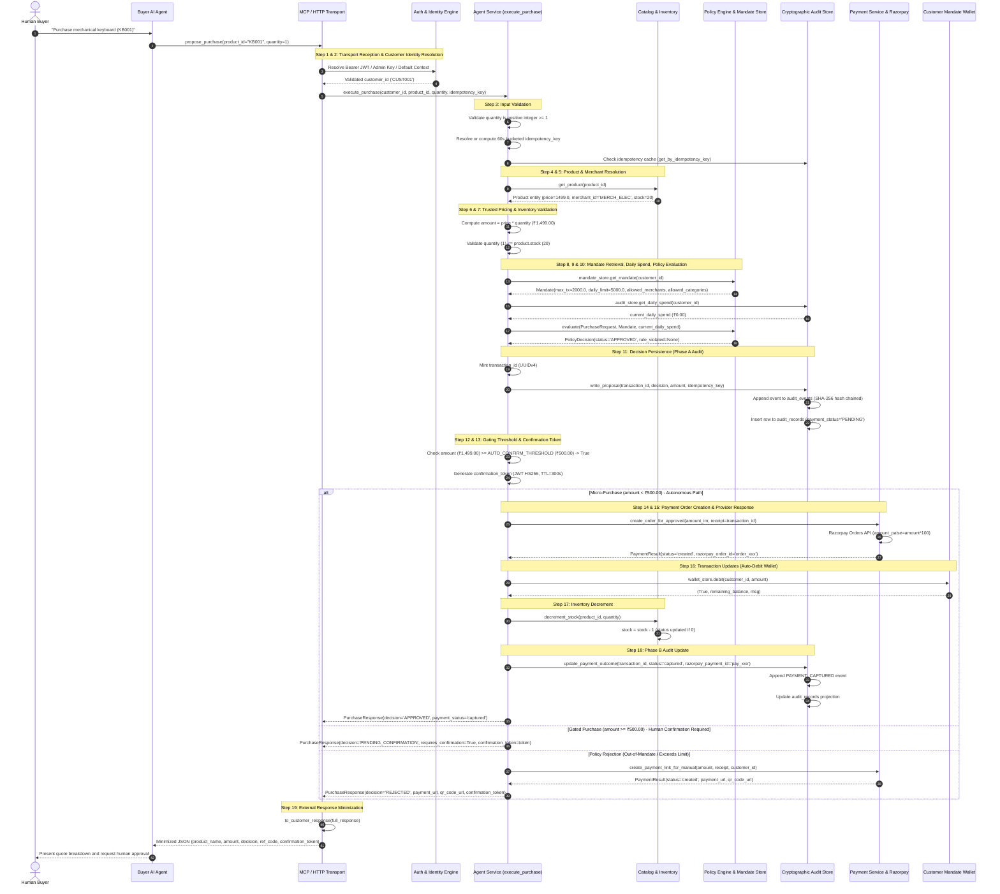
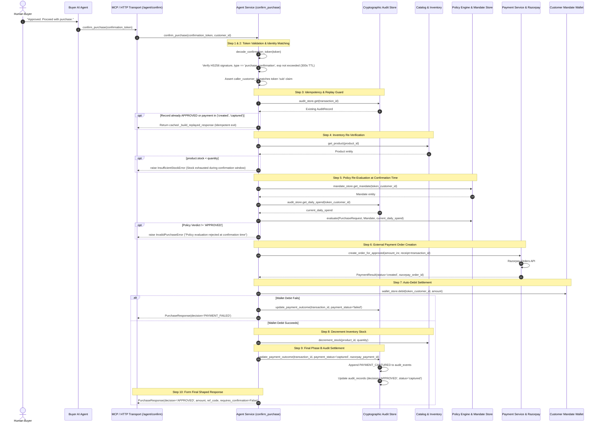
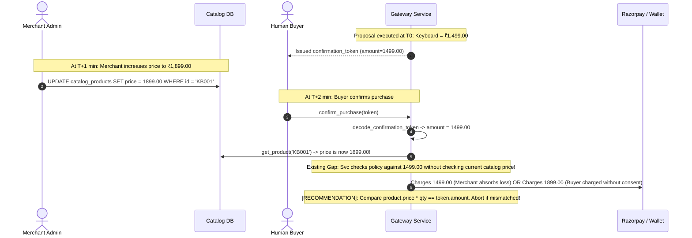
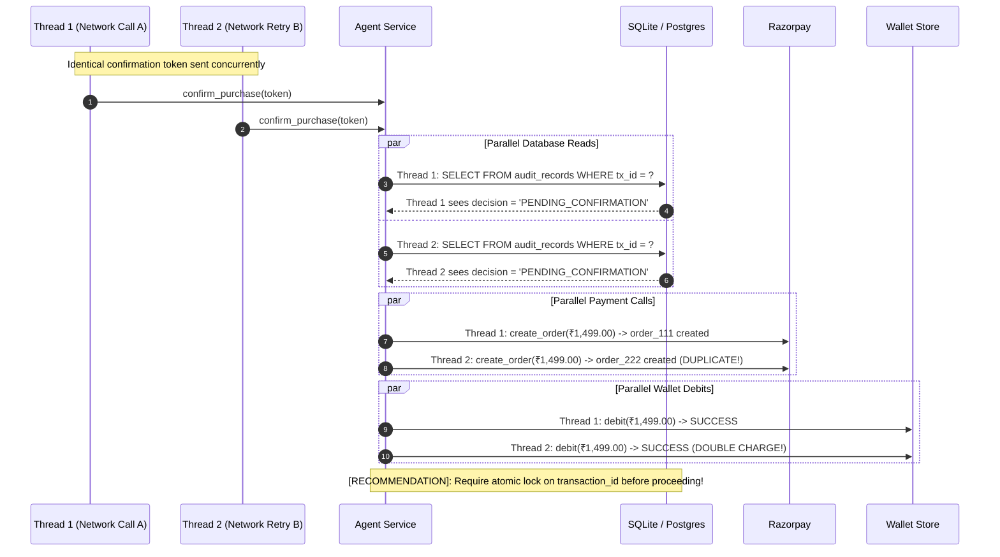
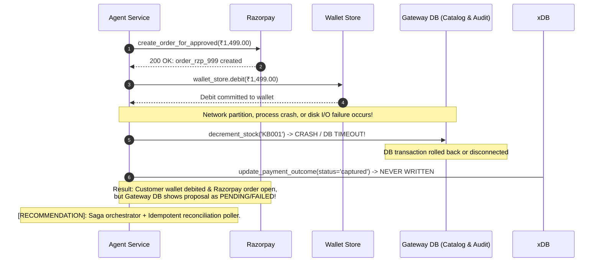

# Purchase Flow Analysis: Proposal, Gated Confirmation, and Failure Modes

> **Document Status**: Comprehensive Architecture Analysis (Phase 0)  
> **Target Scope**: End-to-End Proposal Lifecycle, Gated Confirmation Lifecycle, Race Conditions, and Resiliency Verification  
> **Source Evidence Base**: `app/agent/service.py`, `app/agent/router.py`, `app/mcp/tools.py`, `app/mcp/server.py`, `app/policy/engine.py`, `app/catalog/service.py`, `app/audit/store.py`, `app/wallet/store.py`, `app/payment/service.py`  
> **Classification Framework**: `[VERIFIED]` (derived directly from inspected source code/tests), `[INFERRED]` (logical deduction from architecture patterns), `[ASSUMPTION]` (hypothesized system condition), `[RECOMMENDATION]` (prescriptive mitigation for future phases)

---

## 1. Executive Summary & Architecture Overview

The **Agentic Commerce Gateway** bridges autonomous AI shopping agents (e.g., Claude Desktop, custom buyer agents) and merchant-side commerce execution rails. The gateway enforces **bounded, deterministic policy constraints** that no external AI agent can expand or bypass.

Key architectural boundaries verified in the codebase:
- **Untrusted Agent Intent `[VERIFIED]`**: External AI agents may propose item SKU (`product_id`) and `quantity`, but can never dictate unit price, total transaction amount, merchant identity, customer identity, or policy verdict.
- **Authoritative Gateway Pricing `[VERIFIED]`**: Product catalog lookups, merchant bindings, trusted server-side price computation (`price × quantity`), inventory stock checks, and customer mandate limit evaluations are executed exclusively server-side.
- **Two-Step Human Gating Threshold (`AUTO_CONFIRM_THRESHOLD = ₹500.00`) `[VERIFIED]`**: Purchases below ₹500 with valid policy approval execute autonomously. Purchases $\ge$ ₹500 automatically halt in a `PENDING_CONFIRMATION` state and issue a time-bounded (5-minute TTL) cryptographically signed JWT `confirmation_token` requiring explicit human authorization.
- **Graceful Escalation for Out-of-Mandate Purchases `[VERIFIED]`**: Proposals rejected by policy (e.g., amount exceeding mandate limit) escalate gracefully by generating a dedicated Razorpay hosted checkout URL and dynamic UPI QR code, allowing the human buyer to complete payment manually via their personal banking app.

---

## 2. Complete Proposal Lifecycle Analysis: The 19-Step Trace

The following ordered sequence details the exact execution path across `app/agent/router.py`, `app/mcp/tools.py`, `app/mcp/server.py`, and `app/agent/service.py:execute_purchase`.



### Detailed Trace of the 19 Steps

1. **MCP Request Reception `[VERIFIED]`**:
   - Inbound request arrives via HTTP REST (`POST /agent/purchase` in [`app/agent/router.py#L28-L76`](file:///d:/agentic-commerce-gateway/app/agent/router.py#L28-L76)), local stdio MCP (`propose_purchase` in [`app/mcp/tools.py#L242-L282`](file:///d:/agentic-commerce-gateway/app/mcp/tools.py#L242-L282)), or remote Streamable HTTP MCP (`propose_purchase_remote_handler` in [`app/mcp/tools.py#L320-L345`](file:///d:/agentic-commerce-gateway/app/mcp/tools.py#L320-L345)).
2. **Customer Identity Resolution `[VERIFIED]`**:
   - *Remote MCP*: `McpAuthMiddleware` in [`app/mcp/server.py#L39-L95`](file:///d:/agentic-commerce-gateway/app/mcp/server.py#L39-L95) validates the incoming OAuth 2.1 JWT Bearer token against `JWT_SECRET`, extracts the verified `sub` claim, and binds it to context variable `authenticated_customer_id`. The remote tool handler strictly ignores any client-supplied customer ID.
   - *HTTP REST*: `verify_agent_or_admin_auth` in [`app/auth.py#L72-L120`](file:///d:/agentic-commerce-gateway/app/auth.py#L72-L120) checks whether authentication is an agent OAuth Bearer token (forcing `customer_id = auth["customer_id"]`) or an admin API key (permitting explicit `customer_id` from the payload).
   - *Stdio MCP*: Falls back to the parameter or default customer `"CUST001"`.
3. **Input Validation `[VERIFIED]`**:
   - In [`app/agent/service.py#L239-L240`](file:///d:/agentic-commerce-gateway/app/agent/service.py#L239-L240), `quantity` is asserted: `if not isinstance(quantity, int) or quantity < 1: raise InvalidPurchaseError(...)`.
   - In [`app/agent/service.py#L243-L251`](file:///d:/agentic-commerce-gateway/app/agent/service.py#L243-L251), internal idempotency key is resolved. If omitted, `generate_bucketed_idempotency_key` creates a deterministic SHA-256 hash bucketed to the nearest 60-second window. The audit store is queried via `audit_store.get_by_idempotency_key(idempotency_key)`: if present, the cached response is immediately returned (`_build_replayed_response`), terminating execution without side effects.
4. **Product Resolution (Catalog Lookup) `[VERIFIED]`**:
   - In [`app/agent/service.py#L254`](file:///d:/agentic-commerce-gateway/app/agent/service.py#L254), calls `product = get_product(product_id)`.
   - In [`app/catalog/service.py#L237-L254`](file:///d:/agentic-commerce-gateway/app/catalog/service.py#L237-L254), queries `catalog_products`. If no record matches, raises `ProductNotFoundError(product_id)` (mapped to HTTP 404 in REST router).
5. **Merchant Resolution `[VERIFIED]`**:
   - `merchant_id` is extracted strictly from the catalog record: `product.merchant_id` ([`app/agent/service.py#L281, L321`](file:///d:/agentic-commerce-gateway/app/agent/service.py#L281-L321)). The caller cannot specify or spoof the merchant.
6. **Trusted Pricing `[VERIFIED]`**:
   - Total amount is computed server-side: `amount = product.price * quantity` ([`app/agent/service.py#L270`](file:///d:/agentic-commerce-gateway/app/agent/service.py#L270)). Neither `AgentPurchaseRequest` nor MCP tools accept a client-provided amount.
7. **Inventory Validation (Stock Check) `[VERIFIED]`**:
   - In [`app/agent/service.py#L257-L262`](file:///d:/agentic-commerce-gateway/app/agent/service.py#L257-L262), `if quantity > product.stock: raise InsufficientStockError(...)` (mapped to HTTP 400).
8. **Mandate Retrieval `[VERIFIED]`**:
   - In [`app/agent/service.py#L265-L267`](file:///d:/agentic-commerce-gateway/app/agent/service.py#L265-L267), calls `mandate = mandate_store.get_mandate(customer_id)`. If missing, raises `MandateNotFoundError(customer_id)` (mapped to HTTP 404).
9. **Spending Calculation `[VERIFIED]`**:
   - In [`app/agent/service.py#L273`](file:///d:/agentic-commerce-gateway/app/agent/service.py#L273), calls `current_daily_spend = audit_store.get_daily_spend(customer_id)`.
   - In [`app/audit/store.py#L375-L403`](file:///d:/agentic-commerce-gateway/app/audit/store.py#L375-L403), queries `SELECT SUM(amount) FROM audit_records WHERE customer_id = ? AND (decision = 'APPROVED' OR (decision = 'PENDING_CONFIRMATION' AND payment_status = 'created')) AND timestamp LIKE ?;` for the current UTC date.
10. **Policy Evaluation `[VERIFIED]`**:
    - In [`app/agent/service.py#L276-L284`](file:///d:/agentic-commerce-gateway/app/agent/service.py#L276-L284), builds `PurchaseRequest` and calls pure evaluation function `evaluate(purchase_request, mandate, current_daily_spend)` in [`app/policy/engine.py#L5-L91`](file:///d:/agentic-commerce-gateway/app/policy/engine.py#L5-L91).
    - Sequential fail-fast checks:
      1. `customer_id` match.
      2. Mandate expiry (`is_expired()`).
      3. Merchant authorization (`allowed_merchants`, case-insensitive).
      4. Category authorization (`allowed_categories`, case-insensitive).
      5. Transaction amount cap (`amount <= mandate.max_transaction_amount`).
      6. Daily cumulative spend cap (`current_daily_spend + amount <= mandate.daily_limit`).
11. **Decision Persistence (Phase A Audit) `[VERIFIED]`**:
    - In [`app/agent/service.py#L316-L333`](file:///d:/agentic-commerce-gateway/app/agent/service.py#L316-L333), calls `audit_store.write_proposal(...)`.
    - Appends a cryptographically chained block to `audit_events` with SHA-256 hash chaining (`prev_hash`, `event_hash`).
    - Writes the mutable projection row into `audit_records` with initial payment status (`PENDING` if approved, otherwise `None`).
12. **Confirmation Requirements Check `[VERIFIED]`**:
    - In [`app/agent/service.py#L290-L295`](file:///d:/agentic-commerce-gateway/app/agent/service.py#L290-L295):
      ```python
      requires_confirmation = (
          decision.status == "APPROVED"
          and amount >= AUTO_CONFIRM_THRESHOLD  # 500.0
      )
      initial_decision_status = "PENDING_CONFIRMATION" if requires_confirmation else decision.status
      ```
13. **Approval-Token Generation `[VERIFIED]`**:
    - In [`app/agent/service.py#L305-L313`](file:///d:/agentic-commerce-gateway/app/agent/service.py#L305-L313), if `requires_confirmation` is true (or if rejected), `generate_confirmation_token` issues an HMAC-SHA256 JWT signed with `JWT_SECRET`, containing `sub`, `product_id`, `quantity`, `amount`, `transaction_id`, `idempotency_key`, `type="purchase_confirmation"`, and `exp = now + 300s` (5 minutes).
14. **Payment Order Creation `[VERIFIED]`**:
    - For autonomous micro-purchases (`decision == APPROVED` and `amount < 500.0`): calls `create_order_for_approved` ([`app/agent/service.py#L343`](file:///d:/agentic-commerce-gateway/app/agent/service.py#L343), [`app/payment/service.py#L154-L222`](file:///d:/agentic-commerce-gateway/app/payment/service.py#L154-L222)).
    - Calls Razorpay Test Mode Orders API (`amount_paise = int(round(amount * 100))`, `receipt=transaction_id`).
15. **Payment-Provider Response Evaluation `[VERIFIED]`**:
    - In [`app/agent/service.py#L349-L365`](file:///d:/agentic-commerce-gateway/app/agent/service.py#L349-L365), checks `payment_result.status`. If `"failed"` or `"status_unknown"`, transitions `final_decision = "PAYMENT_FAILED"` and calls Phase B audit update.
16. **Transaction Updates (Auto-Debit Wallet Settlement) `[VERIFIED]`**:
    - In [`app/agent/service.py#L367-L378`](file:///d:/agentic-commerce-gateway/app/agent/service.py#L367-L378), calls `wallet_store.debit(customer_id, amount)`. If the customer's balance is insufficient, sets `final_decision = "PAYMENT_FAILED"` and halts without decrementing stock.
    - If successful, sets `payment_result.status = "captured"`, assigns tracking ID `pay_mandate_{uuid}`, and sets payment method to `"auto_debit"`.
17. **Inventory Updates `[VERIFIED]`**:
    - In [`app/agent/service.py#L380`](file:///d:/agentic-commerce-gateway/app/agent/service.py#L380), calls `decrement_stock(product.id, quantity)`.
    - In [`app/catalog/service.py#L298-L325`](file:///d:/agentic-commerce-gateway/app/catalog/service.py#L298-L325), updates `catalog_products.stock = stock - quantity` and updates status to `"OUT_OF_STOCK"` if new stock equals 0.
18. **Audit Recording (Phase B Update) `[VERIFIED]`**:
    - In [`app/agent/service.py#L389-L394`](file:///d:/agentic-commerce-gateway/app/agent/service.py#L389-L394), calls `audit_store.update_payment_outcome(transaction_id, payment_status="captured", razorpay_order_id=..., razorpay_payment_id=...)`.
    - Appends `PAYMENT_CAPTURED` event to append-only `audit_events` and updates row projection in `audit_records`.
19. **External Response Minimization `[VERIFIED]`**:
    - Returns full `PurchaseResponse` from `execute_purchase`.
    - In MCP handlers ([`app/mcp/tools.py#L50-L95`](file:///d:/agentic-commerce-gateway/app/mcp/tools.py#L50-L95)), passes response through `to_customer_response`:
      - Suppresses raw `transaction_id` and internal `razorpay_order_id`.
      - Exposes human reference code `REF-XXXX` (last 8 characters of UUID) only when paid/created.
      - Returns `decision`, `product_name`, `amount`, `reason`, `payment_url`, `qr_code_url`, `requires_confirmation`, and `confirmation_token`.

---

## 3. Complete Confirmation Lifecycle Analysis: `confirm_purchase`

The confirmation flow executes when a human user authorizes a gated proposal ($\ge$ ₹500) and the Buyer AI Agent invokes `confirm_purchase` with the `confirmation_token`.



### Critical Confirmation Mechanics `[VERIFIED]`

1. **Cryptographic Token Binding ([`app/agent/service.py#L440-L452`](file:///d:/agentic-commerce-gateway/app/agent/service.py#L440-L452))**:
   - The token encapsulates: `sub`, `product_id`, `quantity`, `amount`, `transaction_id`, `idempotency_key`, `iat`, `exp`.
   - Any tampering with the transaction amount or product ID produces an immediate `jwt.InvalidSignatureError`.
   - Expiration (> 300 seconds) raises `jwt.ExpiredSignatureError` (translated to `InvalidPurchaseError: Confirmation token has expired`).
   - If an authenticated customer ID is present in the transport request context, it must match the `sub` claim exactly. Cross-customer confirmation hijacking is rejected.
2. **Replay & Double-Spend Guard ([`app/agent/service.py#L459-L466`](file:///d:/agentic-commerce-gateway/app/agent/service.py#L459-L466))**:
   - Checks `audit_store.get(transaction_id)`. If the record has already reached `decision == "APPROVED"` or `payment_status in ("created", "captured")`, the service returns `_build_replayed_response(existing_record)` without invoking Razorpay or wallet debit again.
   - Verified by unit test `test_confirmation_token_replay_is_idempotent` in [`tests/test_agent_router.py#L333-L376`](file:///d:/agentic-commerce-gateway/tests/test_agent_router.py#L333-L376).
3. **Mandate Re-Evaluation at Confirmation Time ([`app/agent/service.py#L476-L493`](file:///d:/agentic-commerce-gateway/app/agent/service.py#L476-L493))**:
   - **Crucial Safety Guarantee**: The gateway does *not* blindly trust the proposal verdict from 4 minutes prior.
   - It re-fetches the current mandate from `mandate_store` and recalculates `current_daily_spend`. If the customer lowered their limit, revoked the mandate, or exhausted their daily budget on another purchase during the confirmation window, confirmation is strictly aborted with an error.
   - Verified by unit test `test_confirmation_policy_re_evaluation_rejects_if_mandate_revoked` in [`tests/test_agent_router.py#L378-L418`](file:///d:/agentic-commerce-gateway/tests/test_agent_router.py#L378-L418).

---

## 4. Comprehensive Edge-Case & Failure Mode Analysis

The table below outlines real-world edge cases, existing codebase handling, identified vulnerability gaps, and architectural recommendations:

| Failure Mode / Edge Case | Existing Codebase Behavior | Architecture Gap / Vulnerability | Classification | Target Mitigation |
| :--- | :--- | :--- | :--- | :--- |
| **1. Stale Pricing**<br>*(Catalog price changes between proposal & confirmation)* | Token locks `payload["amount"]`. `confirm_purchase` verifies `evaluate` using the *token amount*, but does *not* check if `product.price * quantity == token["amount"]`. | A merchant price hike or flash sale price reduction during the 5-min confirmation window goes undetected; buyer pays outdated price. | `[VERIFIED]` Gap | Add strict catalog price staleness check in `confirm_purchase`: compare `product.price * quantity` against `token["amount"]`. Fail with `STALE_PRICE_DETECTED` if changed. |
| **2. Mandate Revocation / Modification after Proposal** | `confirm_purchase` re-fetches mandate and re-runs `evaluate()`. If mandate was revoked or limit reduced below amount, fails with `InvalidPurchaseError`. | Stock was not decremented and payment was not called, which is correct. However, audit record remains in `PENDING_CONFIRMATION` without an explicit `TERMINATED` event. | `[VERIFIED]` Handled,<br>`[RECOMMENDATION]` Audit Event | Emit explicit `CONFIRMATION_REJECTED` event into `audit_events` to close out the pending proposal lifecycle. |
| **3. Token Replay (Sequential)** | First call settles transaction; second call with identical token detects `existing_record.decision == "APPROVED"` and returns cached response. | No double-charge occurs in sequential replay. | `[VERIFIED]` Protected | Maintain existing idempotent short-circuiting. |
| **4. Concurrent Confirmation Race Conditions**<br>*(Two identical confirmation requests processed simultaneously)* | Both threads execute `audit_store.get(transaction_id)` concurrently before either writes Phase B settlement. | **High Risk**: Check-then-act race. Both threads could call Razorpay `create_order` and both could invoke `wallet_store.debit`, resulting in double-debiting. | `[VERIFIED]` Concurrency Risk | Implement distributed lock / row-level lock (`SELECT ... FOR UPDATE` in Postgres) or atomic CAS `UPDATE audit_records SET decision='PROCESSING' WHERE transaction_id=? AND decision='PENDING_CONFIRMATION'`. |
| **5. Inventory Exhaustion during Confirmation Window** | `confirm_purchase` re-checks `product.stock < quantity`. If another buyer bought the last item, raises `InsufficientStockError`. | Proper rejection occurs before payment. However, inventory was not *reserved* during the 5-min proposal window, leading to high confirmation drop-offs. | `[VERIFIED]` Handled,<br>`[RECOMMENDATION]` Reservations | Introduce temporary inventory reservations (TTL = 300s) during proposal to guarantee fulfillment upon confirmation. |
| **6. Payment Timeout / Network Partition** | Razorpay HTTP timeout triggers `except Exception` in `create_order_for_approved`, returning `status="failed"` or `"status_unknown"`. Audit recorded as `PAYMENT_FAILED`. | If Razorpay actually created the order upstream before the network socket broke, the gateway treats it as failed, causing orphan orders on Razorpay. | `[VERIFIED]` Gap | Implement automated payment status reconciliation job polling Razorpay Orders API by `receipt` before declaring failure. |
| **7. Database Crash After Payment Execution** | Payment succeeds on Razorpay and wallet is debited, but DB crashes during `decrement_stock` or `update_payment_outcome`. | **Dual Write Problem**: External payment succeeded, but local DB rolled back or was uncommitted. Customer was charged, but catalog and audit reflect failure. | `[VERIFIED]` Gap | Implement transactional Outbox / Saga pattern: write payment intent to DB first, execute provider, update outcome with durable retry worker. |

---

## 5. Detailed Mermaid Diagrams for Failure Modes

### Failure Mode A: Stale Pricing Detection Gap



### Failure Mode B: Concurrent Confirmation Race Condition



### Failure Mode C: Dual-Write Failure After External Payment Execution



---

## 6. Synthesis & Phase 1 Readiness Recommendations

1. **Mandate Atomic Step-Up Locking `[RECOMMENDATION]`**:
   Transition confirmation handling to an atomic state transition:
   ```sql
   UPDATE audit_records 
   SET decision = 'CONFIRMING' 
   WHERE transaction_id = :tx_id AND decision = 'PENDING_CONFIRMATION';
   ```
   If row count is 0, the request is rejected immediately as duplicate/in-progress.
2. **Catalog Price Staleness Guard `[RECOMMENDATION]`**:
   In `confirm_purchase`, compare `token["amount"]` against current `product.price * quantity`. If the catalog price has shifted, abort with machine-readable error code `STALE_PRICE_DETECTED`.
3. **Inventory Reservation Engine `[RECOMMENDATION]`**:
   Introduce a `spending_reservations` and `inventory_reservations` table. Instead of immediate stock decrement upon proposal, hold a soft lock on stock with a 5-minute TTL. Release automatically if the confirmation token expires without approval.
