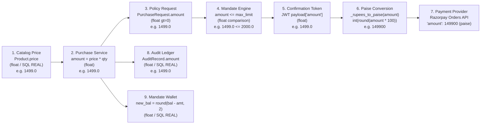
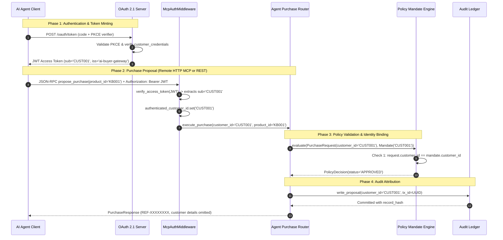
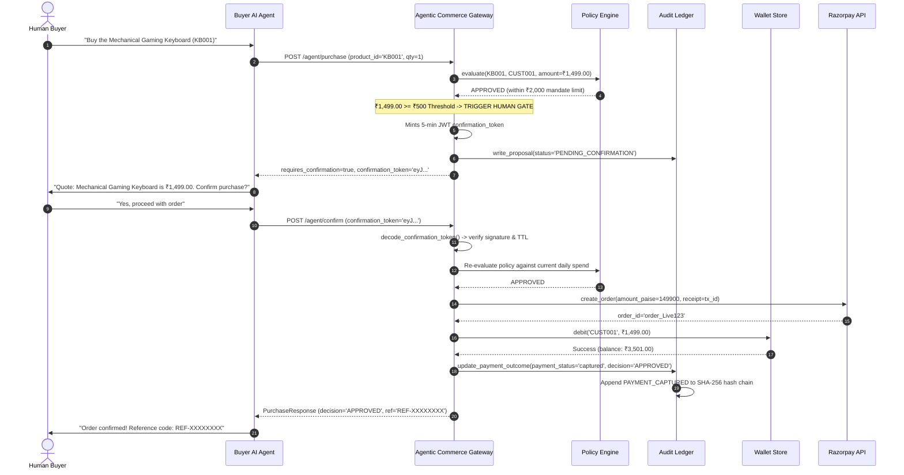
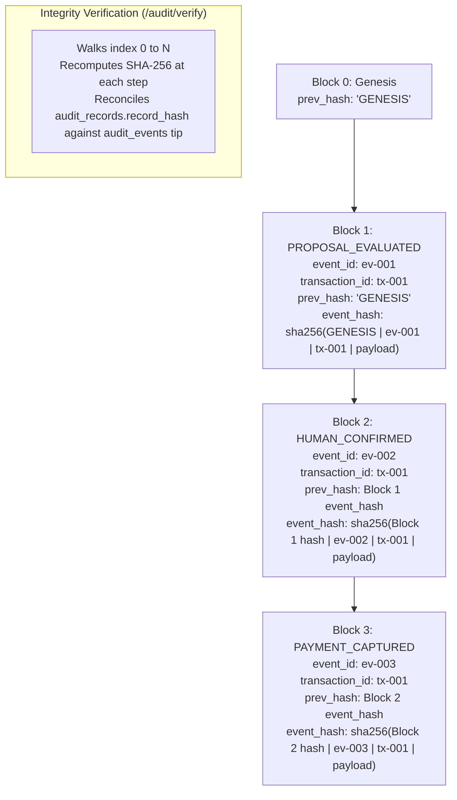

# Gateway Dependency Matrix & Data Flow Analysis

- **Document ID**: `PHASE-0-DOC-04`
- **Revision**: `1.0.0`
- **Status**: `APPROVED / ARCHITECTURAL BASELINE`
- **Author**: System Architect Specialist
- **Timestamp**: `2026-11-09T17:42:00Z`
- **Target Repository**: `d:\agentic-commerce-gateway`

---

## 1. Module Interdependency Matrix

The following matrix documents direct import and call dependencies across the internal codebase modules. High cohesion is maintained in the policy engine, while the purchase orchestrator (`app.agent.service`) acts as the central coordinator.

| Module | `main` | `auth` | `agent` | `policy` | `mcp` | `audit` | `payment` | `catalog` | `wallet` | `oauth` | `admin` | `db` |
|---|:---:|:---:|:---:|:---:|:---:|:---:|:---:|:---:|:---:|:---:|:---:|:---:|
| **`app/main.py`** | — | ✕ | ✕ | ✕ | ✕ | ✕ | ✕ | ✕ | ✕ | ✕ | ✕ | ✕ |
| **`app/auth.py`** | — | — | ✕ | ✕ | ✕ | ✕ | ✕ | ✕ | ✕ | **DEP** | ✕ | ✕ |
| **`app/agent/service.py`** | ✕ | ✕ | — | **DEP** | ✕ | **DEP** | **DEP** | **DEP** | **DEP** | **DEP** | ✕ | ✕ |
| **`app/agent/router.py`** | ✕ | **DEP** | **DEP** | ✕ | ✕ | ✕ | ✕ | ✕ | ✕ | ✕ | ✕ | ✕ |
| **`app/policy/engine.py`** | ✕ | ✕ | ✕ | — | ✕ | ✕ | ✕ | ✕ | ✕ | ✕ | ✕ | ✕ |
| **`app/policy/store.py`** | ✕ | ✕ | ✕ | **DEP** | ✕ | ✕ | ✕ | ✕ | ✕ | ✕ | ✕ | **DEP** |
| **`app/mcp/server.py`** | ✕ | ✕ | ✕ | ✕ | — | ✕ | ✕ | ✕ | ✕ | **DEP** | ✕ | ✕ |
| **`app/mcp/tools.py`** | ✕ | ✕ | **DEP** | **DEP** | ✕ | **DEP** | ✕ | **DEP** | ✕ | **DEP** | ✕ | ✕ |
| **`app/audit/store.py`** | ✕ | ✕ | ✕ | ✕ | ✕ | — | ✕ | ✕ | ✕ | ✕ | ✕ | **DEP** |
| **`app/audit/router.py`** | ✕ | **DEP** | ✕ | ✕ | ✕ | **DEP** | ✕ | ✕ | ✕ | ✕ | ✕ | ✕ |
| **`app/payment/service.py`** | ✕ | ✕ | ✕ | ✕ | ✕ | ✕ | — | ✕ | **DEP** | ✕ | ✕ | ✕ |
| **`app/payment/router.py`** | ✕ | **DEP** | ✕ | ✕ | ✕ | **DEP** | **DEP** | **DEP** | ✕ | ✕ | ✕ | ✕ |
| **`app/catalog/service.py`** | ✕ | ✕ | ✕ | ✕ | ✕ | ✕ | ✕ | — | ✕ | ✕ | ✕ | **DEP** |
| **`app/catalog/router.py`** | ✕ | **DEP** | ✕ | ✕ | ✕ | ✕ | ✕ | **DEP** | ✕ | ✕ | ✕ | ✕ |
| **`app/wallet/store.py`** | ✕ | ✕ | ✕ | **DEP** | ✕ | ✕ | ✕ | ✕ | — | ✕ | ✕ | **DEP** |
| **`app/oauth/router.py`** | ✕ | ✕ | ✕ | **DEP** | ✕ | ✕ | ✕ | ✕ | ✕ | **DEP** | ✕ | ✕ |
| **`app/oauth/store.py`** | ✕ | ✕ | ✕ | ✕ | ✕ | ✕ | ✕ | ✕ | ✕ | **DEP** | ✕ | **DEP** |
| **`app/admin/router.py`** | ✕ | **DEP** | ✕ | **DEP** | ✕ | ✕ | ✕ | ✕ | ✕ | **DEP** | — | ✕ |
| **`app/db.py`** | ✕ | ✕ | ✕ | ✕ | ✕ | ✕ | ✕ | ✕ | ✕ | ✕ | ✕ | — |

*Legend: `DEP` indicates that the row module depends on and calls the column module. `✕` indicates no direct dependency.*

### Architectural Dependency Inversion Analysis
- **Domain Independence**: `app/policy/engine.py` is completely isolated; it has zero dependencies on databases, HTTP libraries, or payment gateways.
- **Service Orchestration**: `app/agent/service.py` functions as the composite domain coordinator, delegating policy evaluation to `policy.engine`, inventory checks to `catalog.service`, settlement to `payment.service` / `wallet.store`, and audit logging to `audit.store`.
- **Circular Dependencies**: Zero circular package imports exist across the codebase.

---

## 2. Monetary Data Flow & Precision Trace

### 2.1 End-to-End Monetary Transformation Pipeline

### 2.2 Monetary Field Specification Table

| Stage | Data Object & Field | Code Location | Data Type | Currency Unit | Precision Risk / Behavior |
|---|---|---|---|---|---|
| **1. Catalog** | `Product.price` / `catalog_products.price` | [`app/catalog/models.py#L13`](file:///d:/agentic-commerce-gateway/app/catalog/models.py#L13) | `float` / SQL `REAL` | INR (₹) | Potential float representation artifacts for fractional prices. |
| **2. Purchase Service** | `amount = product.price * quantity` | [`app/agent/service.py#L270`](file:///d:/agentic-commerce-gateway/app/agent/service.py#L270) | `float` | INR (₹) | Standard IEEE 754 multiplication. |
| **3. Policy Request** | `PurchaseRequest.amount` | [`app/policy/requests.py#L28`](file:///d:/agentic-commerce-gateway/app/policy/requests.py#L28) | `float` (`gt=0`) | INR (₹) | Pre-computed total; never recomputed by policy engine. |
| **4. Mandate Comparison** | `mandate.max_transaction_amount` & `daily_limit` | [`app/policy/engine.py#L59-L80`](file:///d:/agentic-commerce-gateway/app/policy/engine.py#L59-L80) | `float` | INR (₹) | Inclusive comparison (`amount > max_transaction_amount`). |
| **5. Confirmation Token** | `payload["amount"]` in HS256 JWT | [`app/agent/service.py#L75`](file:///d:/agentic-commerce-gateway/app/agent/service.py#L75) | `float` | INR (₹) | Serialized in JSON token payload. |
| **6. Payment Gateway** | `amount_paise = _rupees_to_paise(amount_inr)` | [`app/payment/service.py#L22`](file:///d:/agentic-commerce-gateway/app/payment/service.py#L22) | `int` | INR (Paise) | `int(round(amount_inr * 100))`. Correctly conforms to Razorpay API specs. |
| **7. External Razorpay** | `payload["amount"]` | [`app/payment/razorpay_client.py#L59`](file:///d:/agentic-commerce-gateway/app/payment/razorpay_client.py#L59) | `int` | INR (Paise) | Integer paise accepted by Razorpay Orders & Payment Links API. |
| **8. Audit Store** | `AuditRecord.amount` / `audit_records.amount` | [`app/audit/models.py#L41`](file:///d:/agentic-commerce-gateway/app/audit/models.py#L41) | `float` / SQL `REAL` | INR (₹) | Formatted as `f"{amount:.2f}"` in cryptographic record hashes. |
| **9. Mandate Wallet** | `customer_wallets.balance` | [`app/wallet/store.py#L119`](file:///d:/agentic-commerce-gateway/app/wallet/store.py#L119) | `float` / SQL `REAL` | INR (₹) | Calculated via `round(current_bal - amount, 2)`. |

### 2.3 Evaluation of Currency Precision (Integer Paise for INR)
- **Current Posture**: The application switches between `float` (rupees) in domain services and `int` (paise) at the payment boundary.
- **Architectural Risk**:
  - In Indian banking systems, sub-rupee fractional currency is denominated in integer paise (1 Rupee = 100 Paise).
  - While existing demo prices are whole integers (₹1,499.00, ₹4,999.00) or clean decimals (₹179.00, ₹349.00), floating-point operations can introduce cumulative rounding errors (e.g. `0.1 + 0.2 = 0.30000000000000004`).
  - Daily spend accumulation `SUM(amount)` on SQL `REAL` can diverge slightly from exact paise totals over thousands of transactions.
- **Architectural Recommendation**: Standardize internal storage and policy arithmetic on either Python `Decimal` or pure `int` (paise), converting to rupees strictly at the presentation layer. `[RECOMMENDATION]`

---

## 3. Identity Data Flow & Anti-Spoofing Analysis

### 3.1 Identity Lifecycle & Provenance

### 3.2 Identity Trace Across System Boundaries

| Boundary | Identity Representation | Resolution Mechanism | Security / Anti-Spoofing Guarantee |
|---|---|---|---|
| **1. OAuth 2.1 Provider** | `customer_id` (`CUST001`) | Authenticates username/password in `customer_credentials` or Google SSO callback | Salted PBKDF2 verification; PKCE protects code exchange. |
| **2. Access Token** | `payload["sub"]` | Signed HS256 JWT minted by `create_access_token` | Tamper-proof signature verification; 1-hour expiration. |
| **3. Remote MCP Transport** | `authenticated_customer_id` | `McpAuthMiddleware` decodes token and sets contextvar | AI agent cannot specify `customer_id` in remote tool call. |
| **4. REST API Endpoint** | `effective_customer_id` | [`app/agent/router.py#L44-L50`](file:///d:/agentic-commerce-gateway/app/agent/router.py#L44-L50) checks `auth["auth_type"]` | If `auth_type == "oauth"`, strictly binds to `auth["customer_id"]`. Client-supplied `customer_id` is discarded. |
| **5. Policy Engine** | `PurchaseRequest.customer_id` | Checked against `Mandate.customer_id` | Fail-fast Rule 1 rejects immediately on mismatch (`CUSTOMER_MISMATCH`). |
| **6. Confirmation Token** | `payload["sub"]` | Signed HS256 JWT minted by `generate_confirmation_token` | Token binds original `customer_id`. Checked against caller ID at confirmation time. |
| **7. Payment Provider** | `notes["customer_id"]` | Passed to Razorpay API in metadata notes dictionary | Immutable tracking reference in Razorpay Dashboard. |
| **8. Audit Ledger** | `audit_records.customer_id` | Persisted in relational and cryptographic event tables | Non-repudiable audit trail linking action to verified customer. |

### 3.3 Customer ID Spoofing Threat Analysis

| Threat Vector | Attack Scenario | Gateway Defense Mechanism | Residual Risk Level |
|---|---|---|---|
| **Vector 1: Remote MCP Parameter Injection** | Malicious agent submits `customer_id="CUST002"` to debit another user's balance. | [`register_remote_tools`](file:///d:/agentic-commerce-gateway/app/mcp/tools.py#L906) does **not** accept `customer_id` as a parameter. It forces `authenticated_customer_id.get()` from the verified OAuth JWT. | **NONE / MITIGATED** |
| **Vector 2: REST Payload Spoofing** | Attacker holding valid token for `CUST001` sends POST `/agent/purchase` with `{"customer_id": "CUST002"}`. | [`app/agent/router.py#L46`](file:///d:/agentic-commerce-gateway/app/agent/router.py#L46) overrides request body: `effective_customer_id = auth["customer_id"]`. `CUST002` is ignored. | **NONE / MITIGATED** |
| **Vector 3: Stdio MCP Parameter Tampering** | Local user specifies `customer_id="CUST002"` in Claude Desktop. | Stdio transport accepts `customer_id` parameter without token. Intended strictly for single-user local debugging. | **LOW (LOCAL ONLY)** |
| **Vector 4: Confirmation Token Theft** | Attacker intercepts 5-minute confirmation token generated for `CUST001` and calls `/agent/confirm` using `CUST002` credentials. | [`app/agent/service.py#L448-L451`](file:///d:/agentic-commerce-gateway/app/agent/service.py#L448-L451) asserts `caller_customer_id == payload["sub"]`. Rejects with `InvalidPurchaseError`. | **NONE / MITIGATED** |

---

## 4. Transaction Data Flow & Field Provenance

### 4.1 Authoritative Field Registry

| Field Name | Authoritative Generator | Primary Storage Table / Token | Format / Cryptographic Algorithm | Purpose & Scope |
|---|---|---|---|---|
| `transaction_id` | [`app/agent/service.py#L287`](file:///d:/agentic-commerce-gateway/app/agent/service.py#L287) (`str(uuid4())`) | `audit_records.transaction_id`, `audit_events.transaction_id` | UUID v4 (36-char string) | Universal cross-system correlation key; mapped to Razorpay `receipt`. |
| `idempotency_key` | Client or [`app/agent/service.py#L55`](file:///d:/agentic-commerce-gateway/app/agent/service.py#L55) | `audit_records.idempotency_key` | SHA-256 (32-char prefix hex) | Prevents duplicate charges from agent retry storms within 60-second buckets. |
| `confirmation_token` | [`app/agent/service.py#L82`](file:///d:/agentic-commerce-gateway/app/agent/service.py#L82) | Ephemeral bearer JWT (client-held) | JWT HS256 (`JWT_SECRET`, 5-min TTL) | Authorizes human confirmation for purchases `>= ₹500` or mandate limit. |
| `razorpay_order_id` | Razorpay Orders API | `audit_records.razorpay_order_id`, `audit_events.payload_json` | String (`order_...` / fallback `order_<receipt>`) | Official payment order tracking identifier from Razorpay. |
| `razorpay_payment_id` | Razorpay Checkout / Auto-debit | `audit_records.razorpay_payment_id`, `audit_events.payload_json` | String (`pay_...` / `pay_mandate_<uuid>`) | Official payment capture identifier indicating finalized fund settlement. |
| `event_hash` | [`app/audit/store.py#L55`](file:///d:/agentic-commerce-gateway/app/audit/store.py#L55) | `audit_events.event_hash` | SHA-256 (64-char hex string) | Cryptographic block hash sealing event log sequentially to `prev_hash`. |

---

## 5. End-to-End Purchase Proposal & Confirmation Lifecycle

---

## 6. Cryptographic Hash Chain Structure

---
*End of Document `04_DEPENDENCY_AND_DATA_FLOW.md`*
