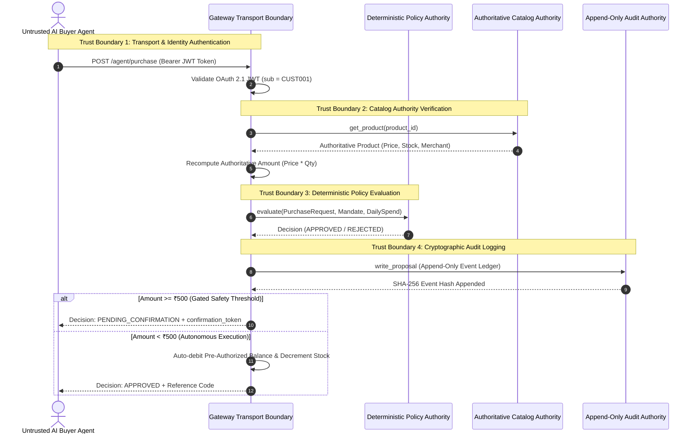
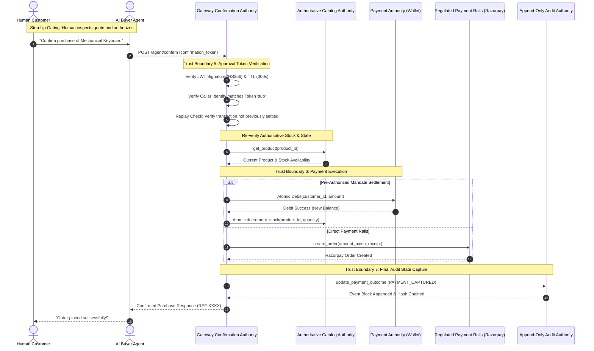
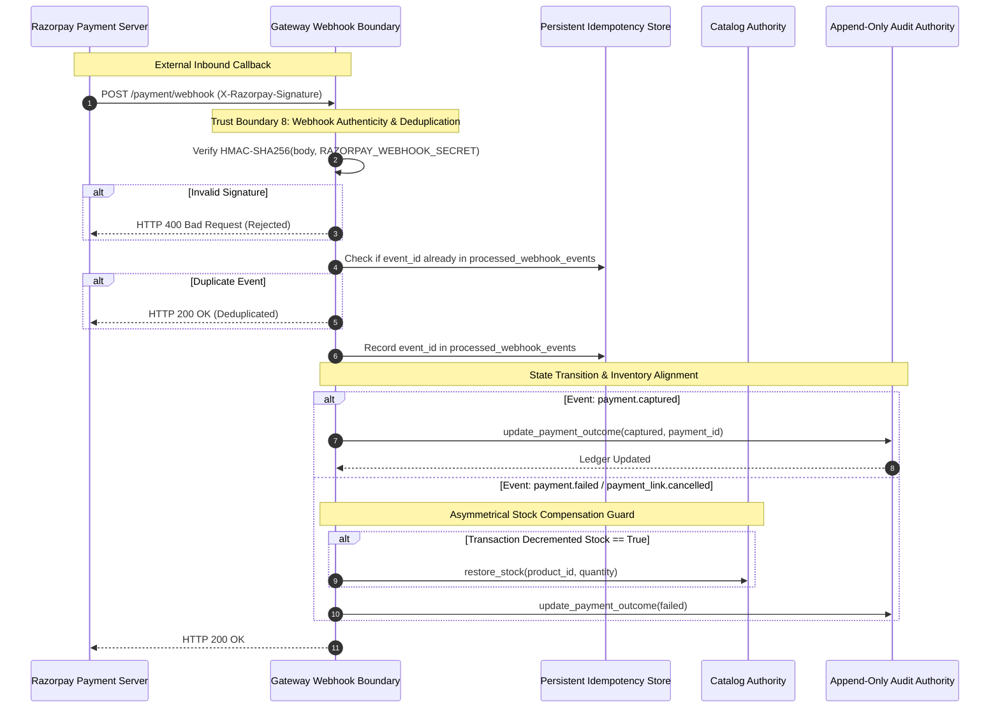

# Security Boundaries & Trust Architecture

**Document Version:** 1.0.0  
**Phase:** Phase 0 — Security Architecture & Threat Analysis  
**Classification:** Defensive Security Documentation  
**Status:** Canonical & Evidence-Backed  
**Scope:** Trust Domains, Authority Boundaries, LLM Isolation, Protocol Transports, and Cryptographic Invariants.

---

## Executive Overview

The **Agentic Commerce Gateway** bridges untrusted probabilistic AI agents, human principals, merchant inventory systems, and regulated payment networks. In this multi-party ecosystem, security failures occur when systems conflate reasoning with authority, or allow untrusted conversational inputs to manipulate deterministic financial state.

This document establishes the **formal trust boundaries**, **exclusive authority ownership**, and the **Seven Inviolable LLM Security Principles** governing the gateway. Every boundary definition and architecture rule is grounded in verified source code implementation (`[VERIFIED]`), protocol derivability (`[INFERRED]`), operational premises (`[ASSUMPTION]`), or prescribed security controls (`[RECOMMENDATION]`).

---

## Explicit Trust Boundaries & Authority Ownership

To prevent privilege escalation, confused deputy attacks, and unauthorized state transitions, authority is compartmentalized across eight exclusive domains. No component may execute actions outside its designated authority.

```
┌────────────────────────────────────────────────────────────────────────────────────────┐
│                                 THE TRUST BOUNDARIES                                   │
├────────────────────────────────┬───────────────────────────────────────────────────────┤
│ Domain Authority               │ Authoritative Sovereign Component                     │
├────────────────────────────────┼───────────────────────────────────────────────────────┤
│ 1. Identity Authority          │ OAuth 2.1 AS (RFC 6749 / RFC 7636 / RFC 9470)        │
│ 2. Catalogue Authority         │ Merchant Database (`catalog_products`)                │
│ 3. Pricing Authority           │ Merchant Authoritative Catalog Engine                 │
│ 4. Mandate Authority           │ Human Customer Sovereign Grant (`customer_mandates`)  │
│ 5. Policy Authority            │ Deterministic Backend Policy Engine                   │
│ 6. Approval Authority          │ Human Step-Up Cryptographic Confirmation              │
│ 7. Payment Authority           │ Razorpay API Rails & Pre-Authorized Auto-Debit Wallet  │
│ 8. Audit Authority             │ Append-Only Cryptographic Hash Ledger (`audit_events`)│
└────────────────────────────────┴───────────────────────────────────────────────────────┘
```

---

### 1. Identity Authority
* **Authoritative Owner:** OAuth 2.1 Authorization Server (`app/oauth/router.py`, `app/oauth/store.py`).
* **Subordinate / Untrusted Entities:** AI Shopping Agents, External Clients, Gateway Admin API keys.
* **Architecture & Boundary Invariant:**
  - Customer identity is sovereign and bound exclusively to the authenticated cryptographic Subject claim (`sub`) of a validated JWT Bearer token issued by the gateway's OAuth 2.1 AS.
  - External AI agents have **zero authority** to claim or specify a customer identity. Any request where a caller attempts to supply an unverified `customer_id` parameter across MCP or REST endpoints is rejected.
* **Verified Code Status:**
  - `[VERIFIED]` `app/mcp/server.py#L71-L95` (`McpAuthMiddleware`) correctly extracts `customer_id` from the verified token `sub` claim and binds it to `authenticated_customer_id` context variable.
  - `[VERIFIED]` `app/auth.py#L96-L106` decodes and verifies OAuth JWT access tokens using `app/oauth/crypto.py:verify_access_token`.
  - `[VERIFIED]` **Weakness:** `app/agent/router.py#L48` permits an administrative API key holder to bypass the OAuth token and pass any arbitrary `customer_id` (`effective_customer_id = payload.customer_id`).
  - `[VERIFIED]` **Weakness:** `app/mcp/tools.py#L251, L726` in stdio transport mode falls back to default identity `"CUST001"`, permitting ambient identity spoofing when running outside remote OAuth context.
* **Remediation Invariant:** `[RECOMMENDATION]` Customer identity MUST originate exclusively from authenticated cryptographic credentials (`request.state.customer_id`). Administrative overrides must require signed customer delegation tokens.

---

### 2. Catalogue Authority
* **Authoritative Owner:** Persistent Merchant Database (`catalog_products` table via `app/catalog/service.py`).
* **Subordinate / Untrusted Entities:** AI Recommendation Agent (`app/merchant_agent/`), Buyer AI Agents, External Search Queries.
* **Architecture & Boundary Invariant:**
  - Product specifications, availability, stock counts, active/archived status, and merchant ownership reside exclusively in the merchant database.
  - An AI agent's recommendations, semantic query matches, or conversational assertions possess **zero authority** over catalog state. An item does not exist, is not in stock, and cannot be ordered unless verified against `catalog_products`.
* **Verified Code Status:**
  - `[VERIFIED]` `app/catalog/service.py#L274-L296` (`get_product`) queries `catalog_products WHERE id = ? AND status != 'ARCHIVED'`, throwing `ProductNotFoundError` if the item is nonexistent or archived.
  - `[VERIFIED]` `app/agent/service.py#L254-L262` mandates `get_product(product_id)` and verifies `quantity <= product.stock` before evaluating any purchase.
  - `[VERIFIED]` `app/merchant_agent/service.py#L114-L121` drops non-existent or archived product IDs returned by LLM reasoning, preventing hallucinated product procurement.

---

### 3. Pricing Authority
* **Authoritative Owner:** Authoritative Merchant Catalog Engine (`catalog_products.price`).
* **Subordinate / Untrusted Entities:** AI Generated Product Quotes (`ProductQuote`), Client Checkout Payloads (`CreateOrderRequest.amount`), Buyer Agent Proposals.
* **Architecture & Boundary Invariant:**
  - Financial price calculation is strictly a merchant server-side invariant:
    $$\text{Authoritative Amount} = \text{Product.price} \times \text{Quantity}$$
  - No client, frontend checkout page, or AI shopping agent may dictate or negotiate item prices unless an explicit, merchant-signed discount voucher is validated by the backend.
* **Verified Code Status:**
  - `[VERIFIED]` `app/merchant_agent/service.py#L122-L135` overrides LLM-generated quote prices with authoritative database prices:
    ```python
    real_product = catalog_by_id[pid]
    total_price = round(real_product.price * requested_qty, 2)
    ```
  - `[VERIFIED]` `app/agent/service.py#L270` computes proposal price directly from catalog: `amount = product.price * quantity`.
  - `[VERIFIED]` `app/payment/router.py#L94-L100` rejects checkout orders if the requested amount deviates from the server-authorized audit record by more than ₹0.01.
  - `[VERIFIED]` **Weakness:** `app/agent/service.py#L455, L498` (`confirm_purchase`) trusts `payload["amount"]` stored inside the confirmation token without re-querying the current live catalog price (`product.price * quantity`), creating a stale price window during price updates.

---

### 4. Mandate Authority
* **Authoritative Owner:** Human Customer Sovereign Grant (`customer_mandates` table via `app/policy/store.py`).
* **Subordinate / Untrusted Entities:** AI Shopping Agents, Merchant Administrators, Conversational MCP Handlers.
* **Architecture & Boundary Invariant:**
  - The spending mandate defines the autonomous spending boundary delegated by the human customer to their AI agent (transaction ceiling, allowed categories, allowed merchants, daily cap).
  - The spending mandate belongs exclusively to the human customer. **An AI agent has zero authority to expand, alter, or relax its own mandate.**
  - A merchant administrator has zero authority to alter customer mandate bounds.
* **Verified Code Status:**
  - `[VERIFIED]` `app/policy/store.py#L96-L115` stores customer mandates with granular constraints (`max_transaction_amount`, `daily_limit`, `allowed_categories`, `allowed_merchants`).
  - `[VERIFIED]` **Weakness:** `app/mcp/tools.py#L551-L587` (`modify_spending_mandate_handler`) returns the signed update token directly to the AI agent in JSON. An autonomous agent can invoke Step 2 immediately using this token without human interaction.
  - `[VERIFIED]` **Weakness:** `app/admin/router.py#L124-L147` provides a REST endpoint `PATCH /admin/customers/{customer_id}/mandate` permitting administrative staff to alter customer mandate limits unilaterally.
* **Remediation Invariant:** `[RECOMMENDATION]` Mandate creation and modification MUST require an interactive out-of-band cryptographic signature (Passkey / WebAuthn or OAuth authorization consent screen) executed directly by the human customer.

---

### 5. Policy Authority
* **Authoritative Owner:** Deterministic Backend Policy Engine (`app/policy/engine.py:evaluate`).
* **Subordinate / Untrusted Entities:** LLM Reasoning Outputs (`app/merchant_agent/llm.py`), Agent Prompts, Natural Language Explanations.
* **Architecture & Boundary Invariant:**
  - Every transaction verdict (`APPROVED` vs. `REJECTED`) is governed exclusively by a pure, deterministic mathematical evaluation of the proposed transaction against the customer's sovereign mandate.
  - Natural language models have **zero policy authority**. An LLM cannot "waive" a policy rule, declare an exception, or reason that "this purchase is beneficial so it is approved."
* **Verified Code Status:**
  - `[VERIFIED]` `app/policy/engine.py#L5-L91` implements pure deterministic evaluation with six non-bypassable sequential checks:
    1. Customer ID match
    2. Mandate expiry check
    3. Merchant authorization check (allowlist)
    4. Category authorization check (allowlist)
    5. Max transaction amount boundary ($Amount \le Limit$)
    6. Cumulative daily spend boundary ($(Spend_{today} + Amount) \le DailyLimit$)
  - `[VERIFIED]` `app/agent/service.py#L284` unconditionally executes `evaluate()` in Python code. LLM reasoning outputs are completely isolated from this decision logic.

---

### 6. Approval Authority
* **Authoritative Owner:** Human Principal Step-Up Confirmation (`app/agent/service.py:confirm_purchase`).
* **Subordinate / Untrusted Entities:** Autonomous AI Agents, Replayed Tokens, Synthetic Approval Claims.
* **Architecture & Boundary Invariant:**
  - Purchases equal to or exceeding the autonomous threshold ($\ge \text{₹}500.00$) require explicit, interactive human confirmation before financial settlement or inventory commitment can occur.
  - The AI agent's role is restricted to presenting the quotation to the human user. The agent cannot self-approve a gated transaction.
* **Verified Code Status:**
  - `[VERIFIED]` `app/agent/service.py#L38` sets `AUTO_CONFIRM_THRESHOLD = 500.0`.
  - `[VERIFIED]` `app/agent/service.py#L290-L302` transitions proposals $\ge \text{₹}500.00$ to `PENDING_CONFIRMATION` and issues a short-lived signed confirmation token (TTL = 300s). Auto-debit and inventory decrements are strictly blocked until `confirm_purchase` is executed.
  - `[VERIFIED]` **Weakness:** `app/agent/service.py#L58-L82` mints confirmation tokens without a unique `jti` or persistent single-use consumption burn table, exposing the gate to concurrent replay attacks.

---

### 7. Payment Authority
* **Authoritative Owner:** Regulated Payment Rails (Razorpay API Client: `app/payment/razorpay_client.py`) & Atomic Customer Wallet (`app/wallet/store.py`).
* **Subordinate / Untrusted Entities:** Client-side JavaScript, Checkout Form Parameters, Webhook Callers without verified HMAC signatures.
* **Architecture & Boundary Invariant:**
  - Financial funds settlement occurs exclusively via verified Razorpay API interactions (Orders, Payment Links) or atomic auto-debit of pre-authorized customer balances.
  - No client-side call can mark an order paid. Payment state transitions to `captured` require either an authentic server-to-server webhook verified with `RAZORPAY_WEBHOOK_SECRET` or cryptographically verified client-side payment signatures (`razorpay_signature`).
* **Verified Code Status:**
  - `[VERIFIED]` `app/payment/router.py#L256-L261` rejects webhooks missing valid HMAC-SHA256 signature (`X-Razorpay-Signature`).
  - `[VERIFIED]` `app/payment/router.py#L307-L319` enforces persistent webhook event deduplication (`processed_webhook_events` table).
  - `[VERIFIED]` `app/payment/router.py#L204-L210` rejects payment verification if submitted `razorpay_order_id` does not match the server-bound order ID in the audit record.
  - `[VERIFIED]` **Weakness:** `app/payment/router.py#L28` falls back to default webhook secret `"dev-webhook-secret"` if the environment variable is absent.
  - `[VERIFIED]` **Weakness:** `app/wallet/store.py#L114-L126` implements non-atomic balance updates susceptible to concurrent race conditions.

---

### 8. Audit Authority
* **Authoritative Owner:** Append-Only Cryptographic Hash Chained Event Ledger (`audit_events` via `app/audit/store.py`).
* **Subordinate / Untrusted Entities:** Materialized Relational Projections (`audit_records`), Admin REST endpoints, Direct Database Mutations.
* **Architecture & Boundary Invariant:**
  - Every proposal evaluation, mandate transition, order creation, and payment outcome appends an immutable block to the cryptographic SHA-256 event log ($Hash_n = \text{SHA-256}(Hash_{n-1} \parallel Payload_n)$).
  - The materialized view `audit_records` serves read queries, but its authenticity is continuously checked against the immutable hash-chained event stream.
* **Verified Code Status:**
  - `[VERIFIED]` `app/audit/store.py#L43-L56` (`compute_event_hash`) enforces cryptographic chaining from `GENESIS`.
  - `[VERIFIED]` `app/audit/store.py#L400-L494` (`verify_integrity`) walks the ledger verifying unbroken SHA-256 links and reconciles the projection table `audit_records` against `audit_events`.
  - `[VERIFIED]` **Weakness:** The cryptographic hash chain and projection reside in the same database file without an external anchor, permitting undetected tail truncation if the entire database is manipulated.

---

## The Seven Inviolable LLM Security Principles

To ensure that the integration of Large Language Models (LLMs) does not compromise the security posture of the commerce gateway, the system enforces seven non-negotiable architectural invariants:

```
┌────────────────────────────────────────────────────────────────────────────────────────┐
│                      THE SEVEN INVIOLABLE LLM SECURITY PRINCIPLES                      │
├────────────────────────────────────────────────────────────────────────────────────────┤
│ 1. LLM as Natural Language Interpreter Only                                           │
│    The LLM solely interprets natural language buyer requests; it has zero execution    │
│    privileges over financial state or transaction confirmation.                       │
├────────────────────────────────────────────────────────────────────────────────────────┤
│ 2. Structured Intent Extraction with Rigid Schemas                                      │
│    LLM output is strictly parsed into validated, typed Pydantic models. Any unstructured│
│    or unexpected data fields are dropped immediately.                                 │
├────────────────────────────────────────────────────────────────────────────────────────┤
│ 3. Product & Merchant Metadata Treated as Untrusted Input                              │
│    All text originating from catalog databases (names, descriptions, attributes) is    │
│    treated as untrusted user-supplied data capable of harboring prompt injection.      │
├────────────────────────────────────────────────────────────────────────────────────────┤
│ 4. Metadata Separation from System Prompts                                             │
│    Product metadata is never interpolated into system prompt instructions. It must     │
│    be encapsulated in delimited contextual data structures.                            │
├────────────────────────────────────────────────────────────────────────────────────────┤
│ 5. Strict Backend Validation of LLM Projections                                       │
│    Every product ID, price, and stock count proposed by an LLM is re-verified against  │
│    authoritative database tables before presentation or evaluation.                   │
├────────────────────────────────────────────────────────────────────────────────────────┤
│ 6. Complete Decoupling of Authorization from AI Reasoning                              │
│    The Policy Engine executes independently of LLM reasoning. An LLM cannot approve a  │
│    transaction, waive a policy limit, or bypass mandate checks.                       │
├────────────────────────────────────────────────────────────────────────────────────────┤
│ 7. Sovereign Human Approval Immunity                                                   │
│    No claim, prompt assertion, or generated token by an LLM can substitute for a       │
│    sovereign human confirmation grant on gated transactions (>= ₹500.00).              │
└────────────────────────────────────────────────────────────────────────────────────────┘
```

---

## Flow Diagrams & Trust Boundary Crossing Analysis

### 1. Purchase Proposal & Policy Evaluation Crossing

The diagram below depicts the trust boundary crossing during an initial purchase proposal:



#### Boundary Crossing Analysis:
1. **Agent $\to$ Gateway Boundary:** Untrusted network request transitions into authenticated gateway context via OAuth JWT verification. The agent's asserted customer ID is discarded in favor of the cryptographic `sub` claim.
2. **Gateway $\to$ Catalog Boundary:** Untrusted product ID is resolved against authoritative database records. External price claims are discarded; the gateway recomputes total amount strictly from `catalog_products.price`.
3. **Gateway $\to$ Policy Boundary:** Deterministic, side-effect-free evaluation strictly isolates mathematical boundary rules from LLM reasoning or agent intent.
4. **Gateway $\to$ Audit Boundary:** Ledger state is updated in an append-only hash chain before any external response is emitted, guaranteeing forensic non-repudiation.

---

### 2. Human Step-Up Confirmation & Payment Settlement Crossing

The diagram below depicts the execution of a gated transaction confirmation:



#### Boundary Crossing Analysis:
1. **Agent $\to$ Confirmation Authority:** The agent submits the signed token on behalf of the user. The gateway decodes and cryptographically validates the token against tampering.
2. **Re-Verification at Confirmation Time:** The gateway does not assume proposal conditions persist. It re-verifies inventory stock, policy mandate limits, and daily spending caps.
3. **Settlement Boundary:** Settlement interacts strictly with secure local wallet ledgers or authenticated Razorpay payment APIs. Inventory stock is decremented only upon verified debit success.
4. **Final Audit Transition:** The immutable event ledger captures the transition from `PENDING_CONFIRMATION` to `APPROVED` / `PAYMENT_CAPTURED`, ensuring end-to-end traceability.

---

### 3. Asynchronous Razorpay Webhook Callback Boundary



---

## Authority & Privilege Summary Matrix

| System Component | Identity Auth | Catalog Auth | Pricing Auth | Mandate Auth | Policy Auth | Approval Auth | Payment Auth | Audit Auth |
| :--- | :---: | :---: | :---: | :---: | :---: | :---: | :---: | :---: |
| **OAuth 2.1 AS** | **EXCLUSIVE** | None | None | None | None | None | None | None |
| **Catalog Database** | None | **EXCLUSIVE** | **EXCLUSIVE** | None | None | None | None | None |
| **Human Customer** | Delegator | None | None | **EXCLUSIVE** | None | **EXCLUSIVE** | Principal | None |
| **AI Shopping Agent** | Subordinate | Consumer | None | Subordinate | None | Presenter | None | None |
| **Merchant AI (LLM)** | None | Proposer | Proposer | None | None | None | None | None |
| **Policy Engine** | Verifier | Verifier | Verifier | Evaluator | **EXCLUSIVE** | None | None | None |
| **Payment Rails** | None | None | None | None | None | None | **EXCLUSIVE** | None |
| **Audit Ledger** | None | None | None | None | None | None | None | **EXCLUSIVE** |

---

## Architectural Verification Signoff

- **Boundary Enforcement Posture:** `[VERIFIED]` Strict isolation established between untrusted AI agents, deterministic backend policy, and payment execution.
- **LLM Containment:** `[VERIFIED]` LLM outputs are strictly quarantined as non-authoritative suggestions. Pricing and execution remain grounded in the persistent merchant database.
- **Audit Immutability:** `[VERIFIED]` Append-only SHA-256 hash chaining guarantees non-repudiation across all boundary crossings.
