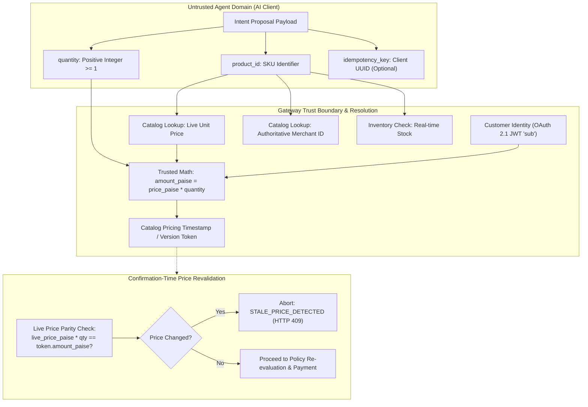
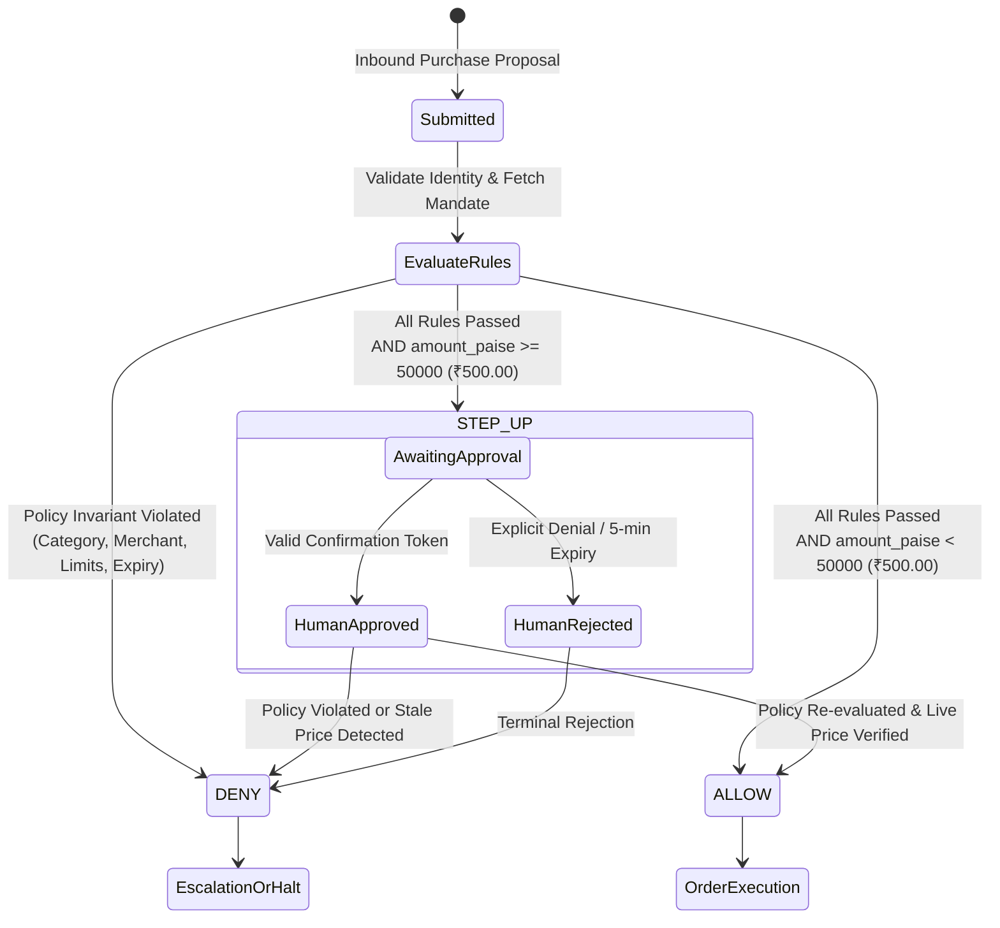
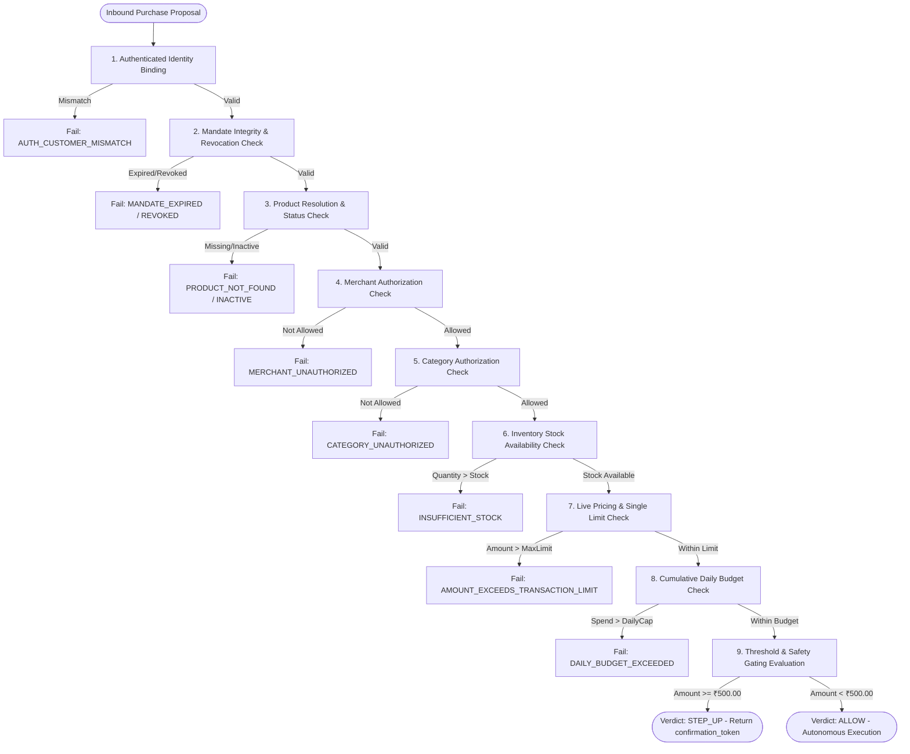

# Policy Contract Specification: Bounded Intent, Sovereign Mandates, and Evaluation Invariants

- **Document ID**: `PHASE-0-DOC-07`
- **Revision**: `1.1.0` (Corrected Server-Side Pricing Context, Unresolved Crypto Decisions, & Pre-P0 Containment Gate)
- **Status**: `PROPOSED / ARCHITECTURAL CONTRACT SPECIFICATION`
- **Authors**: Principal Software Architect & Senior Security Architect
- **Timestamp**: `2026-11-09T18:10:00Z`
- **Target Phases**: Pre-P0 Gate, P0.1 (Purchase Intent), P0.2 (Cryptographic Mandates), P0.3 (Deterministic Engine), P0.4 (Secure Execution)
- **Classification Base**: `[VERIFIED]` (derived directly from current codebase), `[INFERRED]` (logical deduction from existing design patterns), `[UNRESOLVED]` (requires explicit architectural decision), `[RECOMMENDATION]` (formal specification for implementation)

---

## 1. Architectural Scope & Problem Statement

In autonomous Agent-to-Agent (A2A) commerce, the external Buyer AI Agent acts as an **untrusted, non-authoritative client**. If a gateway relies on the agent to calculate prices, specify merchants, provide customer identities, or dictate policy rules, the system is exposed to prompt injection, hallucination, price spoofing, and unauthorized fund drain.

To establish zero-trust commerce execution, the **Policy Engine** operates as an immutable guardrail enforcing three foundational pillars:
1. **Purchase Intent Contract (P0.1)**: Minimizes external agent authority strictly to proposing SKU and quantity, enforcing server-side catalog price resolution and confirmation-time price revalidation.
2. **Sovereign Mandate Governance & Containment (Pre-P0 / P0.2)**: Eliminates conversational mandate self-escalation loops by agents, establishing an independent human approval channel and specifying Ed25519 verifiable credentials.
3. **Deterministic Fail-Fast Invariants (P0.3)**: Pure, predictable three-state policy evaluation (`ALLOW`, `STEP_UP`, `DENY`) governed by strict machine-readable reason codes.

---

## 2. Purchase Intent Specification: Bounded Agent Authority & Pricing Security (P0.1)

### 2.1 Existing Architectural Context & Verified Implementation Baseline
> [!IMPORTANT]
> **Existing Server-Side Pricing Baseline `[VERIFIED]`**  
> The existing gateway implementation in [`app/agent/service.py:execute_purchase`](file:///d:/agentic-commerce-gateway/app/agent/service.py#L254-L270) **already resolves products from the backend catalog and calculates prices server-side**:
> ```python
> product = get_product(product_id)          # Server catalog lookup (L254)
> amount = product.price * quantity           # Server math: price * qty (L270)
> ```
> The current system **does NOT trust external agent-supplied prices** during the initial proposal phase. P0.1 implementation must not duplicate this existing functionality.

### 2.2 Verified Security Gaps Addressed by P0.1 `[VERIFIED]`
1. **Confirmation-Time Stale Pricing Gap (`STALE_PRICE_DETECTED`)**:
   In [`app/agent/service.py:confirm_purchase#L455`](file:///d:/agentic-commerce-gateway/app/agent/service.py#L455), the confirmation flow decodes `amount = payload["amount"]` from the confirmation token. While it re-checks stock (`get_product(product_id)`), **it never re-verifies whether `product.price * quantity == amount` against the live catalog price**. If merchant prices rise during the 5-minute confirmation TTL window, the transaction executes at the stale lower price.
2. **Caller Parameter Override Rejection**:
   External API schemas must strictly reject or discard caller-supplied `price`, `amount`, `merchant_id`, or `customer_id` parameters to prevent accidental or malicious authority bypasses.

### 2.3 P0.1 Purchase Intent Contract Specification `[RECOMMENDATION]`



### Parameter Authority Matrix

| Field Name | Submitted by Agent? | Authoritative Source | Validation & Security Rules | Status |
| :--- | :--- | :--- | :--- | :--- |
| `product_id` | **YES** | Catalog Service | Must exist in `catalog_products` table and possess `ACTIVE` status. | `[VERIFIED]` |
| `quantity` | **YES** | Agent Service | Must be a positive integer $\ge 1$. Floats, zeros, or negative values are strictly rejected (`HTTP 422`). | `[VERIFIED]` |
| `idempotency_key` | Optional | Agent / Gateway Bucket | If omitted, gateway generates a 60-second deterministic SHA-256 hash bucket. | `[VERIFIED]` |
| `price` / `unit_price` | **STRICTLY FORBIDDEN** | Gateway Catalog DB | Authoritative catalog lookup. Any client-submitted price field is discarded or rejected with `HTTP 422`. | `[VERIFIED]` |
| `amount` / `total` | **STRICTLY FORBIDDEN** | Gateway Server Math | Computed authoritatively as `product.price_paise * quantity`. | `[VERIFIED]` |
| `merchant_id` | **STRICTLY FORBIDDEN** | Gateway Catalog DB | Resolved from catalog entity. Agent cannot target unauthorized merchants. | `[VERIFIED]` |
| `customer_id` | **STRICTLY FORBIDDEN** | Verified OAuth JWT `sub` | In agent mode, bound strictly to verified Bearer token claim. Request payload values are ignored. | `[VERIFIED]` |
| `mandate_limits` | **STRICTLY FORBIDDEN** | Gateway Mandate DB | Read exclusively from verified mandate storage. Agent cannot expand or alter limits. | `[VERIFIED]` |
| `decision` / `status` | **STRICTLY FORBIDDEN** | Policy Engine | Evaluated solely by server-side deterministic policy rules. | `[VERIFIED]` |

### 2.4 Stale-Price Handling & Purchase Parameter Binding Specification
1. **Binding Requirements**:
   Every issued proposal and confirmation token must cryptographically bind:
   - `merchant_id`: Exact catalog merchant identifier.
   - `product_id`: Exact SKU.
   - `quantity`: Exact approved units.
   - `currency`: ISO 4217 code (strictly `'INR'`).
   - `amount_paise`: Exact approved integer paise.
   - `price_version`: Catalog price update timestamp or hash.
2. **Price Modification Handling**:
   - During `confirm_purchase()`, the gateway re-queries the live catalog for `product_id`.
   - If `live_product.price_paise * quantity != token.amount_paise`:
     - The confirmation is **immediately aborted**.
     - Status returned: `HTTP 409 Conflict`.
     - Reason code: `STALE_PRICE_DETECTED`.
     - Detail message: `"Catalog price has changed since purchase proposal. A new proposal must be requested and authorized."`
   - **Zero Modification Rule**: An agent can **NEVER** modify purchase parameters (SKU, quantity, price) after approval without obtaining a completely new customer authorization.

---

## 3. Mandatory Pre-P0 Security Gate: Conversational Mandate Escalation Containment

### 3.1 Vulnerability Discovery (`VULN-05` / `TH-03`) `[VERIFIED]`
In [`app/mcp/tools.py#L498-L588`](file:///d:/agentic-commerce-gateway/app/mcp/tools.py#L498-L588), the `modify_spending_mandate` tool implements a two-step conversational workflow:
- **Step 1:** Without a confirmation token, the handler generates a signed `confirmation_token` and **returns it directly to the AI agent** in the tool response, instructing the agent to "ask the user to confirm."
- **Step 2:** The handler executes the mandate modification whenever called with that `confirmation_token`.

Because the executable token is delivered directly to the untrusted caller (the LLM agent), an autonomous script or prompt-injected LLM can immediately invoke Step 2 with the returned token in the very next turn, **increasing its own spending limit to ₹50,000 without true human consent**.

### 3.2 Immediate Pre-P0 Containment Decision `[RECOMMENDATION]`
> [!CAUTION]
> **Pre-P0 Containment Gate: Immediate Deprecation of Conversational Mandate Modification**  
> Before any P0.1 implementation begins, the `modify_spending_mandate` tool **MUST be disabled or deprecated for all untrusted and remote AI agents**.

### 3.3 Core Requirements for Independent Human Mandate Authorization (ADR-03)
1. **No Agent Authority:** The agent requesting a mandate modification must **NEVER** receive authority, tokens, or credentials to approve that modification.
2. **Independent Human Channel:** Approval must occur through an out-of-band channel independent of the AI agent chat session (e.g., authenticated Admin Web Dashboard, customer web portal, or hardware WebAuthn passkey prompt).
3. **No Reusable Token Exposure:** Actionable modification tokens must never be exposed in agent chat contexts.
4. **Exact Scope Binding:** Mandate changes must be strictly bound to the requested parameter delta (`new_limit_paise`, `add_merchant`, `add_category`).
5. **Replay & Expiration Protection:** Approval tokens must enforce single-use consumption (`jti` burn) and strict 5-minute TTL.
6. **Execution Verification:** Active revocation checks must execute at policy evaluation time before any transaction is authorized.

---

## 4. Cryptographic Mandate Architecture: Verifiable Credentials (P0.2)

### 4.1 Proposed Technical Components
The target mandate architecture proposes:
- **Asymmetric Ed25519 Digital Signatures**: High-performance, 64-byte deterministic signatures over customer mandate payloads.
- **RFC 8785 Canonical JSON (JCS)**: Deterministic, byte-level payload canonicalization ensuring signature verification stability across diverse platforms and language runtimes.

### 4.2 Verifiable Mandate Schema `[PROPOSED / UNRESOLVED]`

```json
{
  "$schema": "https://json-schema.org/draft/2020-12/schema",
  "title": "VerifiableIntentMandate",
  "type": "object",
  "required": [
    "mandate_id",
    "version",
    "issuer",
    "subject",
    "currency",
    "max_transaction_amount_paise",
    "daily_budget_paise",
    "allowed_merchants",
    "allowed_categories",
    "validity_period",
    "nonce",
    "key_id",
    "signature"
  ],
  "properties": {
    "mandate_id": { "type": "string", "format": "uuid" },
    "version": { "type": "string", "enum": ["1.0.0"] },
    "issuer": { "type": "string" },
    "subject": { "type": "string", "description": "customer_id" },
    "currency": { "type": "string", "enum": ["INR"] },
    "max_transaction_amount_paise": { "type": "integer", "minimum": 1 },
    "daily_budget_paise": { "type": "integer", "minimum": 1 },
    "allowed_merchants": { "type": "array", "items": { "type": "string" } },
    "allowed_categories": { "type": "array", "items": { "type": "string" } },
    "validity_period": {
      "type": "object",
      "required": ["not_before", "expires_at"],
      "properties": {
        "not_before": { "type": "string", "format": "date-time" },
        "expires_at": { "type": "string", "format": "date-time" }
      }
    },
    "nonce": { "type": "string", "minLength": 16 },
    "key_id": { "type": "string" },
    "signature": { "type": "string", "description": "Base64URL Ed25519 signature" }
  }
}
```

### 4.3 Unresolved Cryptographic Key Management Decisions `[UNRESOLVED]`
The cryptographic mandate specification remains **PROPOSED** and cannot be marked approved until the following ten architectural decisions are formally resolved in **ADR-01**:

1. **Private Signing-Key Ownership `[UNRESOLVED]`**: Where does the private signing key reside? (Client-side browser secure enclave vs. dedicated user wallet app vs. server-side KMS/HSM).
2. **Customer Authorization Mechanism `[UNRESOLVED]`**: What physical human ceremony authorizes mandate creation? (FIDO2/WebAuthn touch vs. SMS/Email OTP vs. master password).
3. **Public-Key Registration `[UNRESOLVED]`**: How are customer public keys initially provisioned into `mandate_keys` without race conditions or injection?
4. **Key Rotation `[UNRESOLVED]`**: What protocol manages scheduled key rotation without invalidating active long-lived daily mandates?
5. **Compromised-Key Handling `[UNRESOLVED]`**: What procedure revokes all credentials if a customer device or private key is compromised?
6. **Durable Mandate Revocation `[UNRESOLVED]`**: How are revocations persisted across distributed instances (PostgreSQL table vs. Redis bloom filter)?
7. **Revocation Verification During Execution `[UNRESOLVED]`**: Does policy evaluation check a local in-memory cache or perform synchronous database lookups against `mandate_revocations`?
8. **Prevention of Autonomous Agent Mandate Creation `[UNRESOLVED]`**: What boundary ensures external agents cannot independently call registration endpoints to authorize their own keys?
9. **Signature Verification vs. Authorization Distinction `[UNRESOLVED]`**: A cryptographically valid signature proves key possession, but does **not** prove customer authorization if the key was misused by an agent. How is human presence attested?
10. **Key Lifecycle Audit Requirements `[UNRESOLVED]`**: What non-repudiation audit records are appended to `audit_events` when keys are generated, rotated, or revoked?

---

## 5. Three-State Policy Engine Contract (P0.3)

The policy engine transitions from binary `APPROVED / REJECTED` to a formal three-state state machine:



### 5.1 Strict Policy Outcome Invariants `[VERIFIED]`
1. **`DENY` is Terminal and Absolute**:
   - **Core Invariant**: An approval requirement (`STEP_UP`) can **NEVER override a `DENY`**.
   - If a proposal targets an unauthorized merchant, an unlisted category, or exceeds mandate budget limits, the policy engine produces an immediate `DENY`.
   - The gateway will **never** generate a confirmation token or prompt the human for a `STEP_UP` approval on a transaction that violates fundamental mandate policies.
2. **`STEP_UP` is Conditional Safety**:
   - `STEP_UP` is applied *only* when all hard policy checks (`CUSTOMER`, `EXPIRY`, `MERCHANT`, `CATEGORY`, `TRANSACTION_LIMIT`, `DAILY_BUDGET`) have evaluated to **`APPROVED`**, but safety thresholds require human confirmation ($\text{amount} \ge \text{₹}500.00$).
3. **`ALLOW` Executes Without Additional Prompts**:
   - Transaction strictly complies with all mandate boundaries and amount $<$ ₹500.00.

---

## 6. Formal Policy Invariants (Testable Contracts)

### Invariant 1: Mandate Validity & Lifecycle `[VERIFIED]`
- **Statement**: An unauthenticated, expired, revoked, or signature-invalid mandate can never authorize a purchase proposal or payment order.
- **Formal Expression**:
  $$\text{Evaluate}(req, m) = \text{ALLOW} \implies \text{VerifySig}(m) \land (m.\text{not\_before} \le t \le m.\text{expires\_at}) \land (m.\text{id} \notin \text{Revocations})$$
- **Failure Code**: `MANDATE_EXPIRED`, `MANDATE_NOT_YET_VALID`, `MANDATE_REVOKED`, `MANDATE_SIGNATURE_INVALID`.

### Invariant 2: Tenant & Customer Boundary Isolation `[VERIFIED]`
- **Statement**: An agent authenticated as Customer $A$ can never execute purchases against a mandate belonging to Customer $B$.
- **Formal Expression**:
  $$\text{Evaluate}(req, m) \implies req.\text{customer\_id} = m.\text{customer\_id} = \text{JWT}.\text{sub}$$
- **Failure Code**: `AUTH_CUSTOMER_MISMATCH`.

### Invariant 3: Merchant and Category Whitelist Enforcement `[VERIFIED]`
- **Statement**: Items outside authorized merchants or taxonomy categories must be rejected with hard `DENY`.
- **Formal Expression**:
  $$p.\text{merchant\_id} \in m.\text{allowed\_merchants} \quad \land \quad p.\text{category} \in m.\text{allowed\_categories}$$
- **Failure Code**: `MERCHANT_UNAUTHORIZED`, `CATEGORY_UNAUTHORIZED`.

### Invariant 4: Non-Bypassable Single Transaction Cap `[VERIFIED]`
- **Statement**: Transaction amount cannot exceed maximum authorized transaction limit.
- **Formal Expression**:
  $$req.\text{amount\_paise} \le m.\text{max\_transaction\_amount\_paise}$$
- **Failure Code**: `AMOUNT_EXCEEDS_TRANSACTION_LIMIT`.

### Invariant 5: Non-Bypassable Cumulative Daily Budget Cap `[VERIFIED]`
- **Statement**: The sum of today's settled transactions, active pending reservations, and the current transaction cannot exceed the customer's daily limit.
- **Formal Expression**:
  $$\text{DailySpendToday}(c) + \text{ActiveReservations}(c) + req.\text{amount\_paise} \le m.\text{daily\_budget\_paise}$$
- **Failure Code**: `DAILY_BUDGET_EXCEEDED`.

### Invariant 6: Replay Immunity & Atomic Settlement `[VERIFIED]`
- **Statement**: A confirmation token or idempotency key can never settle a payment twice or cause duplicate ledger deductions.
- **Formal Expression**:
  $$\text{ExecuteConfirm}(token) \implies \text{Count}(\text{SettledOrders}(token.\text{tx\_id})) \le 1$$
- **Failure Code**: `CONFIRMATION_TOKEN_REPLAYED`, `IDEMPOTENCY_CONFLICT`.

---

## 7. Stable Machine-Readable Reason Code Taxonomy

| Reason Code | Domain | HTTP Status | External Response Redaction | Description |
| :--- | :--- | :--- | :--- | :--- |
| `AUTH_CUSTOMER_MISMATCH` | Identity | 403 Forbidden | Sanitized | Caller identity does not match mandate subject. |
| `MANDATE_NOT_FOUND` | Mandate | 404 Not Found | Sanitized | No mandate exists for resolved customer ID. |
| `MANDATE_EXPIRED` | Mandate | 422 Unprocessable | Sanitized | Current UTC timestamp exceeds `expires_at`. |
| `MANDATE_NOT_YET_VALID` | Mandate | 422 Unprocessable | Sanitized | Current UTC timestamp is prior to `not_before`. |
| `MANDATE_REVOKED` | Mandate | 422 Unprocessable | Sanitized | Mandate ID is listed on revocation list. |
| `MANDATE_SIGNATURE_INVALID` | Security | 401 Unauthorized | Sanitized | Ed25519 signature verification failure. |
| `PRODUCT_NOT_FOUND` | Catalog | 404 Not Found | Detailed | Requested SKU does not exist in catalog. |
| `PRODUCT_INACTIVE` | Catalog | 422 Unprocessable | Detailed | Product status is `ARCHIVED` or `OUT_OF_STOCK`. |
| `MERCHANT_UNAUTHORIZED` | Policy | 422 Unprocessable | Redacted | Merchant is not in mandate `allowed_merchants`. |
| `CATEGORY_UNAUTHORIZED` | Policy | 422 Unprocessable | Redacted | Category is not in mandate `allowed_categories`. |
| `INSUFFICIENT_STOCK` | Inventory | 400 Bad Request | Detailed | Requested quantity exceeds physical stock. |
| `AMOUNT_EXCEEDS_TRANSACTION_LIMIT` | Policy | 200 / 422 | **Redacted** (No numeric cap revealed) | Amount exceeds `max_transaction_amount`. |
| `DAILY_BUDGET_EXCEEDED` | Policy | 200 / 422 | **Redacted** (No spend figures revealed) | Spend would exceed daily limit. |
| `STALE_PRICE_DETECTED` | Price Guard | 409 Conflict | Detailed | Catalog price changed during confirmation window. |
| `CONFIRMATION_TOKEN_EXPIRED` | Step-Up | 422 Unprocessable | Detailed | Confirmation token exceeded 300-second TTL. |
| `CONFIRMATION_TOKEN_REPLAYED` | Idempotency | 200 OK | Cached Output | Token was already executed; returning cached output. |
| `INSUFFICIENT_WALLET_BALANCE` | Payment | 402 Payment Required | Detailed | Pre-authorized auto-debit balance is insufficient. |
| `PAYMENT_RAIL_ERROR` | Payment | 502 Bad Gateway | Sanitized | Razorpay API returned network error or failure. |

---

## 8. Proposed Policy Evaluation Order & Fail-Fast Sequence



Rules are evaluated in strict $O(1)$ memory order before performing database aggregations or cryptographic evaluations, guaranteeing high throughput and resistance to Denial-of-Service attacks.
