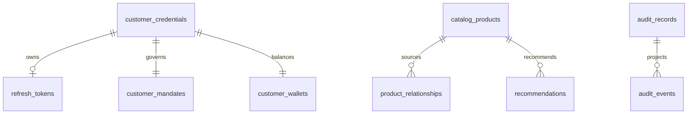
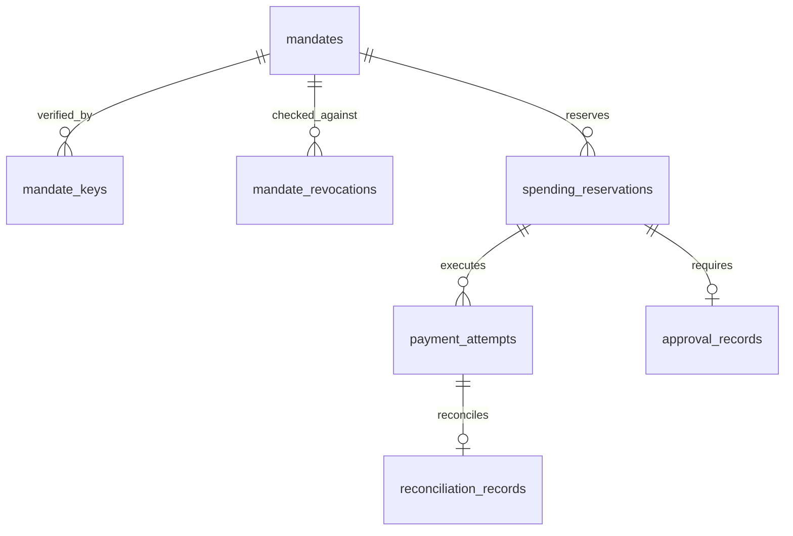
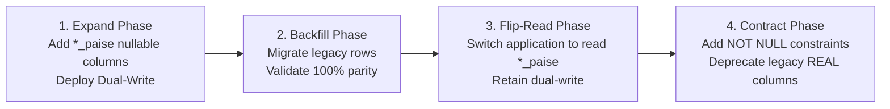

# Database Schema Inspection and Production Migration Plan

- **Document ID**: `PHASE-0-DOC-08`
- **Revision**: `1.1.0` (Corrected Monetary Quantization, Historical Reconciliation, & PostgreSQL Concurrency Model)
- **Status**: `PROPOSED / ARCHITECTURAL SPECIFICATION`
- **Authors**: Principal Software Architect & Senior Security Architect
- **Timestamp**: `2026-11-09T18:15:00Z`
- **Target Phases**: P0.4 (Secure Execution & Database Concurrency)
- **Classification Base**: `[VERIFIED]` (inspected directly from running codebase), `[INFERRED]` (deduced from data access patterns), `[UNRESOLVED]` (requires operational sign-off), `[RECOMMENDATION]` (prescriptive migration specification)

---

## 1. Schema Inspection of Existing Tables

The gateway currently persists state across 10 tables managed via SQLite locally and PostgreSQL on Render ([`app/db.py`](file:///d:/agentic-commerce-gateway/app/db.py)). The schema below reflects the exact DDL and runtime constraints inspected from the codebase.



### Table 1: `audit_records` `[VERIFIED]`
- **Source**: [`app/audit/store.py#L105-L121`](file:///d:/agentic-commerce-gateway/app/audit/store.py#L105-L121)
- **Role**: Mutable CQRS read-model projection view of evaluated proposals and payment outcomes.

| Column Name | Data Type | Nullable? | Default | Constraints / Indexes | Description |
| :--- | :--- | :--- | :--- | :--- | :--- |
| `transaction_id` | `TEXT` | `NO` | None | `PRIMARY KEY` | Gateway-minted UUIDv4 for end-to-end tracing |
| `timestamp` | `TEXT` | `NO` | None | None | ISO 8601 UTC timestamp string |
| `customer_id` | `TEXT` | `NO` | None | None | Identifier of the customer |
| `product_id` | `TEXT` | `NO` | None | None | Catalog SKU identifier |
| `merchant_id` | `TEXT` | `NO` | None | None | Merchant identifier |
| `quantity` | `INTEGER` | `NO` | None | None | Units purchased ($\ge 1$) |
| `amount` | `REAL` | `NO` | None | None | **Floating-point INR amount** (e.g. 1499.0) |
| `decision` | `TEXT` | `NO` | None | None | Status: `APPROVED`, `REJECTED`, `PENDING_CONFIRMATION`, `PAYMENT_FAILED` |
| `decision_reason`| `TEXT` | `NO` | None | None | Human-readable explanation of the verdict |
| `payment_status` | `TEXT` | `YES` | `NULL` | None | Razorpay/wallet state: `PENDING`, `created`, `captured`, `failed` |
| `razorpay_order_id`| `TEXT` | `YES` | `NULL` | None | External provider order ID (e.g. `order_xxx`) |
| `razorpay_payment_id`| `TEXT` | `YES` | `NULL` | None | External provider payment capture ID |
| `idempotency_key`| `TEXT` | `YES` | `NULL` | `UNIQUE` (`idx_audit_idempotency_key`) | Client key or 60s bucketed SHA-256 hash |
| `prev_hash` | `TEXT` | `YES` | `'GENESIS'` | None | Cryptographic hash of preceding ledger block |
| `record_hash` | `TEXT` | `YES` | `NULL` | None | SHA-256 cryptographic hash of this record |

### Table 2: `audit_events` `[VERIFIED]`
- **Source**: [`app/audit/store.py#L140-L150`](file:///d:/agentic-commerce-gateway/app/audit/store.py#L140-L150)
- **Role**: Append-only cryptographic event-sourcing ledger (tamper-evident, not inherently immutable).

| Column Name | Data Type | Nullable? | Default | Constraints / Indexes | Description |
| :--- | :--- | :--- | :--- | :--- | :--- |
| `id` | `INTEGER` | `NO` | Autoincrement | `PRIMARY KEY` | Monotonic sequence integer (SERIAL in PG) |
| `event_id` | `TEXT` | `NO` | None | None | UUIDv4 event identifier |
| `transaction_id` | `TEXT` | `NO` | None | `INDEX` (`idx_audit_events_tx`) | Correlation ID linking to proposal |
| `event_type` | `TEXT` | `NO` | None | None | `PROPOSAL_EVALUATED`, `HUMAN_CONFIRMED`, `PAYMENT_CAPTURED`, etc. |
| `timestamp` | `TEXT` | `NO` | None | None | ISO 8601 UTC timestamp string |
| `payload_json` | `TEXT` | `NO` | None | None | Canonical sorted JSON payload dictionary |
| `prev_hash` | `TEXT` | `NO` | None | None | Cryptographic SHA-256 hash of event `id - 1` |
| `event_hash` | `TEXT` | `NO` | None | None | SHA-256 of `(prev_hash, event_id, tx_id, type, ts, payload)` |

### Table 3: `processed_webhook_events` `[VERIFIED]`
- **Source**: [`app/audit/store.py#L159-L164`](file:///d:/agentic-commerce-gateway/app/audit/store.py#L159-L164)
- **Role**: Deduplication table for asynchronous inbound payment webhooks.

| Column Name | Data Type | Nullable? | Default | Constraints / Indexes | Description |
| :--- | :--- | :--- | :--- | :--- | :--- |
| `event_id` | `TEXT` | `NO` | None | `PRIMARY KEY` | External webhook event ID (e.g. from Razorpay) |
| `received_at` | `REAL` | `NO` | None | None | Unix epoch timestamp (float seconds) |

### Table 4: `catalog_products` `[VERIFIED]`
- **Source**: [`app/catalog/service.py#L32-L43`](file:///d:/agentic-commerce-gateway/app/catalog/service.py#L32-L43)
- **Role**: Authoritative inventory catalog and pricing store.

| Column Name | Data Type | Nullable? | Default | Constraints / Indexes | Description |
| :--- | :--- | :--- | :--- | :--- | :--- |
| `id` | `TEXT` | `NO` | None | `PRIMARY KEY` | Product SKU identifier (e.g. `KB001`) |
| `name` | `TEXT` | `NO` | None | None | Product title / display name |
| `category` | `TEXT` | `NO` | None | `INDEX` (`idx_cat_category`) | Taxonomy category (`electronics`, `food`, etc.) |
| `merchant_id` | `TEXT` | `NO` | `'MERCH_ELEC'` | None | Authoritative merchant identifier |
| `price` | `REAL` | `NO` | None | None | **Floating-point unit price in INR** |
| `stock` | `INTEGER` | `NO` | None | None | Physical units currently available |
| `description` | `TEXT` | `NO` | None | None | Detailed product specification |
| `status` | `TEXT` | `NO` | `'ACTIVE'` | `INDEX` (`idx_cat_status`) | `ACTIVE`, `OUT_OF_STOCK`, `ARCHIVED` |
| `created_at` | `REAL` | `NO` | None | None | Unix epoch timestamp (float seconds) |
| `updated_at` | `REAL` | `NO` | None | None | Unix epoch timestamp (float seconds) |

### Table 5: `product_relationships` `[VERIFIED]`
- **Source**: [`app/catalog/service.py#L52-L60`](file:///d:/agentic-commerce-gateway/app/catalog/service.py#L52-L60)
- **Role**: Catalog cross-sell / upsell graph relationships for Track 01 revenue growth.

| Column Name | Data Type | Nullable? | Default | Constraints / Indexes | Description |
| :--- | :--- | :--- | :--- | :--- | :--- |
| `id` | `INTEGER` | `NO` | Autoincrement | `PRIMARY KEY` | Monotonic primary key |
| `source_product_id`| `TEXT` | `NO` | None | `INDEX` (`idx_rel_source`) | Base product SKU |
| `target_product_id`| `TEXT` | `NO` | None | None | Recommended add-on SKU |
| `relationship_type`| `TEXT` | `NO` | `'COMPLEMENTARY'` | None | Relationship classification |
| `created_at` | `REAL` | `NO` | None | None | Unix epoch timestamp (float seconds) |
| *Composite* | - | - | - | `UNIQUE(source_product_id, target_product_id)` | Prevents duplicate edges |

### Table 6: `recommendations` `[VERIFIED]`
- **Source**: [`app/catalog/service.py#L67-L79`](file:///d:/agentic-commerce-gateway/app/catalog/service.py#L67-L79)
- **Role**: Lifecycle tracking and terminal decision idempotency for agent recommendations.

| Column Name | Data Type | Nullable? | Default | Constraints / Indexes | Description |
| :--- | :--- | :--- | :--- | :--- | :--- |
| `recommendation_id`| `TEXT` | `NO` | None | `PRIMARY KEY` | UUIDv4 recommendation token |
| `primary_product_id`| `TEXT` | `NO` | None | None | Primary item SKU |
| `addon_product_id` | `TEXT` | `NO` | None | None | Add-on item SKU |
| `customer_id` | `TEXT` | `NO` | None | None | Target customer identifier |
| `status` | `TEXT` | `NO` | `'GENERATED'` | `INDEX` (`idx_rec_status`) | `GENERATED`, `ACCEPTED`, `REJECTED`, `EXPIRED` |
| `primary_transaction_id`| `TEXT` | `YES` | `NULL` | `INDEX` (`idx_rec_primary_tx`) | Link to primary purchase |
| `addon_transaction_id` | `TEXT` | `YES` | `NULL` | None | Link to add-on purchase |
| `logical_order_group_id`| `TEXT` | `YES` | `NULL` | None | Shared order UUID for AOV telemetry |
| `created_at` | `REAL` | `NO` | None | None | Unix epoch timestamp (float seconds) |
| `updated_at` | `REAL` | `NO` | None | None | Unix epoch timestamp (float seconds) |

### Table 7: `customer_credentials` `[VERIFIED]`
- **Source**: [`app/oauth/store.py#L264-L272`](file:///d:/agentic-commerce-gateway/app/oauth/store.py#L264-L272)
- **Role**: Customer identity authentication and password hash store.

| Column Name | Data Type | Nullable? | Default | Constraints / Indexes | Description |
| :--- | :--- | :--- | :--- | :--- | :--- |
| `customer_id` | `TEXT` | `NO` | None | `PRIMARY KEY` | Customer unique identifier (e.g. `CUST001`) |
| `username` | `TEXT` | `NO` | None | `UNIQUE` | Unique login username |
| `email` | `TEXT` | `YES` | `NULL` | None | Customer contact email |
| `password_hash` | `TEXT` | `NO` | None | None | PBKDF2-HMAC-SHA256 hashed password |
| `salt` | `TEXT` | `NO` | None | None | Cryptographic hex salt |

### Table 8: `refresh_tokens` `[VERIFIED]`
- **Source**: [`app/oauth/store.py#L275-L283`](file:///d:/agentic-commerce-gateway/app/oauth/store.py#L275-L283)
- **Role**: OAuth 2.1 refresh token persistence and rotation store.

| Column Name | Data Type | Nullable? | Default | Constraints / Indexes | Description |
| :--- | :--- | :--- | :--- | :--- | :--- |
| `token_hash` | `TEXT` | `NO` | None | `PRIMARY KEY` | SHA-256 hash of issued refresh token |
| `customer_id` | `TEXT` | `NO` | None | None | Customer identity bound to token |
| `client_id` | `TEXT` | `NO` | None | None | Authorized OAuth client identifier |
| `expires_at` | `REAL` | `NO` | None | None | Unix epoch expiration timestamp |
| `revoked` | `INTEGER` | `NO` | `0` | None | `1` if revoked, `0` if active |
| `created_at` | `REAL` | `NO` | None | None | Unix epoch issuance timestamp |

### Table 9: `customer_mandates` `[VERIFIED]`
- **Source**: [`app/policy/store.py#L96-L110`](file:///d:/agentic-commerce-gateway/app/policy/store.py#L96-L110)
- **Role**: Customer spending mandate policies and category/merchant bounds.

| Column Name | Data Type | Nullable? | Default | Constraints / Indexes | Description |
| :--- | :--- | :--- | :--- | :--- | :--- |
| `customer_id` | `TEXT` | `NO` | None | `PRIMARY KEY` | Customer unique identifier |
| `display_name` | `TEXT` | `NO` | None | None | Human display name (e.g. 'Dinesh Kumar') |
| `email` | `TEXT` | `YES` | `NULL` | `INDEX` (`idx_mandates_email`) | Customer email address |
| `max_transaction_amount`| `REAL` | `NO` | None | None | **Floating-point max limit in INR** |
| `daily_limit` | `REAL` | `NO` | `5000.0` | None | **Floating-point daily spend cap in INR** |
| `currency` | `TEXT` | `NO` | `'INR'` | None | Currency identifier |
| `allowed_categories`| `TEXT` | `NO` | None | None | JSON array string (e.g. `["electronics"]`) |
| `allowed_merchants` | `TEXT` | `NO` | None | None | JSON array string (e.g. `["MERCH_ELEC"]`) |
| `expires_at` | `TEXT` | `YES` | `NULL` | None | ISO 8601 UTC expiration string or NULL |
| `prompt_playback` | `TEXT` | `YES` | `NULL` | None | Human summary for conversational audit |
| `created_at` | `REAL` | `NO` | None | None | Unix epoch timestamp (float seconds) |
| `updated_at` | `REAL` | `NO` | None | None | Unix epoch timestamp (float seconds) |

### Table 10: `customer_wallets` `[VERIFIED]`
- **Source**: [`app/wallet/store.py#L55-L63`](file:///d:/agentic-commerce-gateway/app/wallet/store.py#L55-L63)
- **Role**: Pre-authorized auto-debit simulated balance ledger.

| Column Name | Data Type | Nullable? | Default | Constraints / Indexes | Description |
| :--- | :--- | :--- | :--- | :--- | :--- |
| `customer_id` | `TEXT` | `NO` | None | `PRIMARY KEY` | Customer unique identifier |
| `balance` | `REAL` | `NO` | None | None | **Floating-point wallet balance in INR** |
| `currency` | `TEXT` | `NO` | `'INR'` | None | Currency code |
| `created_at` | `REAL` | `NO` | None | None | Unix epoch timestamp (float seconds) |
| `updated_at` | `REAL` | `NO` | None | None | Unix epoch timestamp (float seconds) |

---

## 2. Structural Deficiencies of Current Schema

1. **Floating-Point Representation (`REAL` / `Float`) `[VERIFIED]` (VULN-01 - Critical)**:
   - `audit_records.amount`, `catalog_products.price`, `customer_mandates.max_transaction_amount`, `customer_mandates.daily_limit`, and `customer_wallets.balance` use IEEE-754 floating-point values.
   - *Risk*: Binary floating-point representation causes precision loss (e.g. `₹19.99 * 3 = ₹59.970000000000006`). Cumulative spend queries (`SELECT SUM(amount)`) risk off-by-one boundary bypasses.
2. **Absence of Foreign Key Constraints `[VERIFIED]`**:
   - Zero `FOREIGN KEY` clauses are defined across the entire database.
3. **Absence of Concurrency Locks & Check-Then-Act Race Conditions `[VERIFIED]` (VULN-02, VULN-03, VULN-04)**:
   - `wallet_store.debit()` and `decrement_stock()` perform disconnected read-then-write updates without row locking (`SELECT ... FOR UPDATE`) or atomic conditional decrements.

---

## 3. Candidate Future Entities for P0.4 `[RECOMMENDATION]`



1. **`mandates`**: Verifiable intent mandates storing integer paise limits (`max_transaction_amount_paise`, `daily_budget_paise`), validity periods, and Ed25519 signatures.
2. **`mandate_keys`**: Public key registry for customer Ed25519 keys with active validity windows.
3. **`mandate_revocations`**: Durable revocation entries checked at policy evaluation time.
4. **`spending_reservations`**: Atomic holds against daily spend and wallet balance with 5-minute TTL.
5. **`approval_records`**: Single-use token tracking (`jti`) with atomic status transition (`PENDING` $\rightarrow$ `CONSUMED`).
6. **`payment_attempts`**: External provider request/response logs linked to transactions.
7. **`idempotency_records`**: Request deduplication keys with response payloads.
8. **`reconciliation_records`**: Asynchronous discrepancy tracking between Razorpay and internal state.

---

## 4. Monetary Migration Strategy: Transition to Integer Paise & Historical Data Reconciliation

### 4.1 Specification
- **Representation Standard**: All currency values must use **64-bit non-negative integers** (`BIGINT` / `INTEGER`) representing **paise** ($1\text{ INR} = 100\text{ paise}$).
- **Currency Code**: Hardcoded string `'INR'` (ISO 4217). Fractional paise are strictly prohibited.

### 4.2 Exact Conversion Formula: Decimal Quantization with `ROUND_HALF_UP` `[RECOMMENDATION]`
> [!IMPORTANT]
> **Correction to Previous Specification**  
> The previously proposed expression `int(Decimal(str(value)) * 100)` truncated values instead of rounding. The canonical conversion function must explicitly use quantization with `ROUND_HALF_UP`:

```python
from decimal import Decimal, ROUND_HALF_UP
from typing import Union

def rupees_to_paise(value: Union[str, int, float, Decimal]) -> int:
    """
    Deterministically converts an INR value to integer paise using explicit Decimal quantization.
    Rejects negative, non-finite, or malformed inputs.
    """
    amount = Decimal(str(value))

    if not amount.is_finite() or amount < Decimal("0"):
        raise ValueError(f"Invalid monetary amount: {value}")

    paise = (amount * Decimal("100")).quantize(
        Decimal("1"),
        rounding=ROUND_HALF_UP
    )

    return int(paise)
```

### 4.3 Historical Data Reconciliation Policy & Exception Handling
> [!CAUTION]
> **Strict Rule: Never Blindly Round Historical Financial Records**  
> Historical transaction and audit records represent legal evidence of past financial transactions. Blindly applying rounding during migration risks silent discrepancy creation.

1. **Pre-Migration Integrity Audit**:
   Prior to running data conversion, execute an audit query detecting non-standard monetary entries:
   ```sql
   -- Identify records with more than 2 decimal places in legacy floats
   SELECT transaction_id, amount, amount * 100 AS raw_paise
   FROM audit_records
   WHERE (amount * 100) != ROUND(amount * 100, 0);
   ```
2. **Reconciliation Exception Ledger**:
   Any historical record exhibiting fractional paise or unexpected precision anomalies must be written to a dedicated `migration_exceptions` table:
   ```sql
   CREATE TABLE migration_exceptions (
       exception_id SERIAL PRIMARY KEY,
       table_name TEXT NOT NULL,
       record_id TEXT NOT NULL,
       original_value_real REAL NOT NULL,
       converted_paise INTEGER,
       delta_paise REAL,
       status TEXT NOT NULL DEFAULT 'FLAGGED_FOR_REVIEW',
       flagged_at TIMESTAMP WITH TIME ZONE DEFAULT CURRENT_TIMESTAMP
   );
   ```
3. **Auditability & Parity Verification**:
   The migration must compute global checksums before and after conversion:
   $$\sum \text{amount\_paise} \equiv \text{quantize}\left(\sum \text{legacy\_amount\_inr} \times 100\right)$$
   Any discrepancy $> 0\text{ paise}$ halts the migration and triggers human operator investigation.

### 4.4 Zero-Downtime Migration Protocol (The Expand/Contract Pattern)



1. **Step 1 (Expand)**: Add new nullable columns to existing tables (`price_paise`, `max_transaction_amount_paise`, `daily_limit_paise`, `balance_paise`, `amount_paise`).
2. **Step 2 (Dual Write)**: Deploy gateway code that writes to *both* legacy `REAL` and new `*_paise` columns on every `INSERT` and `UPDATE`.
3. **Step 3 (Backfill & Reconcile)**: Run Python migration script executing `rupees_to_paise()` with exception logging on all historical rows.
4. **Step 4 (Validation)**: Run reconciliation audit comparing legacy totals to new integer totals.
5. **Step 5 (Flip Read)**: Switch read queries in `app.catalog`, `app.policy`, and `app.wallet` to reference `*_paise` directly.
6. **Step 6 (Contract)**: Apply `NOT NULL` constraints and drop old `REAL` columns.

---

## 5. PostgreSQL Production Database & Concurrency Model (ADR-02)

> [!WARNING]
> **`SELECT ... FOR UPDATE` Is Not a Complete Concurrency Solution**  
> While row-level locking serializes concurrent updates to a single row, it does not prevent deadlocks, handle timeouts, manage reservation lifecycles, or prevent duplicate external payment orders. A comprehensive concurrency model is required.

### 5.1 Concurrency Architecture Specification
1. **Transaction Isolation Level**:
   - Production PostgreSQL databases must run with **`READ COMMITTED`** isolation, paired with **atomic conditional updates** and explicit row locks where necessary.
2. **Atomic Conditional Updates (Preferred over Heavy Row Locks)**:
   - For wallet debit:
     ```sql
     UPDATE customer_wallets
     SET balance_paise = balance_paise - :amount_paise,
         updated_at = :now
     WHERE customer_id = :customer_id
       AND balance_paise >= :amount_paise;
     ```
     Inspect `rowcount`. If `0`, raise `InsufficientBalanceError` immediately without holding locks.
   - For inventory stock decrement:
     ```sql
     UPDATE catalog_products
     SET stock = stock - :quantity,
         status = CASE WHEN stock - :quantity = 0 THEN 'OUT_OF_STOCK' ELSE status END,
         updated_at = :now
     WHERE id = :product_id
       AND stock >= :quantity;
     ```
3. **Lock Ordering & Deadlock Prevention**:
   - Where multiple rows must be locked in a single transaction (e.g. multi-item orders), rows must **ALWAYS be acquired in strictly sorted primary key order** (e.g., `ORDER BY id ASC`). This mathematically eliminates lock cycles and prevents deadlocks.
4. **Deadlock Detection & Exponential Backoff**:
   - Database operations encountering PostgreSQL error code `40P01` (deadlock detected) must catch the exception, roll back the transaction, and retry with exponential backoff and jitter (maximum 3 retries over 500ms).
5. **Idempotency Scope & Confirmation-Token Burning**:
   - A single-use table `approval_records` stores `jti` (UUIDv4) with a unique constraint.
   - At the beginning of `confirm_purchase()`, execute:
     ```sql
     INSERT INTO approval_records (jti, transaction_id, status, consumed_at)
     VALUES (:jti, :transaction_id, 'CONSUMED', :now);
     ```
     If a `UNIQUE_VIOLATION` (`23505`) occurs, the request is immediately rejected as a replayed or duplicate confirmation.
6. **Reservation Lifecycle & Recovery Reaper**:
   - Spending reservations (`spending_reservations`) carry a strict 5-minute TTL.
   - An asynchronous background daemon polls for reservations with `status='HELD'` where `expires_at < CURRENT_TIMESTAMP`, restoring decremented stock and marking the reservation `EXPIRED`.

### 5.2 PostgreSQL vs. SQLite Testing Requirements `[RECOMMENDATION]`
> [!CAUTION]
> **SQLite Tests Do Not Validate PostgreSQL Concurrency Semantics**  
> SQLite operates with database-level locking and does not support `SELECT ... FOR UPDATE`, true row-level locks, or PostgreSQL deadlock detection. Tests passing on SQLite provide zero proof of concurrency correctness in production.

- **Mandatory Requirement**: Concurrency and race condition test suites (specifically VULN-02 and VULN-03) must be executed against a real PostgreSQL instance in CI (e.g. via GitHub Actions service containers or testcontainers-python).

---

## 6. Audit Trail & Payment Webhook Security

### 6.1 Audit Ledger Integrity Model: Tamper-Evidence vs. Enforced Immutability
- **Epistemic Classification**: The gateway's SHA-256 hash chaining (`audit_events`) is **tamper-evident, NOT inherently immutable**.
- **Threat Vector**: An attacker or rogue DBA with write access to the PostgreSQL database can alter a row and recompute hashes to the tip of the chain, or truncate rows.
- **Defense-in-Depth Controls `[RECOMMENDATION]`**:
  1. **Database Role Privileges**: The application runtime user must be granted `INSERT` and `SELECT` privileges only on `audit_events`. `UPDATE`, `DELETE`, `TRUNCATE`, and `DROP` must be revoked.
  2. **External Root Anchoring**: The tip hash (`/audit/anchor`) must be published periodically (hourly or daily) to an independent, immutable external store (RFC 3161 TSA, WORM cloud storage, or public notary).

### 6.2 Payment Webhook Security & Inventory Consistency
To prevent fraudulent payment state transitions and resolve the phantom stock inflation bug (`VULN-07` / `TH-17`):
1. **Binding to Known Transactions**: Webhooks are accepted **only** if the payload's `transaction_id` or `order_id` matches an existing, pre-authorized transaction in `audit_records`.
2. **Strict Identity Validation**: Webhook payment amount and merchant ID must match the recorded transaction record; mismatched amounts trigger an immediate security alert and rejection.
3. **Idempotent Inventory Restoration**:
   - `audit_records` must track `stock_decremented: BOOLEAN NOT NULL DEFAULT FALSE`.
   - On `payment.failed`, `payment_link.cancelled`, or `payment_link.expired`, the webhook handler executes:
     ```python
     if record.stock_decremented:
         restore_stock(record.product_id, record.quantity)
         mark_stock_restored(record.transaction_id)
     ```
     This ensures inventory is restored **IF AND ONLY IF** it was previously decremented, mathematically eliminating phantom stock inflation.
4. **Out-of-Order Webhook Handling**:
   - State transitions must obey a monotonic state machine: `PENDING` $\rightarrow$ `ORDER_CREATED` $\rightarrow$ `CAPTURED` (terminal).
   - If a `payment.failed` webhook arrives *after* a `payment.captured` webhook has already committed, the late failure event is logged as an anomaly and discarded without altering settled state.
