# Phase 0 Final Review & Readiness Verdict

- **Document:** `10_PHASE_0_FINAL_REVIEW.md`
- **Project:** Agentic Commerce Gateway
- **Phase:** Phase 0 (Engineering Preparation & Pre-Implementation Specification)
- **Role:** Engineering Orchestrator & Senior Security Architect
- **Revision:** 1.1.0 (Refined Architecture, Reconciled Findings & Readiness Review)
- **Status:** Complete — **CONDITIONALLY APPROVED**
- **Date:** 2026-11-09

---

## 1. Executive Summary

Phase 0 of the **Agentic Commerce Gateway** project has concluded its comprehensive, evidence-backed engineering investigation. Operating as a senior security-focused engineering organization, the multi-agent orchestration team (Engineering Orchestrator, System Architect, Security Engineer, Backend Engineer, and QA Engineer) has physically inspected the repository, evaluated the baseline test execution history, mapped sensitive data flows, analyzed race conditions, conducted threat modeling, specified deterministic policy contracts, planned database schema migrations, and authored three Architecture Decision Records (ADRs).

In strict compliance with the **Phase 0 constraints**, **zero application source code, active policy logic, payment integrations, or database schemas were modified**. All eleven required specification deliverables and three Architecture Decision Records now exist under `docs/phase-0/`.

The gateway represents an innovative and functional agentic commerce platform featuring dual-transport Model Context Protocol (MCP) connectivity, deterministic policy enforcement, an append-only SHA-256 cryptographic audit ledger, Razorpay payment links, and simulated auto-debit balances. However, this investigation has verified **eight discrete vulnerability findings** across the architecture:
- **3 Critical Vulnerabilities:** Floating-point monetary representation (`VULN-01`), non-atomic wallet debit TOCTOU race (`VULN-02`), and conversational mandate escalation loop (`VULN-05`).
- **3 High Vulnerabilities:** Non-atomic inventory overselling race (`VULN-03`), confirmation-token concurrent replay race (`VULN-04`), and hardcoded fallback JWT secret (`VULN-06`).
- **2 Medium Vulnerabilities:** Asymmetrical inventory inflation on webhook failure (`VULN-07`) and unauthenticated diagnostic information disclosure (`VULN-08`).

Crucially, this review establishes a mandatory **Pre-P0 Containment Gate** to immediately disable conversational mandate modification via MCP (`VULN-05`), eliminating the self-escalation attack surface before P0.1 implementation begins.

Consequently, the Engineering Orchestrator and Security Architect render a formal readiness verdict of **CONDITIONALLY APPROVED**, requiring execution of the Pre-P0 Containment Gate and stakeholder sign-off on the three Architecture Decision Records prior to the commencement of P0.1 code implementation.

---

## 2. Deliverables Audit & Verification Matrix

All fourteen Phase 0 specification documents (11 core deliverables + 3 ADRs) have been authored, peer-reviewed, and verified against actual repository code:

| Deliverable File | Core Topic | Primary Lead | Status | Epistemic State |
| :--- | :--- | :--- | :--- | :--- |
| [`00_PHASE_0_MASTER_PLAN.md`](file:///d:/agentic-commerce-gateway/docs/phase-0/00_PHASE_0_MASTER_PLAN.md) | Governance, orchestration architecture, and Phase 0 boundaries | Orchestrator | Complete (v1.1.0) | `[VERIFIED]` |
| [`01_REPOSITORY_BASELINE.md`](file:///d:/agentic-commerce-gateway/docs/phase-0/01_REPOSITORY_BASELINE.md) | Git state, dependency inventory, and two-stage test history | System Architect | Complete (v1.1.0) | `[VERIFIED]` |
| [`02_ARCHITECTURE_INVENTORY.md`](file:///d:/agentic-commerce-gateway/docs/phase-0/02_ARCHITECTURE_INVENTORY.md) | Subsystem inventory, flows, I/O, tables, and limitations | System Architect | Complete (v1.0.0) | `[VERIFIED]` |
| [`03_PURCHASE_FLOW_ANALYSIS.md`](file:///d:/agentic-commerce-gateway/docs/phase-0/03_PURCHASE_FLOW_ANALYSIS.md) | 19-step proposal & 9-step confirmation lifecycles | Backend Engineer | Complete (v1.0.0) | `[VERIFIED]` |
| [`04_DEPENDENCY_AND_DATA_FLOW.md`](file:///d:/agentic-commerce-gateway/docs/phase-0/04_DEPENDENCY_AND_DATA_FLOW.md) | Inter-module coupling, monetary trace, and identity lineage | System Architect | Complete (v1.0.0) | `[VERIFIED]` |
| [`05_THREAT_MODEL.md`](file:///d:/agentic-commerce-gateway/docs/phase-0/05_THREAT_MODEL.md) | 17 STRIDE threat vectors mapped to 8 canonical findings | Security Engineer | Complete (v1.1.0) | `[VERIFIED]` |
| [`06_SECURITY_BOUNDARIES.md`](file:///d:/agentic-commerce-gateway/docs/phase-0/06_SECURITY_BOUNDARIES.md) | 8 Trust Authorities and 7 Inviolable LLM Security Principles | Security Engineer | Complete (v1.0.0) | `[VERIFIED]` |
| [`07_POLICY_CONTRACT_SPECIFICATION.md`](file:///d:/agentic-commerce-gateway/docs/phase-0/07_POLICY_CONTRACT_SPECIFICATION.md) | P0.1–P0.3 policy contract, Ed25519 mandates, reason codes | Backend Engineer | Complete (v1.1.0) | `[VERIFIED]` |
| [`08_DATABASE_MIGRATION_PLAN.md`](file:///d:/agentic-commerce-gateway/docs/phase-0/08_DATABASE_MIGRATION_PLAN.md) | Schema audit, integer paise migration, PostgreSQL concurrency | Backend Engineer | Complete (v1.1.0) | `[VERIFIED]` |
| [`09_TEST_AND_EVALUATION_STRATEGY.md`](file:///d:/agentic-commerce-gateway/docs/phase-0/09_TEST_AND_EVALUATION_STRATEGY.md) | 13-domain test pyramid, adversarial suites, CI requirements | QA Engineer | Complete (v1.0.0) | `[VERIFIED]` |
| [`10_PHASE_0_FINAL_REVIEW.md`](file:///d:/agentic-commerce-gateway/docs/phase-0/10_PHASE_0_FINAL_REVIEW.md) | Synthesis, 9-area evaluation, and readiness verdict | Orchestrator | Complete (v1.1.0) | `[VERIFIED]` |
| [`ADR-01_MANDATE_SIGNING_AUTHORITY.md`](file:///d:/agentic-commerce-gateway/docs/phase-0/ADR-01_MANDATE_SIGNING_AUTHORITY.md) | Cryptographic signature architecture & unresolved questions | Backend Engineer | PROPOSED | `[UNRESOLVED]` |
| [`ADR-02_POSTGRESQL_CONCURRENCY_MODEL.md`](file:///d:/agentic-commerce-gateway/docs/phase-0/ADR-02_POSTGRESQL_CONCURRENCY_MODEL.md) | Production concurrency, conditional updates, CI testing | Backend Engineer | PROPOSED | `[RECOMMENDATION]` |
| [`ADR-03_INDEPENDENT_HUMAN_APPROVAL.md`](file:///d:/agentic-commerce-gateway/docs/phase-0/ADR-03_INDEPENDENT_HUMAN_APPROVAL.md) | Pre-P0 containment of conversational mandate escalation | Security Engineer | PROPOSED | `[RECOMMENDATION]` |

---

## 3. Repository Baseline & Two-Stage Test History

### 3.1 Git and Runtime State
- **Git Branch:** `main` (tracking `origin/main` at commit `a1cf612`) `[VERIFIED]`.
- **Working Tree:** Clean of application modifications; all additions strictly isolated under `docs/phase-0/` `[VERIFIED]`.
- **Runtime Environment:** Python 3.12.2 on Windows x86_64 `[VERIFIED]`.
- **Core Dependencies:** FastAPI 0.142.2, Pydantic 2.12.5, Uvicorn 0.54.0, PyJWT 2.15.1, Cryptography 50.0.2, Razorpay 2.0.1, MCP 2.3.0, Psycopg2-binary 2.9.13 `[VERIFIED]`.

### 3.2 Two-Stage Test Execution History

To ensure complete empirical accuracy, the test execution history is documented across its two distinct phases:

```
┌────────────────────────────────────────────────────────────────────────────────────────┐
│ Stage A: Initial Execution (Host Environment without requirements installed)           │
│ Command: pytest -v                                                                     │
│ Result: FAILED at startup during conftest loading                                     │
│ Root Cause: ModuleNotFoundError: No module named 'jwt' (from app/oauth/crypto.py)     │
│ Context: Host Python environment lacked packages declared in requirements.txt          │
└────────────────────────────────────────┬───────────────────────────────────────────────┘
                                         │
                                         ▼ [Action: pip install -r requirements.txt]
┌────────────────────────────────────────────────────────────────────────────────────────┐
│ Stage B: Validated Execution (Dependencies Installed)                                  │
│ Command: pytest                                                                        │
│ Result: 205 passed, 1 deselected, 0 failed, 1 warning in 131.54s                       │
│ Total Collected: 206 tests                                                             │
└────────────────────────────────────────────────────────────────────────────────────────┘
```

1. **Stage A (Initial Execution Failure) `[VERIFIED]`:**
   - *Command:* `pytest -v`
   - *Outcome:* Total test runner abort prior to test collection.
   - *Failure Detail:* `ModuleNotFoundError: No module named 'jwt'` raised by [`tests/conftest.py:17`](file:///d:/agentic-commerce-gateway/tests/conftest.py#L17) importing [`app/oauth/crypto.py:10`](file:///d:/agentic-commerce-gateway/app/oauth/crypto.py#L10).
   - *Explanation:* The host workstation's global Python environment lacked dependencies declared in `requirements.txt` (specifically `pyjwt`, `razorpay`, `mcp`, and `python-multipart`).

2. **Stage B (Post-Dependency Installation Baseline) `[VERIFIED]`:**
   - *Resolution:* Executed `pip install -r requirements.txt` to align the environment with declared project specifications.
   - *Command:* `pytest`
   - *Total Items Collected:* 206
   - *Passed:* **205** (99.5% of collected items)
   - *Deselected:* **1** (`tests/test_live_razorpay_checkout.py::test_live_razorpay_checkout_lifecycle`)
   - *Failed / Errors:* **0**
   - *Warnings:* 1 (`StarletteDeprecationWarning` regarding `HTTP_422_UNPROCESSABLE_ENTITY`)
   - *Execution Duration:* 131.54 seconds.

> [!WARNING]
> **Integration Test Deselection & Coverage Reality**  
> 1. The 1 deselected test (`test_live_razorpay_checkout_lifecycle`) is marked `@pytest.mark.integration` and excluded by `pytest.ini` (`addopts = -m "not integration"`). **This test did NOT execute and CANNOT be claimed as passed or validated.** Live Razorpay API interactions remain unverified in automated runs.  
> 2. Automated test coverage is currently unmeasured in the repository because `pytest-cov` is not declared in `requirements.txt` or configured in CI.

---

## 4. Key Architectural Discoveries

### 4.1 Purchase Proposal & Confirmation Lifecycles
1. **Three-Tier Execution Architecture `[VERIFIED]`:**
   - **Tier 1 (Autonomous Micro-Purchases):** Orders `< ₹500.00` approved by policy execute immediately via simulated auto-debit (`AUTO-PAID`).
   - **Tier 2 (Gated Step-Up Approval):** Orders `₹500.00 ≤ amount ≤ mandate limit` return `PENDING_CONFIRMATION` alongside a 5-minute signed JWT `confirmation_token` requiring execution via `confirm_purchase`.
   - **Tier 3 (Hosted Escalation):** Out-of-mandate orders (`> mandate limit`) return `REJECTED` and generate a Razorpay Payment Link and dynamic UPI QR code for manual buyer checkout.
2. **Dual-Transport Model Context Protocol (MCP) `[VERIFIED]`:**
   - Local `stdio` transport (`python -m app.mcp.server`) defaulting to `CUST001`.
   - Remote Streamable HTTP transport mounted at `/mcp` on FastAPI, secured via `McpAuthMiddleware` which validates OAuth 2.1 Bearer JWTs and binds identity to context variable `authenticated_customer_id`.
3. **Data Minimization Projection `[VERIFIED]`:**
   - `to_customer_response()` in `app/mcp/tools.py` strips internal transaction UUIDs and Razorpay order IDs from AI responses, returning minimized customer reference codes (`REF-XXXXXXXX`).

### 4.2 Critical Boundary Clarifications: Proposal vs. Confirmation Pricing
- **Existing Proposal Pricing (`[VERIFIED]`):** The current `execute_purchase()` implementation in [`app/agent/service.py:101-118`](file:///d:/agentic-commerce-gateway/app/agent/service.py#L101-L118) **already resolves products server-side** from `catalog_products` and computes total price as `product.price * quantity`. It does **not** blindly trust external caller-quoted prices during proposal evaluation.
- **Confirmation-Time Stale Pricing Gap (`[VERIFIED]`):** The vulnerability exists in `confirm_purchase()` in [`app/agent/service.py:467-510`](file:///d:/agentic-commerce-gateway/app/agent/service.py#L467-L510). When confirming a purchase, the service extracts `payload["amount"]` from the JWT token and debits the wallet **without re-querying `catalog_products` for the live price**. If the merchant changes the product price between proposal and confirmation, the customer is billed the stale proposed amount.
- **Specification for P0.1:** Confirmation handlers must re-query `catalog_products`. If the current price differs from the approved amount, execution must immediately abort with `STALE_PRICE_DETECTED` (HTTP 409).

### 4.3 Audit Trail & Webhook Integrity Realities
- **Audit Ledger Reality (`[VERIFIED]`):** The SHA-256 hash chaining across `audit_events` provides **tamper-evidence**, not absolute immutability. A malicious database administrator with write access could rewrite historical blocks and recalculate downstream hashes. True immutability requires external RFC 3161 timestamping or public transparency anchoring (`TH-10`).
- **Webhook Stock Restoration Reality (`[VERIFIED]`):** [`app/payment/router.py:344-348`](file:///d:/agentic-commerce-gateway/app/payment/router.py#L344-L348) calls `restore_stock()` unconditionally on `payment.failed` webhooks. For proposals that were rejected without decrementing stock, this generates phantom inventory (`VULN-07`). Stock restoration must check `record.stock_decremented == True`.

---

## 5. Vulnerability Classification & Reconciliation

The architecture review verified exactly **eight discrete vulnerability findings** across the codebase. Every Phase 0 document is synchronized to this canonical taxonomy:

```mermaid
graph TD
    subgraph CriticalFindings["Critical Severity (3 Findings)"]
        V1["VULN-01: Floating-Point Monetary Drift<br/>(REAL in DB, float in Python — IEEE-754 drift)"]
        V2["VULN-02: Non-Atomic Wallet Debit TOCTOU<br/>(Read balance, compute in Python, UPDATE without lock)"]
        V5["VULN-05: Conversational Mandate Escalation<br/>(modify_spending_mandate returns token to AI agent)"]
    end

    subgraph HighFindings["High Severity (3 Findings)"]
        V3["VULN-03: Inventory Oversell Race<br/>(SELECT stock, compute in Python, UPDATE without lock)"]
        V4["VULN-04: Confirmation Token Concurrent Replay<br/>(No JTI burn in DB, parallel confirmation race)"]
        V6["VULN-06: Hardcoded Fallback JWT Secret<br/>(Default hardcoded secret, shared across auth & tokens)"]
    end

    subgraph MediumFindings["Medium Severity (2 Findings)"]
        V7["VULN-07: Phantom Stock Inflation on Webhook<br/>(restore_stock called without checking prior decrement)"]
        V8["VULN-08: Unauthenticated Debug Endpoint<br/>(/debug-search leaks DB info and tracebacks)"]
    end

    V5 --> PreP0["Pre-P0 Containment Gate (ADR-03)"]
    V8 --> P01["Phase P0.1 Remediation"]
    V6 --> P02["Phase P0.2 Remediation (ADR-01)"]
    V1 --> P04["Phase P0.4 Remediation (Integer Paise)"]
    V2 --> P04
    V3 --> P04
    V4 --> P04
    V7 --> P04
```



### Detailed Vulnerability Register

| Vulnerability ID | Severity | Affected Component | Technical Description & Failure Mode | Target Remediation Phase |
| :--- | :--- | :--- | :--- | :--- |
| **VULN-01** | **Critical** | Database schemas & `app/` models | 5 monetary columns use `REAL`; Python handles currency as `float`. Sub-cent rounding errors and IEEE-754 drift corrupt cumulative spend caps and ledger balances. | **P0.4** (Integer Paise Migration) |
| **VULN-02** | **Critical** | [`app/wallet/store.py:108-128`](file:///d:/agentic-commerce-gateway/app/wallet/store.py#L108-L128) | Non-atomic TOCTOU race: balance is read in one connection, computed in Python, and updated in another without row locks. Concurrent requests allow wallet overdraft. | **P0.4** (Atomic SQL / Row Locks) |
| **VULN-03** | **High** | [`app/catalog/service.py:298-325`](file:///d:/agentic-commerce-gateway/app/catalog/service.py#L298-L325) | Non-atomic inventory decrement: stock is checked and decremented in disconnected queries. Concurrent requests for the last remaining stock both succeed. | **P0.4** (Conditional `UPDATE` / CAS) |
| **VULN-04** | **High** | [`app/agent/service.py:460-466`](file:///d:/agentic-commerce-gateway/app/agent/service.py#L460-L466) | Confirmation JWT tokens lack `jti` database consumption tracking. Two concurrent confirmation requests can execute in parallel, resulting in double-debiting. | **P0.4** (`approval_records` Burning) |
| **VULN-05** | **Critical** | [`app/mcp/tools.py:498-588`](file:///d:/agentic-commerce-gateway/app/mcp/tools.py#L498-L588) | Conversational escalation loop: `modify_spending_mandate` returns a signed confirmation token directly to the external AI agent in chat, enabling autonomous self-escalation up to ₹50,000. | **Pre-P0 Gate** (ADR-03 Disabling) |
| **VULN-06** | **High** | [`app/oauth/crypto.py:13`](file:///d:/agentic-commerce-gateway/app/oauth/crypto.py#L13) | `JWT_SECRET` defaults to a known hardcoded string (`dev-oauth-jwt-secret-key...`) if unset. The same symmetric secret signs OAuth access tokens, confirmation tokens, and checkout links. | **P0.2** (Distinct Secrets / Ed25519) |
| **VULN-07** | **Medium** | [`app/payment/router.py:344-348`](file:///d:/agentic-commerce-gateway/app/payment/router.py#L344-L348) | Webhook handler unconditionally calls `restore_stock()` on `payment.failed`, creating phantom inventory for proposals that never decremented stock. | **P0.4** (Audit-Verified Restoration) |
| **VULN-08** | **Medium** | [`app/main.py:159-214`](file:///d:/agentic-commerce-gateway/app/main.py#L159-L214) | Diagnostic `/debug-search` endpoint is exposed without authentication, leaking internal SQLite database prefixes, product counts, and full error tracebacks. | **P0.1** (Authentication / Disabling) |

---

## 6. Mandatory Pre-P0 Containment Gate

To eliminate the most severe active attack surface before P0.1 code execution begins, the Engineering Orchestrator establishes an immediate **Pre-P0 Containment Gate** governed by `ADR-03`:

> [!CAUTION]
> **Pre-P0 Mandatory Action: Contain VULN-05**  
> 1. Remote AI agents must be completely blocked from modifying spending mandates.  
> 2. Prior to any other feature work in P0.1, the `modify_spending_mandate` tool in [`app/mcp/tools.py`](file:///d:/agentic-commerce-gateway/app/mcp/tools.py#L498) must be disabled or deprecated for all agent callers.  
> 3. Confirmation tokens for mandate increases must never be routed into LLM conversational contexts.  
> 4. Customer spending mandates may only be configured through authenticated admin/customer portals or signed cryptographic authority channels (ADR-01).

---

## 7. Explicit Nine-Area Readiness Evaluation

In accordance with engineering gate governance, the repository and specifications are evaluated across nine distinct operational areas:

| Operational Area | Readiness Assessment | Verified Repository Evidence | Remaining Gating Requirements |
| :--- | :--- | :--- | :--- |
| **1. Baseline Stability** | **CONDITIONALLY READY** | 205 tests passing in Stage B. Git working tree clean. Core dependencies verified. | Live integration test (`test_live_razorpay_checkout.py`) remains unvalidated. `pytest-cov` needed in CI. |
| **2. Architectural Inventory** | **READY** | All 12 subsystems mapped in `02_ARCHITECTURE_INVENTORY.md` with I/O, flows, and limitations. | Maintain documentation parity during P0.1 refactoring. |
| **3. Purchase Lifecycle** | **READY** | 19-stage proposal & 9-stage confirmation mapped in `03_PURCHASE_FLOW_ANALYSIS.md`. Server-side pricing verified. | Implement confirmation-time price revalidation (`STALE_PRICE_DETECTED`). |
| **4. Threat Modeling** | **READY** | 17 STRIDE threat scenarios mapped to 8 canonical vulnerabilities in `05_THREAT_MODEL.md`. | Execute Pre-P0 containment gate for `VULN-05`. |
| **5. Security Boundaries** | **READY** | 8 Trust Authorities and 7 Inviolable LLM Security Principles codified in `06_SECURITY_BOUNDARIES.md`. | Enforce strict separation between agent request authority and human approval. |
| **6. Policy Contracts** | **READY** | Standardized 3-state evaluation (`ALLOW`, `STEP_UP`, `DENY`) and reason codes specified in `07_POLICY_CONTRACT_SPECIFICATION.md`. | Formalize stakeholder sign-off on the 10 unresolved cryptographic decisions in ADR-01. |
| **7. Database Migration** | **READY** | Expand/Contract migration to integer paise (`amount_paise`) using `ROUND_HALF_UP` specified in `08_DATABASE_MIGRATION_PLAN.md`. | Human sign-off on PostgreSQL deployment requirement and migration script review. |
| **8. Validation Framework** | **READY** | 13-domain test pyramid and adversarial evaluation suites specified in `09_TEST_AND_EVALUATION_STRATEGY.md`. | Provision PostgreSQL container in CI runner before executing P0.4 concurrency tests. |
| **9. Implementation Dependencies** | **READY** | Sequenced delivery roadmap (P0.1 $\rightarrow$ P0.2 $\rightarrow$ P0.3 $\rightarrow$ P0.4) with hard dependency gates. | Pre-P0 Containment Gate execution required before opening P0.1 branch. |

---

## 8. Architecture Decision Records (ADRs) Summary

Three Architecture Decision Records have been authored under `docs/phase-0/` to resolve foundational technical trade-offs:

### 8.1 ADR-01: Mandate Signing Authority Architecture
- **Status:** `PROPOSED` (Specification complete, awaiting decision on 10 unresolved questions).
- **Architecture:** Mandates migrate to customer-sovereign asymmetric **Ed25519** signatures over RFC 8785 canonical JSON, decoupling verification from authorization.
- **Ten Unresolved Decisions Requiring Stakeholder Resolution:**
  1. *Key Custody Model:* Non-custodial client-side keys vs. gateway-managed HSM keys.
  2. *Key Registration Protocol:* WebAuthn bootstrapping vs. OAuth token exchange.
  3. *Revocation Architecture:* In-memory CRL cache vs. distributed Redis revocation list.
  4. *Signature Container Format:* Raw Ed25519 header vs. Ed25519-signed JWS (RFC 8037).
  5. *Nonce / Anti-Replay Strategy:* Monotonic sequence numbers vs. UUIDv4 burn ledger.
  6. *Offline Agent Delegation:* Cryptographic sub-mandate delegation vs. gateway session tokens.
  7. *Clock Skew Tolerance:* Strict $\pm 30\text{s}$ tolerance vs. monotonic timestamp headers.
  8. *Key Rotation Lifecycle:* Grace period for retired public keys vs. instant invalidation.
  9. *Algorithm Agility:* Strict Ed25519 enforcement vs. multi-algorithm header identifiers.
  10. *Client SDK Availability:* Standardized client signing libraries for external shopping agents.

### 8.2 ADR-02: PostgreSQL Concurrency & Isolation Model
- **Status:** `PROPOSED`.
- **Architecture:** Mandates PostgreSQL 15+ under `READ COMMITTED` with atomic conditional SQL updates (`UPDATE ... WHERE balance >= amount`) as the primary concurrency mechanism, supplemented by strictly ordered `SELECT ... FOR UPDATE` row-level locks and exponential backoff retry for deadlock code `40P01`.
- **Testing Mandate:** SQLite cannot validate PostgreSQL row-level locks; automated CI must run integration tests against a real PostgreSQL instance via Docker Compose.

### 8.3 ADR-03: Independent Human Approval for Mandate Escalation
- **Status:** `PROPOSED`.
- **Architecture:** Mandates immediate Pre-P0 containment of `VULN-05` by disabling `modify_spending_mandate` for remote AI agents. Establishes an independent, out-of-band human approval workflow (email/SMS magic links, Authenticator push notifications, or signed administrative UI) completely isolated from LLM agent context.

---

## 9. Phase 0 Revised Readiness Verdict

```
┌────────────────────────────────────────────────────────────────────────────────────────┐
│                                                                                        │
│                               REVISED FORMAL VERDICT:                                  │
│                              CONDITIONALLY APPROVED                                    │
│                                                                                        │
│   Phase 0 technical documentation and architectural de-risking are 100% COMPLETE.      │
│   Implementation of Phase P0.1 is CONDITIONALLY AUTHORIZED, subject to the             │
│   immediate execution of the Pre-P0 Containment Gate and stakeholder sign-off on ADRs. │
│                                                                                        │
└────────────────────────────────────────────────────────────────────────────────────────┘
```

### Mandatory Pre-Implementation Gate Conditions:
1. **Pre-P0 Containment Execution:** The `modify_spending_mandate` tool must be deprecated and removed from external MCP exposure in `app/mcp/tools.py` as the initial commit of implementation work (`ADR-03`).
2. **ADR Sign-Off:** Engineering and security leadership must formally record decisions on the 10 unresolved questions in `ADR-01` and approve the PostgreSQL migration path in `ADR-02`.
3. **Preservation of Phase 0 Scope:** The zero-modification boundary was rigorously respected during Phase 0; no application source code, schemas, or payment logic were altered.

---

## 10. Recommended Next Implementation Steps

Upon satisfaction of the Pre-P0 conditions, work will proceed strictly according to the phased sequence:
1. **Pre-P0 Containment:** Deprecate conversational mandate modification tool in `app/mcp/tools.py`.
2. **P0.1 Branch Initialization:** Implement `CleanPurchaseIntentRequest` schema, sanitize external agent inputs to `(product_id, quantity)`, enforce confirmation-time price revalidation (`STALE_PRICE_DETECTED`), and secure `/debug-search`.
3. **P0.2 Branch Initialization:** Implement Ed25519 signature verification engine, public key directory, and distinct token signing secrets.
4. **P0.3 Branch Initialization:** Refactor policy engine to deterministic 3-state evaluation (`ALLOW`, `STEP_UP`, `DENY`), standardized reason codes, and pending budget reservation.
5. **P0.4 Branch Initialization:** Execute PostgreSQL integer paise schema migration, implement atomic conditional updates and lock ordering, single-use `jti` token burning, and Razorpay Saga reconciliation.
