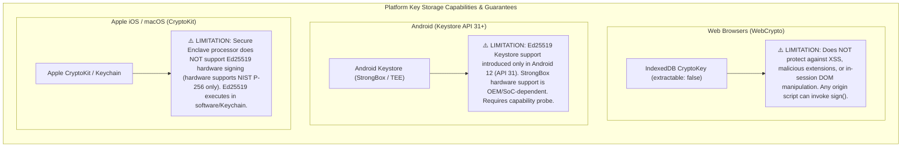
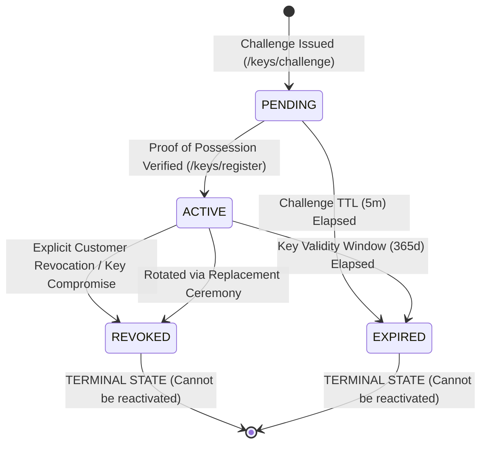
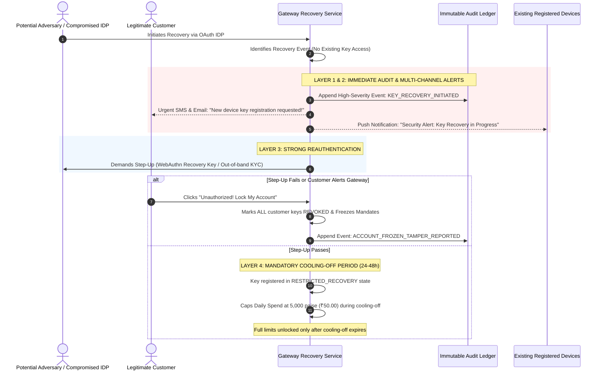
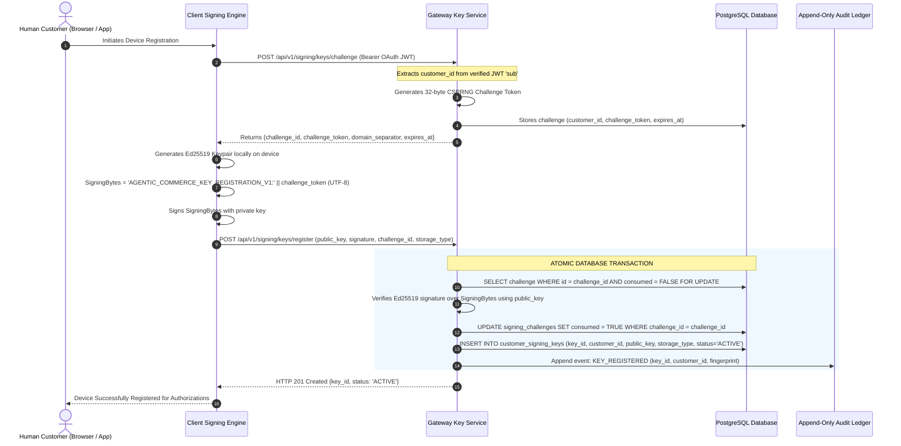
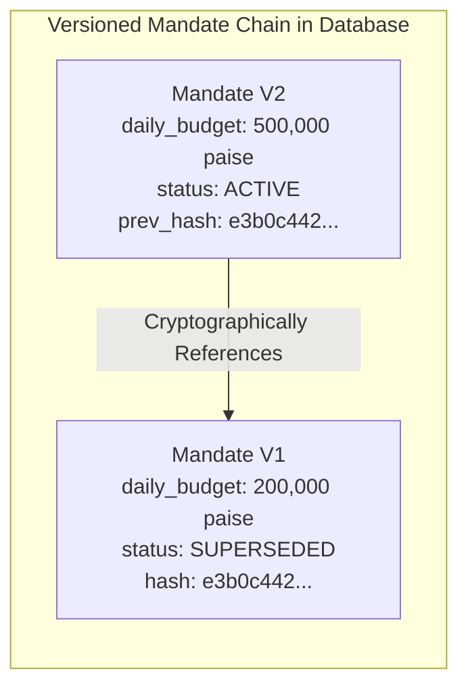
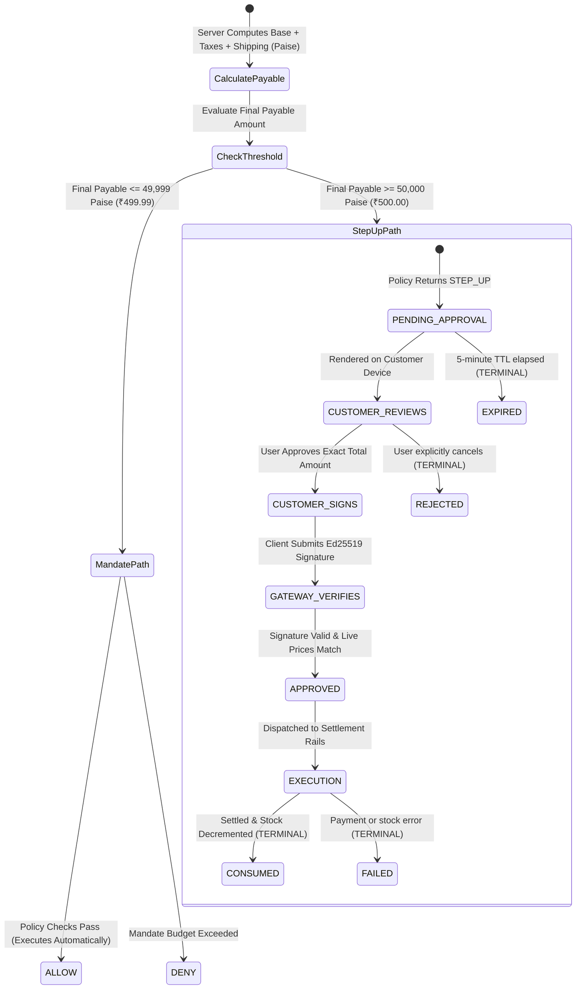
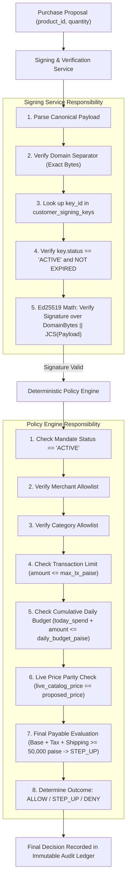

# ADR-01: Non-Custodial Customer Signing — Option A

- **ADR ID**: `ADR-01`
- **Title**: Non-Custodial Customer Signing Authority, Asymmetric Verification, and Key Management
- **Status**: `ACCEPTED (FORMALIZED SPECIFICATION — REVISED)`
- **Architectural Selection**: **Option A — Non-Custodial Customer Signing**
- **Governing Role**: Principal Software Architect & Senior Security Architect
- **Revision**: `1.2.0` (Incorporates Security Audit Corrections: Platform Storage Limitations, Account Recovery Hardening, Exact ₹500 Threshold Semantics, Deterministic Byte Construction, Mandate Concurrency Invariants, and Liability Framing)
- **Date**: `2026-11-09`
- **Target Implementation**: Phase P0.2 (Cryptographic Mandates) & P0.3 / P0.4 Integration
- **Classification**: `[PROPOSED SPECIFICATION — NOT YET IMPLEMENTED IN CODE]`

---

## 1. Executive Summary & Objective

In autonomous Agent-to-Agent (A2A) commerce, external AI Buyer Agents (e.g., Claude, ChatGPT, custom autonomous shopping agents) propose transactions on behalf of human consumers. If spending mandates are represented as mutable database rows or signed with server-controlled keys, the gateway cannot provide mathematical proof that a financial transaction was authorized by the sovereign human consumer rather than an autonomous LLM loop, a prompt-injection exploit, or a compromised internal database.

This Architecture Decision Record formally establishes the architecture and security specification for **Option A: Non-Custodial Customer Signing**:
1. **The customer exclusively owns and controls their Ed25519 private signing key** on their personal device.
2. **The gateway stores customer public keys only** in a strictly audited public-key directory (`customer_signing_keys`).
3. **The gateway verifies customer digital signatures** over canonicalized intent payloads; it never signs on behalf of the customer.
4. **Merchants and external AI agents cannot generate customer authorization signatures** under any circumstance.
5. **No gateway-managed customer signing keys are permitted** within the gateway infrastructure, server vaults, or databases.

> [!IMPORTANT]
> **Gateway Liability & Responsibility Framing**  
> The gateway does not custody customer private signing keys. Its responsibility is limited to secure public-key registration, signature verification, authorization enforcement, revocation handling, and auditability. Avoiding private-key custody significantly reduces a major class of centralized key-compromise risks, but the gateway retains full operational, regulatory, and technical liability for enforcing verification invariants, maintaining audit ledgers, and preventing unauthorized transaction settlement.

> [!WARNING]
> **Strict Phase 0 Boundary Notice**  
> This document is a formal architecture and security specification. In compliance with Phase 0 governance, **no cryptographic algorithms, application code, database migrations, or API routes are implemented in the codebase as part of this deliverable**. Implementation will occur during Phase P0.2–P0.4.

---

## 2. Context & Problem Statement

### 2.1 The Current Baseline (`[VERIFIED]`)
In the existing prototype:
- Mandates are stored as unsigned database records in `customer_mandates` ([`app/policy/store.py:96-110`](file:///d:/agentic-commerce-gateway/app/policy/store.py#L96-L110)), seeded statically from `DEMO_MANDATES`.
- Any process with database write access or access to `PATCH /admin/customers/{customer_id}/mandate` can mutate spending limits, allowed merchants, or validity windows.
- Conversational agents can trigger mandate modifications via MCP tools (`modify_spending_mandate` in [`app/mcp/tools.py:498`](file:///d:/agentic-commerce-gateway/app/mcp/tools.py#L498)), returning confirmation tokens back into LLM chat contexts (`VULN-05`).

### 2.2 The Threat of Delegated Authority
When an AI agent acts autonomously, delegated authority must be bounded, verifiable, and non-repudiable. If the gateway or an AI agent has the ability to mint or adjust customer spending limits:
- **Prompt Injection:** An adversarial product description could instruct the agent to expand its mandate.
- **Rogue Agents:** A malfunctioning loop could deplete a user's wallet across thousands of micro-transactions.
- **Insider Threat:** A compromised database administrator could forge purchase approvals.
- **Repudiation:** In payment rail disputes (e.g., credit card chargebacks or UPI fraud claims), the merchant and gateway cannot prove the human intended the purchase.

---

## 3. Evaluated Options & Architectural Selection

| Dimension | Option A: Non-Custodial Customer Signing (SELECTED) | Option B: Gateway-Managed HSM / Vault Keys (REJECTED) | Option C: Symmetric Shared Secret HMAC (REJECTED) |
| :--- | :--- | :--- | :--- |
| **Private Key Location** | Customer device (Hardware Keystore / Software Container / WebCrypto) | Gateway cloud vault (AWS KMS / HashiCorp Vault) | Shared secret on gateway server and client config |
| **Non-Repudiation** | **Strong**: Gateway mathematically cannot forge signatures | **Zero**: Gateway possesses keys and can forge customer intent | **Zero**: Anyone who can verify can forge |
| **Agent Isolation** | **Total**: Agent cannot access customer private keys | **Vulnerable**: Prompt injection can trick vault API if session valid | **Vulnerable**: Shared secret easily exposed in agent environment |
| **Target of Attack** | Individual consumer devices (distributed risk) | Central gateway vault (catastrophic honeypot) | Central gateway database / config files |
| **Regulatory & Payment Alignment** | Aligns with AP2 (Agentic Protocol 2.0), FIDO2, and W3C Verifiable Credentials | Fails zero-trust audit; constitutes custodial custody | Non-compliant with modern payment security standards |

### Formal Selection: Option A
**Option A is formally adopted as the architectural foundation of the Agentic Commerce Gateway.**  
Custodial solutions (Option B) and symmetric architectures (Option C) are permanently rejected for customer spending authorization.

```mermaid
flowchart TD
    subgraph CustomerDevice["Customer Sovereign Device (Browser / Mobile / Desktop)"]
        PrivKey["Ed25519 Private Key<br/>(Platform Keystore / IndexedDB CryptoKey)<br/>*NEVER LEAVES DEVICE*"]
        ReviewUI["Trusted Human UI<br/>(Reviews exact terms: merchant, SKU, limits, total amount)"]
        SignEngine["Local Signing Engine<br/>(RFC 8785 JCS + Exact Byte Construction + Ed25519)"]
        
        ReviewUI -->|"Human Approves"| SignEngine
        PrivKey -->|"Signs Deterministic Bytes"| SignEngine
    end

    subgraph UntrustedZone["Untrusted Network / Agent Zone"]
        Agent["External AI Buyer Agent<br/>(Proposes product_id & quantity ONLY)"]
        SignedDoc["Detached Signature Envelope<br/>(Signature + Key ID + Payload)"]
    end

    subgraph GatewayBoundary["Gateway Trust Boundary"]
        PubKeyDir[("customer_signing_keys<br/>(Stores Public Keys ONLY)") constraints: status=ACTIVE]
        VerifyService["Signature Verification Service<br/>(Pure Math: Ed25519 + JCS)"]
        PolicyEngine["Deterministic Policy Engine<br/>(Independent Business Rule Evaluation)"]
        AuditLedger[("audit_events<br/>(Append-Only Cryptographic Ledger)")]
    end

    SignEngine -->|"Transmits Signed Envelope"| SignedDoc
    Agent -.->|"Cannot Forge Signatures"| SignedDoc
    SignedDoc --> VerifyService
    PubKeyDir -->|"Fetches Public Key"| VerifyService
    VerifyService -->|"Cryptographic Proof Valid"| PolicyEngine
    PolicyEngine -->|"Enforces Budget, Merchants & Thresholds"| AuditLedger
```

---

## 4. Cryptographic Foundation & Deterministic Byte Construction

Every cryptographic operation across the gateway must conform strictly to these non-negotiable specifications:

| Primitive | Specification | Justification & Invariants |
| :--- | :--- | :--- |
| **Signature Algorithm** | **Ed25519** (RFC 8032 / PureEdDSA over Curve25519) | 128-bit security level, immune to timing side-channels, deterministic (no RFC 6979 RNG failure modes), high verification throughput (> 20,000 ops/sec/core). Mandatory for Schema v1. |
| **Canonicalization** | **RFC 8785** (JSON Canonicalization Scheme — JCS) | Byte-for-byte deterministic serialization across Python, TypeScript, Go, Rust, and WebCrypto. Guarantees whitespace, property order, and Unicode normalization parity. |
| **Digest / Hashing** | **SHA-256** (FIPS 180-4) | Used for challenge entropy, payload fingerprinting, and audit ledger chaining. |
| **Public Keys** | Raw 32-byte Ed25519 public key, **Base64URL-encoded** (RFC 4648 §5, unpadded) | Format: `^[A-Za-z0-9_-]{43}$`. Stored as `BYTEA` or Base64URL `VARCHAR(44)`. |
| **Signatures** | Raw 64-byte Ed25519 signature, **Base64URL-encoded** (unpadded) | Format: `^[A-Za-z0-9_-]{86}$`. Detached signature representation. |
| **Identifiers** | **UUIDv4** (RFC 4122) | Globally unique, non-sequential tokens for keys, challenges, mandates, and approvals. |
| **Monetary Values** | **Integer Paise** (`INTEGER` / `BIGINT`) | ₹1.00 = 100 paise. Floating-point values (`REAL`, `float`) are **strictly prohibited** in signed schemas and database models (`VULN-01`). |
| **Transport** | **HTTPS / TLS 1.3** exclusively | HSTS enforced. Unencrypted plain HTTP is rejected at the reverse proxy. |

### 4.1 Byte-for-Byte Deterministic Signature Construction
To prevent **cross-protocol signature substitution attacks** (where an attacker attempts to use a signature generated for a purchase approval as a spending mandate, or vice versa) and **encoding ambiguities**, the exact input to the Ed25519 signature function is frozen as follows:

$$\text{SigningBytes} = \text{DomainSeparatorBytes} \mathbin{\Vert} \text{CanonicalJsonBytes}$$

Where:
1. $\text{DomainSeparatorBytes}$ is the ASCII / UTF-8 byte encoding of the exact domain separator prefix string, including the terminating colon (`:`).
2. $\text{CanonicalJsonBytes}$ is the UTF-8 byte stream resulting from applying RFC 8785 (JSON Canonicalization Scheme) to the signed payload.
3. $\mathbin{\Vert}$ represents direct byte concatenation.

```
+------------------------------------------+------------------------------------------+
|          DomainSeparatorBytes            |            CanonicalJsonBytes            |
| "AGENTIC_COMMERCE_MANDATE_V1:" (UTF-8)   |   RFC 8785 Canonical JSON Bytes (UTF-8)  |
+------------------------------------------+------------------------------------------+
<------------------------ EXACT ED25519 SIGNING INPUT ------------------------------->
```

#### Inviolable Byte Construction Rules:
- **No Extra Whitespace:** Zero leading, trailing, or separating whitespace between the domain separator and canonical JSON bytes.
- **No Implicit Newlines:** Zero carriage return (`\r`) or linefeed (`\n`) characters added between or after components.
- **Strict Prefix Exactness:** The domain prefix string must match character-for-character with zero variation.
- **Identical Client/Server Execution:** Signer and verifier must construct this byte sequence identically.

| Domain Type | Exact Domain Separator Prefix String | Target Entity |
| :--- | :--- | :--- |
| **Key Registration Challenge** | `AGENTIC_COMMERCE_KEY_REGISTRATION_V1:` | Proof-of-Possession Challenge |
| **Spending Mandate** | `AGENTIC_COMMERCE_MANDATE_V1:` | Bounded Customer Spending Mandates |
| **Purchase Approval** | `AGENTIC_COMMERCE_APPROVAL_V1:` | Per-Transaction Step-Up Approvals |

### 4.2 Cross-Language Verification Test Vectors
To ensure byte-level interoperability across heterogenous runtimes, the P0.2 test suite must provide standardized test vectors validated across:
- Python (`cryptography.hazmat.primitives.asymmetric.ed25519`)
- TypeScript / Web (`@noble/ed25519` and browser WebCrypto)
- Go (`crypto/ed25519`)
- Rust (`ed25519-dalek`)

Each test vector fixture must contain:
1. Raw JSON input dict.
2. Canonical RFC 8785 JSON UTF-8 hex dump.
3. Domain separator string.
4. Combined concatenated signing input hex dump.
5. Ed25519 private key seed (hex).
6. Expected Ed25519 public key (Base64URL).
7. Expected Ed25519 signature (Base64URL).

### 4.3 Rejection of Malformed & Non-Canonical Inputs
The gateway signature verification service must strictly reject:
1. Payloads containing unrecognized cryptographic algorithms (e.g., `none`, `RS256`, `secp256k1`). **Only `Ed25519` is supported.**
2. Signed documents with missing or non-matching `domain_separator`.
3. Non-canonical JSON formatting (keys out of lexicographical order, floats, trailing commas, non-normalized Unicode).
4. Signatures whose length is not exactly 64 bytes (86 Base64URL characters).

---

## 5. Platform Key-Custody Architecture & Technical Limitations

The gateway relies on customer devices to hold private keys. However, **platform storage primitives do not provide equivalent security guarantees**. The engineering specification must explicitly document platform limitations and fallback rules.

### 5.1 Platform-by-Platform Security Analysis



#### 1. Web Browsers (Web Crypto API):
- **Mechanism:** Generated via `window.crypto.subtle.generateKey()` using `extractable: false` and stored as an opaque `CryptoKey` in IndexedDB.
- **Security Boundary:** Prevents programmatic export of raw private key bytes via `crypto.subtle.exportKey()`.
- **Explicit Limitations:** Web Crypto **does NOT protect against Cross-Site Scripting (XSS), malicious browser extensions, or compromised browser sessions**. Any script executing within the authenticated origin can invoke `crypto.subtle.sign()`. Web clients must enforce strict Content Security Policy (CSP) and treat browser signing keys as low-to-medium assurance credentials bounded by mandate daily limits.

#### 2. Android (Keystore Provider):
- **Mechanism:** Generated via Android `KeyStore` provider backed by Trusted Execution Environment (TEE) or StrongBox Keymaster.
- **Security Boundary:** Hardware-isolated private key operations guarded by biometric user authentication (BiometricPrompt / Class 3 strong biometrics).
- **Explicit Limitations:** **Hardware-backed Ed25519 support is device-, Android version-, and provider-dependent**. Standard Android Keystore introduced Ed25519 support in Android 12 (API level 31). Furthermore, StrongBox hardware chips (dedicated secure element) frequently lack Curve25519 coprocessors, falling back to TEE or failing key generation. Client apps must execute a runtime capability test.

#### 3. Apple iOS / macOS (CryptoKit / Keychain):
- **Mechanism:** Generated via Apple CryptoKit (`Curve25519.Signing.PrivateKey`) and stored in the macOS/iOS Data Protection Keychain with `kSecAccessControlBiometryAny`.
- **Security Boundary:** OS-level keychain encryption tied to user passcode and biometrics (Touch ID / Face ID).
- **Explicit Limitations:** **Apple's Secure Enclave does NOT support general-purpose Ed25519 private-key operations**. The Secure Enclave processor hardware only supports NIST P-256 (`secp256r1`). Consequently, Ed25519 private-key operations on Apple devices execute in software within the operating system kernel/CryptoKit sandbox, protected by Secure Enclave-derived keychain wrapping keys, but **not** inside the hardware enclave processor itself.

### 5.2 Mandatory Algorithm Invariance & Fallback Policies
> [!CAUTION]
> **No Silent Algorithm Substitution**  
> Ed25519 is the mandatory digital signature algorithm for Schema v1. The client and gateway **MUST NEVER silently substitute another algorithm** (e.g., falling back to P-256 or RSA).

Where hardware-backed Ed25519 support is unavailable on the client device, the client application must conform strictly to one of two documented policies:
1. **Explicit Platform Failure (High-Assurance Clients):** The client application detects lack of hardware Ed25519 support and explicitly refuses key registration (`PLATFORM_HARDWARE_UNSUPPORTED`).
2. **Documented Software-Backed Fallback (Standard Clients):** The client falls back to OS-level secure software storage (e.g., encrypted local keychain or software container with restricted file permissions), explicitly setting `key_storage_type = 'SOFTWARE_SECURE_STORAGE'` during public-key registration. The gateway records this storage tier in the public-key directory and audit ledger, allowing policy engines to impose tighter spending caps on software-backed keys.

### 5.3 Prohibited Storage Locations
Storing customer private keys in any of the following locations is an **inviolable security violation**:
- ❌ Gateway servers, memory, environment variables, or disk storage.
- ❌ Gateway databases (SQLite, PostgreSQL, Redis).
- ❌ API request payloads or HTTP query parameters.
- ❌ Server application logs, stdout/stderr, or APM traces.
- ❌ Web analytics, error-monitoring tools (Sentry), or telemetry streams.
- ❌ Browser `localStorage` or `sessionStorage` (which are trivially accessible to injected scripts).

---

## 6. Key Lifecycle & Hardened Account Recovery Architecture

Each customer signing key follows a strictly enforced, one-way state machine:



### 6.1 State Definitions & Irreversibility
1. **`PENDING`**: Challenge generated and assigned to the customer. Awaiting client key generation and proof-of-possession signature. TTL: 5 minutes.
2. **`ACTIVE`**: Proof-of-possession verified. Key is trusted by the gateway to verify customer spending mandates and purchase approvals.
3. **`REVOKED`**: Key was explicitly revoked by the customer, flagged as compromised, or superseded during rotation. **Terminal state**.
4. **`EXPIRED`**: Key passed its maximum lifecycle validity timestamp (`expires_at`). **Terminal state**.

> [!CAUTION]
> **Inviolable Invariant: Terminal States are Irreversible**  
> Under no circumstance may a `REVOKED` or `EXPIRED` key be returned to `ACTIVE`. Re-enabling a revoked key constitutes a critical security breach.

### 6.2 Hardened Account Recovery Architecture (Guarding Against Channel Compromise)

> [!WARNING]
> **The Threat of Recovery-Channel Compromise**  
> Relying solely on OAuth identity-provider (IDP) login to register a replacement signing key is insufficient. If account recovery silently grants signing authority, an attacker who compromises the customer's email, SIM card, or IDP credentials can register a new key and steal customer funds. Account recovery must never silently replace signing authority.

To preserve non-custodial integrity during device loss or recovery, the gateway enforces a **six-layer recovery defense**:



#### Required Recovery Security Controls:
1. **Strong Step-Up Reauthentication:** Re-authenticating via OAuth password alone is insufficient. Recovery requires strong reauthentication: a secondary FIDO2/WebAuthn backup passkey, an out-of-band identity attestation, or administrator-assisted KYC.
2. **Audit Ledger Logging:** The gateway appends high-severity, non-repudiable events (`KEY_RECOVERY_INITIATED`, `KEY_RECOVERY_STEP_UP_PASSED`, `KEY_RECOVERY_COMPLETED`) to `audit_events`.
3. **Multi-Channel Customer Notifications:** Immediate, out-of-band notifications are transmitted to the customer's primary email, verified SMS number, and pushed to all existing active devices.
4. **Mandatory Cooling-Off Period:** A recovered device key is placed into a temporary **cooling-off restriction** for 24 hours. During cooling-off, the key cannot authorize transactions exceeding 5,000 paise (₹50.00) or modify spending mandates.
5. **Immediate Revocation Capability:** The customer or security administrators retain the ability to immediately mark any key as `REVOKED` through an emergency one-click kill link in notification alerts, without waiting for cooling-off delays.
6. **Treatment of Recovery-Channel Compromise:** If an attacker compromises the primary OAuth IDP, the combination of multi-channel notification, strong secondary reauthentication, and cooling-off prevents immediate fund extraction, allowing the human customer time to trigger emergency account freezing.

---

## 7. Key Registration Protocol (Proof of Possession)

Registration of an Ed25519 public key binds the key to a verified customer identity. To prevent public-key injection and unauthorized key binding, registration requires an **authenticated cryptographic proof of possession (PoP)**.



### 7.1 Registration Invariants
1. **Identity Grounding:** The `customer_id` is derived **exclusively** from the verified OAuth 2.1 access token claim (`sub`). Caller-supplied customer IDs in the request body are strictly ignored.
2. **Challenge Entropy:** Challenge tokens must contain $\ge 32$ bytes of cryptographic randomness generated by `secrets.token_bytes(32)`.
3. **Atomic Single-Use Consumption:** The challenge must be burned inside the same PostgreSQL transaction that inserts the public key, preventing concurrent challenge reuse.

---

## 8. Signed Spending Mandate Contract

Spending mandates represent customer-sovereign policy boundaries. They establish the maximum spending envelope that an external AI agent is permitted to propose.

### 8.1 Mandate Canonical Payload Schema (`1.0.0`)

```json
{
  "$schema": "https://json-schema.org/draft/2020-12/schema",
  "title": "CustomerSpendingMandatePayload",
  "type": "object",
  "required": [
    "schema_version",
    "mandate_id",
    "mandate_version",
    "customer_id",
    "merchant_id",
    "currency",
    "max_transaction_amount_paise",
    "daily_budget_paise",
    "allowed_categories",
    "allowed_products",
    "validity_period",
    "automatic_purchase_restrictions",
    "nonce",
    "created_at"
  ],
  "additionalProperties": false,
  "properties": {
    "schema_version": { "type": "string", "enum": ["1.0.0"] },
    "mandate_id": { "type": "string", "format": "uuid" },
    "mandate_version": { "type": "integer", "minimum": 1 },
    "customer_id": { "type": "string", "pattern": "^CUST[0-9]{3,}$" },
    "merchant_id": { "type": "string", "description": "Specific merchant ID or '*' for any gateway merchant" },
    "currency": { "type": "string", "enum": ["INR"] },
    "max_transaction_amount_paise": { "type": "integer", "minimum": 100 },
    "daily_budget_paise": { "type": "integer", "minimum": 100 },
    "allowed_categories": {
      "type": "array",
      "items": { "type": "string" },
      "minItems": 1
    },
    "allowed_products": {
      "type": "array",
      "items": { "type": "string" },
      "description": "Specific SKU list, or empty array indicating category-wide authorization"
    },
    "validity_period": {
      "type": "object",
      "required": ["not_before", "expires_at"],
      "additionalProperties": false,
      "properties": {
        "not_before": { "type": "string", "format": "date-time" },
        "expires_at": { "type": "string", "format": "date-time" }
      }
    },
    "automatic_purchase_restrictions": {
      "type": "object",
      "required": ["max_auto_amount_paise", "require_step_up_above_paise"],
      "additionalProperties": false,
      "properties": {
        "max_auto_amount_paise": { "type": "integer", "minimum": 0 },
        "require_step_up_above_paise": { "type": "integer", "minimum": 0 }
      }
    },
    "previous_mandate_id": { "type": "string", "format": "uuid" },
    "previous_payload_hash": { "type": "string", "pattern": "^[a-f0-9]{64}$" },
    "nonce": { "type": "string", "minLength": 32, "maxLength": 64 },
    "created_at": { "type": "string", "format": "date-time" }
  }
}
```

### 8.2 Detached Signature Envelope Specification
Mandates are transmitted to the gateway as a **detached signature envelope**:

```json
{
  "payload": { "... canonical mandate payload object ..." },
  "envelope": {
    "algorithm": "Ed25519",
    "key_id": "8f3b2e5a-7b1c-4e89-a2e1-9c3d4f5e6a7b",
    "canonicalization": "RFC8785",
    "domain_separator": "AGENTIC_COMMERCE_MANDATE_V1:",
    "signature": "base64url_encoded_64_byte_ed25519_signature"
  }
}
```

---

## 9. Mandate Version Concurrency & Replacement Invariants

Signed mandates are **immutable**. Once signed, an existing mandate record cannot be edited, patched, or updated in place.



### 9.1 Mandate Replacement Concurrency Invariants
To modify a spending mandate (e.g., increasing daily budget from 200,000 paise to 500,000 paise):
1. **Exactly One ACTIVE Version per Mandate Chain:** The database must enforce that a customer cannot have multiple active versions of the same mandate simultaneously.
2. **Cryptographic Chaining to Predecessor:** Version $N+1$ must reference `previous_mandate_id` and the SHA-256 digest of the canonical version $N$ payload (`previous_payload_hash`).
3. **Atomic Replacement in One Database Transaction:** Superseding version $N$ (`ACTIVE` $\rightarrow$ `SUPERSEDED`) and activating version $N+1$ (`ACTIVE`) must execute in a single atomic PostgreSQL transaction.
4. **Strict Concurrency Protection:** The transaction must acquire a row-level lock (`SELECT ... FOR UPDATE`) on the existing `ACTIVE` record. Concurrent update attempts will either serialize or abort with error `40001` / `23505`.
5. **Rollback Guarantee:** If signature verification, payload hash matching, or database insertion fails, the entire transaction rolls back, leaving version $N$ active and intact.

### 9.2 Atomic SQL Implementation

```sql
BEGIN TRANSACTION;

-- 1. Lock existing active mandate row
SELECT mandate_id, mandate_version, payload_hash 
  FROM signed_mandates 
 WHERE customer_id = :customer_id 
   AND mandate_id = :previous_mandate_id 
   AND status = 'ACTIVE'
   FOR UPDATE;

-- 2. Verify previous payload hash matches payload
-- (Application layer verifies :previous_payload_hash == locked_row.payload_hash)

-- 3. Supersede old version
UPDATE signed_mandates
   SET status = 'SUPERSEDED', updated_at = NOW()
 WHERE customer_id = :customer_id 
   AND mandate_id = :previous_mandate_id 
   AND status = 'ACTIVE';

-- 4. Insert new version
INSERT INTO signed_mandates (
    mandate_id, mandate_version, customer_id, merchant_id, key_id,
    canonical_payload, payload_hash, signature, domain_separator,
    max_transaction_amount_paise, daily_budget_paise, status,
    valid_from, valid_until, previous_mandate_id, previous_payload_hash, created_at
) VALUES (
    :new_mandate_id, :new_version, :customer_id, :merchant_id, :key_id,
    :canonical_payload, :payload_hash, :signature, 'AGENTIC_COMMERCE_MANDATE_V1:',
    :max_tx_paise, :daily_budget_paise, 'ACTIVE',
    :valid_from, :valid_until, :previous_mandate_id, :previous_payload_hash, NOW()
);

COMMIT;
```

---

## 10. Purchase Approval Signing & Exact ₹500 Threshold Semantics

Spending mandates authorize a broad spending envelope. In contrast, **Purchase Approvals** authorize a **single, specific, high-value transaction** requiring step-up customer authentication.

### 10.1 Exact Semantics of the 50,000 Paise (₹500.00) Threshold
The threshold governing whether a purchase requires customer approval is frozen with exact mathematical precision:

$$\text{FinalPayablePaise} = \sum (\text{unit\_price\_paise} \times \text{quantity}) + \text{taxes\_paise} + \text{shipping\_paise} + \text{fees\_paise}$$

> [!IMPORTANT]
> **Total Payable Amount Determines Approval Requirement**  
> The threshold evaluation is based strictly on the **final payable amount in integer paise**, calculated server-side including all applicable taxes, shipping, handling, and fees—**not** merely the product's catalog base price.

#### Boundary Test Matrix:
- **Case 1 (49,999 paise / ₹499.99):** Final payable amount $< 50,000$ paise. **Does NOT trigger customer approval**. Evaluates via autonomous mandate-based policy path; executes automatically if mandate limits pass (`ALLOW`).
- **Case 2 (50,000 paise / ₹500.00):** Final payable amount $= 50,000$ paise. **TRIGGERS CUSTOMER APPROVAL (`STEP_UP`)**. Requires Ed25519 purchase approval signature on customer device.
- **Case 3 (50,001 paise / ₹500.01):** Final payable amount $> 50,000$ paise. **TRIGGERS CUSTOMER APPROVAL (`STEP_UP`)**. Requires Ed25519 purchase approval signature on customer device.



### 10.2 Purchase Approval Payload Schema (`1.0.0`)

```json
{
  "$schema": "https://json-schema.org/draft/2020-12/schema",
  "title": "PurchaseApprovalPayload",
  "type": "object",
  "required": [
    "schema_version",
    "approval_id",
    "purchase_id",
    "customer_id",
    "merchant_id",
    "mandate_id",
    "mandate_version",
    "items",
    "subtotal_paise",
    "taxes_paise",
    "shipping_paise",
    "fees_paise",
    "total_payable_paise",
    "currency",
    "expires_at",
    "nonce",
    "created_at"
  ],
  "additionalProperties": false,
  "properties": {
    "schema_version": { "type": "string", "enum": ["1.0.0"] },
    "approval_id": { "type": "string", "format": "uuid" },
    "purchase_id": { "type": "string", "format": "uuid" },
    "customer_id": { "type": "string", "pattern": "^CUST[0-9]{3,}$" },
    "merchant_id": { "type": "string" },
    "mandate_id": { "type": "string", "format": "uuid" },
    "mandate_version": { "type": "integer", "minimum": 1 },
    "items": {
      "type": "array",
      "minItems": 1,
      "items": {
        "type": "object",
        "required": ["product_id", "quantity", "unit_price_paise", "total_item_amount_paise"],
        "additionalProperties": false,
        "properties": {
          "product_id": { "type": "string" },
          "quantity": { "type": "integer", "minimum": 1 },
          "unit_price_paise": { "type": "integer", "minimum": 1 },
          "total_item_amount_paise": { "type": "integer", "minimum": 1 }
        }
      }
    },
    "subtotal_paise": { "type": "integer", "minimum": 1 },
    "taxes_paise": { "type": "integer", "minimum": 0 },
    "shipping_paise": { "type": "integer", "minimum": 0 },
    "fees_paise": { "type": "integer", "minimum": 0 },
    "total_payable_paise": { "type": "integer", "minimum": 1 },
    "currency": { "type": "string", "enum": ["INR"] },
    "expires_at": { "type": "string", "format": "date-time" },
    "nonce": { "type": "string", "minLength": 32 },
    "created_at": { "type": "string", "format": "date-time" }
  }
}
```

---

## 11. Database Architecture & PostgreSQL Schema Specifications

The relational schema implements the atomic invariants established in `ADR-02`.

```sql
-- 1. Customer Signing Keys Registry
CREATE TABLE customer_signing_keys (
    key_id VARCHAR(36) PRIMARY KEY,
    customer_id VARCHAR(64) NOT NULL,
    public_key_bytes BYTEA NOT NULL,
    device_name VARCHAR(128) NOT NULL,
    storage_type VARCHAR(32) NOT NULL DEFAULT 'SOFTWARE_SECURE_STORAGE'
        CHECK (storage_type IN ('HARDWARE_KEYSTORE', 'SOFTWARE_SECURE_STORAGE', 'WEB_CRYPTO_INDEXED_DB')),
    status VARCHAR(16) NOT NULL DEFAULT 'PENDING' 
        CHECK (status IN ('PENDING', 'ACTIVE', 'REVOKED', 'EXPIRED')),
    created_at TIMESTAMPTZ NOT NULL DEFAULT NOW(),
    expires_at TIMESTAMPTZ NOT NULL,
    revoked_at TIMESTAMPTZ NULL,
    FOREIGN KEY (customer_id) REFERENCES customer_credentials(customer_id)
);
CREATE INDEX idx_signing_keys_cust_status ON customer_signing_keys (customer_id, status);

-- 2. Signing Challenges Store (Proof-of-Possession)
CREATE TABLE signing_challenges (
    challenge_id VARCHAR(36) PRIMARY KEY,
    customer_id VARCHAR(64) NOT NULL,
    challenge_token VARCHAR(64) NOT NULL UNIQUE,
    purpose VARCHAR(32) NOT NULL DEFAULT 'KEY_REGISTRATION'
        CHECK (purpose IN ('KEY_REGISTRATION', 'MANDATE_REVOCATION')),
    consumed BOOLEAN NOT NULL DEFAULT FALSE,
    created_at TIMESTAMPTZ NOT NULL DEFAULT NOW(),
    expires_at TIMESTAMPTZ NOT NULL,
    FOREIGN KEY (customer_id) REFERENCES customer_credentials(customer_id)
);
CREATE INDEX idx_challenges_cust_unconsumed ON signing_challenges (customer_id, consumed, expires_at);

-- 3. Cryptographically Signed Mandates Ledger
CREATE TABLE signed_mandates (
    mandate_id VARCHAR(36) NOT NULL,
    mandate_version INTEGER NOT NULL DEFAULT 1,
    customer_id VARCHAR(64) NOT NULL,
    merchant_id VARCHAR(64) NOT NULL,
    key_id VARCHAR(36) NOT NULL,
    canonical_payload JSONB NOT NULL,
    payload_hash CHAR(64) NOT NULL,
    signature VARCHAR(128) NOT NULL,
    domain_separator VARCHAR(64) NOT NULL DEFAULT 'AGENTIC_COMMERCE_MANDATE_V1:',
    max_transaction_amount_paise BIGINT NOT NULL,
    daily_budget_paise BIGINT NOT NULL,
    status VARCHAR(16) NOT NULL DEFAULT 'ACTIVE'
        CHECK (status IN ('ACTIVE', 'SUPERSEDED', 'REVOKED', 'EXPIRED')),
    valid_from TIMESTAMPTZ NOT NULL,
    valid_until TIMESTAMPTZ NOT NULL,
    previous_mandate_id VARCHAR(36) NULL,
    previous_payload_hash CHAR(64) NULL,
    created_at TIMESTAMPTZ NOT NULL DEFAULT NOW(),
    updated_at TIMESTAMPTZ NOT NULL DEFAULT NOW(),
    PRIMARY KEY (mandate_id, mandate_version),
    FOREIGN KEY (customer_id) REFERENCES customer_credentials(customer_id),
    FOREIGN KEY (key_id) REFERENCES customer_signing_keys(key_id)
);

-- INVARIANT: Exactly one ACTIVE version per mandate chain for a customer
CREATE UNIQUE INDEX uq_active_mandate_per_customer 
    ON signed_mandates (customer_id, mandate_id) 
 WHERE status = 'ACTIVE';

CREATE INDEX idx_signed_mandates_lookup 
    ON signed_mandates (customer_id, status, valid_until);

-- 4. Purchase Approvals (Step-Up Authorizations)
CREATE TABLE purchase_approvals (
    approval_id VARCHAR(36) PRIMARY KEY,
    purchase_id VARCHAR(36) NOT NULL UNIQUE,
    customer_id VARCHAR(64) NOT NULL,
    mandate_id VARCHAR(36) NOT NULL,
    mandate_version INTEGER NOT NULL,
    key_id VARCHAR(36) NOT NULL,
    total_amount_paise BIGINT NOT NULL,
    canonical_payload JSONB NOT NULL,
    payload_hash CHAR(64) NOT NULL,
    signature VARCHAR(128) NOT NULL,
    status VARCHAR(20) NOT NULL DEFAULT 'PENDING_APPROVAL'
        CHECK (status IN ('PENDING_APPROVAL', 'APPROVED', 'CONSUMED', 'REJECTED', 'EXPIRED', 'FAILED')),
    expires_at TIMESTAMPTZ NOT NULL,
    consumed_at TIMESTAMPTZ NULL,
    created_at TIMESTAMPTZ NOT NULL DEFAULT NOW(),
    FOREIGN KEY (customer_id) REFERENCES customer_credentials(customer_id),
    FOREIGN KEY (mandate_id, mandate_version) REFERENCES signed_mandates(mandate_id, mandate_version),
    FOREIGN KEY (key_id) REFERENCES customer_signing_keys(key_id)
);
CREATE INDEX idx_purchase_approvals_status ON purchase_approvals (purchase_id, status, expires_at);
```

---

## 12. Policy Integration & Separation of Concerns

A fundamental architectural principle of the gateway is the strict separation between **Cryptographic Verification** and **Policy Authorization**:

$$\text{Valid Signature} \ne \text{Authorized Transaction}$$



---

## 13. Threat Model & Security Analysis

The non-custodial signing architecture mitigates 14 distinct threat scenarios:

| Threat ID | Threat Vector | Attack Mechanics | Mitigation Architecture | Residual Risk & Operational Defense |
| :--- | :--- | :--- | :--- | :--- |
| **TH-01** | Compromised Customer Device | Host OS compromised with malware. | Private keys stored in platform Keystore with biometric authorization. | Device revoked out-of-band; daily budget limits financial loss. |
| **TH-02** | Malicious Browser Extensions | Injected script attempts to read key. | WebCrypto non-extractable keys in IndexedDB; cannot export raw bytes. | Script could call `sign()` if in-session; bounded by daily spending cap. |
| **TH-03** | Cross-Site Scripting (XSS) | Stored XSS executes arbitrary JS in origin. | Strict CSP; non-extractable keys; mandate budget limit stops wallet drain. | XSS can invoke `sign()` in-session; high-value purchases require separate step-up. |
| **TH-04** | Stolen OAuth Session Tokens | Bearer token intercepted by proxy. | Key registration requires proof-of-possession; purchase requires device signature. | Session token alone cannot sign mandates or authorize purchases. |
| **TH-05** | Unauthorized Key Registration | Attacker registers their own key for victim. | Authenticated session + challenge PoP + step-up + audit log. | Registration logged immediately to immutable audit ledger. |
| **TH-06** | Challenge Replay Attack | Intercepted registration challenge reused. | 32 bytes entropy, 5-minute TTL, atomically burned in DB transaction. | Zero residual risk; replay rejected by database status constraint. |
| **TH-07** | Signature Replay Attack | Intercepted mandate/approval signature replayed. | Mandates enforce version sequencing; approvals burned atomically (`CONSUMED`). | Zero residual risk; unique indexes reject duplicate payload hashes and approval IDs. |
| **TH-08** | Conversational Mandate Escalation (`VULN-05`) | AI agent calls tool to raise spending limit. | `modify_spending_mandate` tool removed from MCP. Mandates require non-custodial signature. | Zero agent authority; agents cannot self-escalate. |
| **TH-09** | Purchase Amount Manipulation | Caller alters purchase amount in transit. | Gateway computes amount server-side; approval signatures cover exact `total_payable_paise`. | Any tampering invalidates signature; mismatch rejected. |
| **TH-10** | Product Quantity Manipulation | Agent alters quantity after approval. | Approval signature explicitly covers `items[].quantity`. Quantity change breaks signature. | Approval immediately rejected with `SIGNATURE_VERIFICATION_FAILED`. |
| **TH-11** | Concurrent Approval Race (`VULN-04`) | Parallel requests with same approval token. | PostgreSQL atomic `UPDATE purchase_approvals SET status = 'CONSUMED' WHERE status = 'APPROVED'`. | Only exactly one request succeeds; second request returns 0 rows and fails. |
| **TH-12** | Lost or Stolen Customer Device | Physical phone stolen without passcode. | Device lock guards Keystore; customer revokes device key via recovery ceremony. | Key marked `REVOKED` within seconds across all gateway nodes. |
| **TH-13** | Account Recovery Abuse | Social engineering attempt to re-provision keys. | Multi-factor step-up + cooling-off period + multi-channel alerts + audit events. | Cooling-off period allows legitimate customer to freeze compromised account. |
| **TH-14** | Blind Signing / Spoofed UI | Malicious site presents spoofed summary. | Customer signing software must be trusted first-party client; payload canonicalized and verified. | Native client enforces standardized signing sheet with cryptographic origin verification. |

---

## 14. MVP Security Decisions (Frozen Framework)

The following architectural decisions are **permanently frozen for the MVP implementation (P0.2–P0.4)**:

| Decision Area | Frozen MVP Requirement | Rationale & Boundary |
| :--- | :--- | :--- |
| **Key Custody** | **Non-Custodial Customer Controlled** | No private keys inside gateway or cloud vaults. Customer devices sign locally. |
| **Digital Signature** | **Ed25519 Exclusively** | PureEdDSA over Curve25519. No algorithm negotiation or legacy RSA/ECDSA fallbacks. |
| **Canonicalization** | **RFC 8785 (JCS)** | Byte-exact JSON Canonicalization Scheme. No custom serializers. |
| **Exact Byte Construction**| **PrefixBytes $\mathbin{\Vert}$ CanonicalJsonBytes**| Direct UTF-8 byte concatenation with zero extra whitespace or newlines. |
| **Key Registration** | **Authenticated Proof of Possession** | Challenge-response signed by private key over OAuth 2.1 authenticated session. |
| **Signature Format** | **Detached Signature Envelope** | Raw 64-byte Ed25519 signature Base64URL-encoded alongside canonical payload. |
| **Anti-Replay Mechanism**| **Nonces, Expiry, and Atomic DB Burning**| Challenges and approvals burned atomically in PostgreSQL (`CONSUMED = TRUE`). |
| **Approval Threshold** | **$\ge \text{50,000 paise}$ (₹500.00)** | Evaluated on total payable amount (base + taxes + shipping + fees) in paise. |
| **Key Revocation** | **Authenticated Revocation Ceremony** | Immediate transition to `REVOKED` in `customer_signing_keys`; irreversible. |
| **Account Recovery** | **Hardened Multi-Layer Defense** | Step-up auth, multi-channel alerts, 24h cooling-off, emergency freeze. |
| **Mandate Replacement** | **Atomic Swap with Predecessor Chaining**| Exactly one ACTIVE version; references previous hash; single DB transaction. |
| **Authoritative Clock** | **Server UTC Authoritative** | Gateway server UTC is authoritative. Clock skew tolerance strictly $\pm 30$ seconds. |
| **Delegation Limits** | **No Sub-Mandate Delegation** | External agents cannot mint sub-mandates. Mandates are non-delegable in MVP. |
| **Client Test Vectors** | **Shared Multi-Language Test Vectors** | Test suite must provide standardized JSON fixtures and byte-exact test vectors. |

---

## 15. Explicit Unresolved Architectural Decisions (Post-MVP)

The following decisions are formally classified as **`[UNRESOLVED]`** and deferred beyond the MVP:

1. **Hardware Passkey (WebAuthn / FIDO2) Native Assertion Bridge `[UNRESOLVED]`**:
   - *Question:* Should WebAuthn assertions (`authenticatorData` + clientDataJSON) be converted into Ed25519 signatures via a client-side proxy, or should the gateway natively support WebAuthn P-256 assertions as an alternate signature format in Phase P2.0?
   - *Status:* Deferred to Phase P2.0. MVP enforces Ed25519 via WebCrypto / native Keystore.
2. **Distributed Redis Revocation Bloom Filter `[UNRESOLVED]`**:
   - *Question:* In a multi-region deployment with $>10,000$ requests/sec, should key and mandate revocations be synchronized via Redis Bloom Filters instead of synchronous PostgreSQL queries?
   - *Status:* Deferred to production scale review. MVP synchronous PostgreSQL index lookup takes $< 2\text{ms}$.
3. **Decentralized Identity / DID Document Discovery `[UNRESOLVED]`**:
   - *Question:* Should customer public keys be resolvable via W3C DID methods (e.g., `did:key:z6M...`) to support cross-merchant federated commerce?
   - *Status:* Deferred to AP2 federated commerce standardization.

---

## 16. Proposed API Specifications (Contracts for P0.2)

> [!NOTE]
> All endpoints documented below are **specifications for Phase P0.2 implementation**. They do not exist in the codebase today.

### Contract 1: Issue Key Registration Challenge
- **Endpoint:** `POST /api/v1/signing/keys/challenge`
- **Authentication:** `Bearer <OAuth_JWT>` (Customer Identity)
- **Request Headers:** `Authorization: Bearer eyJhbGciOi...`
- **Request Body:**
  ```json
  {
    "device_name": "Pixel 8 Pro (Chrome)",
    "purpose": "KEY_REGISTRATION"
  }
  ```
- **Response (`HTTP 201 Created`):**
  ```json
  {
    "challenge_id": "c7a8b9e0-1234-4567-89ab-cdef01234567",
    "challenge_token": "u4W7qL9xP2mK8vN5yR1tE3wQ6zX0jB4hF7gC2vD8sA1",
    "domain_separator": "AGENTIC_COMMERCE_KEY_REGISTRATION_V1:",
    "expires_at": "2026-11-09T18:45:00Z"
  }
  ```
- **Validation & Security Controls:** Rate-limited to 5 challenges per customer per hour. Customer ID bound strictly to JWT `sub`.

### Contract 2: Register Public Key (Proof of Possession)
- **Endpoint:** `POST /api/v1/signing/keys/register`
- **Authentication:** `Bearer <OAuth_JWT>` (Same customer)
- **Request Body:**
  ```json
  {
    "challenge_id": "c7a8b9e0-1234-4567-89ab-cdef01234567",
    "public_key": "O2IvqvnlJ2QkWNaHp6RHPvln_0WkJOmEcbpWdOzTreo",
    "signature": "3R9v...base64url_64_bytes...K8wQ",
    "device_name": "Pixel 8 Pro (Chrome)",
    "storage_type": "WEB_CRYPTO_INDEXED_DB",
    "key_ttl_days": 365
  }
  ```
- **Response (`HTTP 201 Created`):**
  ```json
  {
    "key_id": "8f3b2e5a-7b1c-4e89-a2e1-9c3d4f5e6a7b",
    "customer_id": "CUST001",
    "public_key": "O2IvqvnlJ2QkWNaHp6RHPvln_0WkJOmEcbpWdOzTreo",
    "storage_type": "WEB_CRYPTO_INDEXED_DB",
    "status": "ACTIVE",
    "created_at": "2026-11-09T18:40:15Z",
    "expires_at": "2027-11-09T18:40:15Z"
  }
  ```
- **Failure Conditions:** `HTTP 400` (`CHALLENGE_INVALID_OR_CONSUMED`), `HTTP 401` (`SIGNATURE_VERIFICATION_FAILED`).

### Contract 3: Revoke Customer Signing Key
- **Endpoint:** `POST /api/v1/signing/keys/{key_id}/revoke`
- **Authentication:** `Bearer <OAuth_JWT>` (Customer Identity)
- **Request Body:**
  ```json
  {
    "reason": "DEVICE_LOST"
  }
  ```
- **Response (`HTTP 200 OK`):**
  ```json
  {
    "key_id": "8f3b2e5a-7b1c-4e89-a2e1-9c3d4f5e6a7b",
    "status": "REVOKED",
    "revoked_at": "2026-11-09T19:00:00Z"
  }
  ```

### Contract 4: Submit Signed Mandate
- **Endpoint:** `POST /api/v1/mandates/signed`
- **Authentication:** `Bearer <OAuth_JWT>`
- **Request Body:** Detached signature envelope (Section 8.2).
- **Response (`HTTP 201 Created`):**
  ```json
  {
    "mandate_id": "d1e2f3a4-5678-90ab-cdef-1234567890ab",
    "mandate_version": 1,
    "status": "ACTIVE",
    "customer_id": "CUST001",
    "created_at": "2026-11-09T18:45:00Z"
  }
  ```

### Contract 5: Revoke Mandate
- **Endpoint:** `POST /api/v1/mandates/{mandate_id}/revoke`
- **Authentication:** `Bearer <OAuth_JWT>`
- **Response (`HTTP 200 OK`):**
  ```json
  {
    "mandate_id": "d1e2f3a4-5678-90ab-cdef-1234567890ab",
    "status": "REVOKED",
    "revoked_at": "2026-11-09T19:15:00Z"
  }
  ```

### Contract 6: Create Purchase Approval (Gateway Generated)
- **Endpoint:** `POST /api/v1/purchases/{purchase_id}/approvals/create`
- **Authentication:** Internal Service / Gateway Authorization
- **Response (`HTTP 201 Created`):**
  ```json
  {
    "approval_id": "a9b8c7d6-e5f4-3210-fedc-ba9876543210",
    "purchase_id": "e4f5a6b7-c8d9-0123-4567-89abcdef0123",
    "payload_to_sign": { "... canonical purchase approval object ..." },
    "domain_separator": "AGENTIC_COMMERCE_APPROVAL_V1:",
    "expires_at": "2026-11-09T18:50:00Z"
  }
  ```

### Contract 7: Verify and Consume Purchase Approval
- **Endpoint:** `POST /api/v1/purchases/{purchase_id}/approvals/verify-and-consume`
- **Authentication:** `Bearer <OAuth_JWT>`
- **Request Body:**
  ```json
  {
    "approval_id": "a9b8c7d6-e5f4-3210-fedc-ba9876543210",
    "key_id": "8f3b2e5a-7b1c-4e89-a2e1-9c3d4f5e6a7b",
    "signature": "base64url_64_byte_signature"
  }
  ```
- **Response (`HTTP 200 OK`):**
  ```json
  {
    "purchase_id": "e4f5a6b7-c8d9-0123-4567-89abcdef0123",
    "approval_id": "a9b8c7d6-e5f4-3210-fedc-ba9876543210",
    "status": "CONSUMED",
    "consumed_at": "2026-11-09T18:48:30Z",
    "payment_execution_status": "AUTO_PAID"
  }
  ```

---

## 17. Explicit Architectural Restrictions

The following restrictions are mandatory and inviolable across all future implementation phases:
1. **No Customer Private Keys Inside Gateway Infrastructure:** Gateway must never generate, store, handle, or log customer private keys.
2. **No Customer Signing Operations Exposed to AI Agents:** External agents cannot call signing functions or receive signing keys.
3. **No Agent-Controlled Mandate Escalation:** AI agents cannot modify, extend, or escalate customer spending mandates.
4. **No Sub-Mandate Delegation in MVP:** Customer mandates cannot be sub-delegated to downstream agents.
5. **No Floating-Point Currency Calculations:** All currency amounts must be strictly integer paise.
6. **No Non-Canonical JSON Serializations:** All signed payloads must pass through RFC 8785 canonicalization.
7. **No Silent Algorithm Fallbacks:** Any algorithm other than `Ed25519` results in immediate rejection.
8. **No Post-Signing Modifications:** Any modification to approved transaction parameters invalidates the approval.
9. **No In-Place Mandate Mutations:** Mandates are immutable; updates require new version signatures.
10. **No Reusable Approval Tokens:** Approvals must be burned atomically upon execution.
11. **No Policy Engine Bypass:** Cryptographic verification cannot bypass deterministic business rules.

---

## 18. Consequences of this Decision

### Positive Consequences
- **Strong Non-Repudiation:** Merchandising platforms and financial payment rails obtain indisputable mathematical evidence that the human customer authorized the mandate and high-value purchases.
- **Immunity to Prompt Injection Authority Expansion:** Even if an LLM is completely compromised by adversarial prompt injection, it cannot spend beyond the customer's signed daily budget or target unauthorized merchants.
- **Risk Mitigation:** By refusing custody of customer private signing keys, the gateway eliminates a catastrophic centralized key-compromise honeypot.
- **AP2 Standard Alignment:** Positions the gateway architecture at the forefront of the emerging Agentic Protocol 2.0 verifiable credential standard.

### Negative & Operational Consequences
- **Client Implementation Complexity:** Requires client web applications and mobile apps to implement local key generation, storage handling, runtime capability testing, and RFC 8785 canonicalization.
- **UX Friction on Escalation:** Final payable amounts $\ge \text{50,000 paise}$ (₹500.00) require human interaction on a registered device, preventing fully autonomous unattended high-value purchases.
- **Hardened Recovery Overhead:** Recovering from device loss requires formal step-up authentication, cooling-off delays, and multi-channel alerting to prevent account takeovers.
