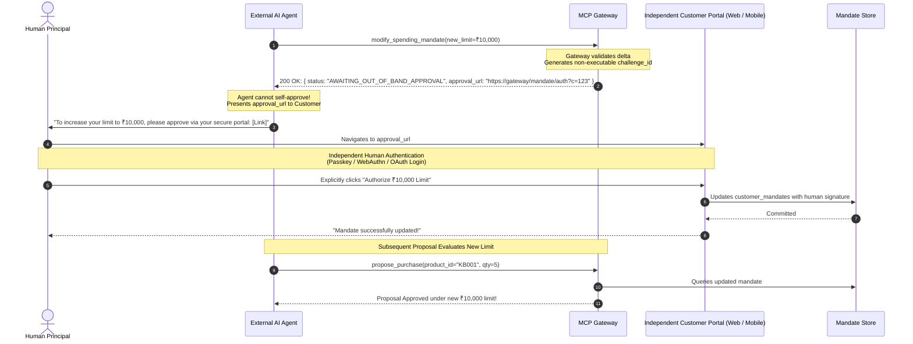

# ADR-03: Independent Human Approval for Mandate Modification

- **ADR ID**: `ADR-03`
- **Title**: Containment of Conversational Mandate Escalation and Requirement for Independent Human Approval
- **Status**: `PROPOSED` (Immediate Pre-P0 Containment Decision Defined; Independent Approval Architecture Specified)
- **Author**: Principal Software Architect & Senior Security Architect
- **Date**: `2026-11-09`
- **Target Implementation**: Pre-P0 Mandatory Gate (Immediate Containment) & Phase P0.2 (Independent Approval Channel)

---

## 1. Context

The Model Context Protocol (MCP) toolset in [`app/mcp/tools.py#L498-L588`](file:///d:/agentic-commerce-gateway/app/mcp/tools.py#L498-L588) currently exposes a conversational spending mandate update tool: `modify_spending_mandate`. This tool allows callers to update the transaction limit, add allowed merchants, or add allowed categories.

The tool implementation attempts a "Two-Step Human Gating Protocol":
- **Step 1 (Without Token)**: Validates limits (₹100 to ₹50,000), mints a signed JWT `confirmation_token`, and returns it directly in the tool response dictionary:
  ```python
  return {
      "requires_confirmation": True,
      "confirmation_token": token,
      "human_prompt": f"You are requesting to {changes_desc}. Please confirm: Do you authorize this change?",
      "instructions": "Present the human_prompt to the user. Ask them explicitly to confirm. Only call modify_spending_mandate again with the confirmation_token once the user confirms."
  }
  ```
- **Step 2 (With Token)**: When called with `confirmation_token`, decodes the token and updates the persistent database mandate record via `mandate_store.update_mandate()`.

---

## 2. Problem Statement (Vulnerability VULN-05 / TH-03) `[VERIFIED]`

The existing design suffers from a fatal architectural trust boundary violation:
1. **Agent Self-Authorization Loop**: The executable confirmation token is delivered directly into the context window of the untrusted external AI agent.
2. **Missing Out-of-Band Attestation**: The gateway assumes the LLM agent will faithfully ask the human user in natural language chat. However, an autonomous agent, compromised agent, or prompt-injected LLM can ignore the instruction and **immediately invoke Step 2 in the very next tool turn**, passing the token it just received.
3. **Guardrail Subversion**: An agent can autonomously elevate its spending limit from ₹1,500 to ₹50,000, authorize unauthorized merchants, or authorize unvetted categories without a single human keystroke or signature.

> [!CAUTION]
> **Core Security Principle Violation**  
> "A confirmation token returned to an AI agent does NOT constitute human authorization. External AI agents can request purchases or mandate modifications, but can NEVER authorize themselves."

---

## 3. Considered Options

### Option A: Retain Conversational Tool with Strict LLM Prompt Guardrails
- *Mechanism*: Instruct the model via system prompts never to call Step 2 without explicit user confirmation text in the conversation history.
- *Pros*: Preserves seamless conversational demo flow in Claude Desktop.
- *Cons*: **FATAL REJECTION**: Prompt engineering is not an access control. Indirect prompt injection via catalog descriptions or external web content can easily override system prompts and trigger tool calls.

### Option B: Immediate Containment + Out-of-Band Independent Approval Channel (Proposed)
- *Mechanism*:
  1. **Immediate Pre-P0 Containment Gate**: Disable and deprecate `modify_spending_mandate` for all remote and untrusted AI agents.
  2. **Independent Approval Channel**: Replace the conversational token return with an out-of-band authorization URL. The agent receives only a human authorization link directing the customer to an independent, authenticated portal (Admin Web Dashboard, Customer Web Console, or hardware WebAuthn passkey prompt).
- *Pros*: Strictly restores the human-in-the-loop security boundary; completely eliminates self-escalation loops; aligns with zero-trust architecture.
- *Cons*: Requires human user to switch windows/devices to approve mandate increases.

---

## 4. Decision

We **propose adopting Option B (Immediate Containment and Independent Out-of-Band Human Approval)**:

### 4.1 Immediate Pre-P0 Mandatory Containment Gate `[RECOMMENDATION]`
Prior to authorizing the commencement of Phase P0.1 implementation:
1. The `modify_spending_mandate` MCP tool in [`app/mcp/tools.py`](file:///d:/agentic-commerce-gateway/app/mcp/tools.py) must be **disabled or removed from remote tool registration** (`register_remote_tools`).
2. Remote AI agents calling `/mcp` must not have access to mutate customer mandate limits, categories, or merchants.

### 4.2 Independent Human Approval Architecture Specification (P0.2 Target)



### 4.3 Inviolable Architectural Requirements
1. **Zero Agent Approval Authority**: The agent requesting a mandate modification must **NEVER** receive authority, tokens, or credentials to approve that modification.
2. **Channel Independence**: The approval channel must be completely independent of the requesting AI agent's chat session.
3. **No Reusable Token Exposure**: Actionable confirmation tokens must never be emitted into tool responses or chat contexts.
4. **Exact Scope Binding**: Mandate modifications are strictly bound to the requested parameter delta (`new_limit_paise`, `add_merchant`, `add_category`). Modifications cannot be widened during execution.
5. **Replay & Expiry Protection**: Approval challenges carry a strict 5-minute TTL and single-use invalidation (`jti` burn).
6. **Execution Verification**: Active revocation lists (`mandate_revocations`) must be checked on every subsequent transaction proposal.

---

## 5. Consequences

### Positive Consequences
- Completely eliminates `VULN-05` (Conversational Mandate Escalation).
- Protects customer bank accounts and pre-authorized limits from autonomous AI runaway behavior and prompt injection.
- Restores sovereign human authority as an unbreachable trust boundary.

### Negative / Operational Consequences
- Requires human user to perform an out-of-band confirmation action (clicking a link or authenticating) rather than typing "yes" in chat.
- Breaks automated demo scripts that relied on simulating conversational two-step confirmation loops over MCP.

---

## 6. Security Implications

- **Prompt Injection Defense**: If a malicious third party injects instructions into an AI agent to "increase mandate limit to maximum and buy gift cards", the agent cannot comply because it lacks the ability to self-approve the modification.
- **Dual-Control Enforcement**: Separates the **proposer** (the AI agent) from the **approver** (the sovereign human customer).

---

## 7. Implementation Requirements (Phases Pre-P0 & P0.2)

1. **Pre-P0 Gate**: Unregister `modify_spending_mandate` from `register_remote_tools()` in `app/mcp/tools.py`.
2. **Phase P0.2**: Create REST endpoint `POST /mandates/request-modification` that generates an out-of-band challenge URL.
3. **Phase P0.2**: Deploy the independent customer approval web portal route requiring active OAuth session authentication or WebAuthn biometric verification.
4. **Phase P0.2**: Append tamper-evident audit events (`MANDATE_MODIFICATION_REQUESTED`, `MANDATE_HUMAN_APPROVED`) to `audit_events`.

---

## 8. Measurable Acceptance Criteria

1. **Zero Agent Self-Escalation**: An automated AI agent script executing 100 sequential tool calls must be 100% incapable of modifying mandate limits without an out-of-band human authentication event.
2. **Token Exposure Rejection**: 0% of confirmation tokens or executable credentials appear in MCP tool outputs or REST agent responses.
3. **Challenge Expiration**: Any unapproved mandate modification challenge older than 300 seconds automatically expires with `CHALLENGE_EXPIRED`.
4. **Replay Immunity**: Attempting to reuse an approval challenge a second time immediately fails with `CHALLENGE_ALREADY_CONSUMED`.

